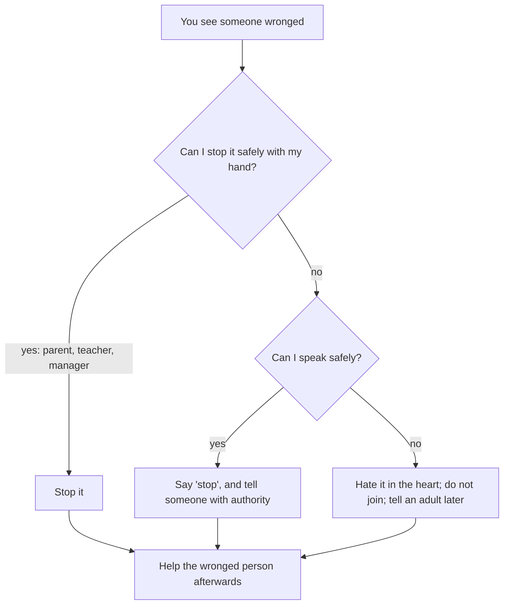

## Wednesday and Thursday

On Wednesday, older boys threw stones at a stray dog near the park and called Musa to join. On Thursday, a younger boy in his building was being pushed around by two others, and Musa walked past. On Friday, telling his mother, he said he had not known what he was supposed to do.

That is an honest answer, and a common one, for children and adults alike. We know cruelty is wrong. We are less sure what to do when we see it, especially when the people doing it are older, stronger or our own friends. This chapter joins two habits that belong together: mercy toward those weaker than us, and the courage to act when they are wronged.

Before you step through Musa's day, make a guess.

```predict
prompt: "According to Sahih Muslim 49, what is the weakest level of responding to a wrong you see?"
options:
  - id: heart
    label: "Hating it in the heart, when you cannot do more"
  - id: ignore
    label: "Ignoring it, since it is not your business to interfere"
correctOptionId: heart
explanation: "Whoever sees a wrong, let him change it with his hand; if he cannot, then with his tongue; if he cannot, then with his heart, and that is the weakest of faith (Sahih Muslim 49). Ignoring it is not on the list."
```

Step through the canvas below. It follows Musa's day with mercy and courage.

<InteractiveCanvas slug="mercy-and-courage" />

The canvas showed five moments: a seat given to an elder, water for a cat, saying no to stoning a dog, seeing bullying, and telling a teacher, which is using the tongue safely.

## The merciful are shown mercy

Abdullah ibn Amr reported that the Prophet, peace be upon him, said (Jami' at-Tirmidhi 1924, graded sahih):

> الرَّاحِمُونَ يَرْحَمُهُمُ الرَّحْمَنُ ارْحَمُوا مَنْ فِي الأَرْضِ يَرْحَمْكُمْ مَنْ فِي السَّمَاءِ

Meaning: The merciful are shown mercy by the Most Merciful. Be merciful to those on the earth, and the One above the heavens will be merciful to you (Jami' at-Tirmidhi 1924).

And Jarir reported that he said: whoever is not merciful will not be shown mercy (Sahih al-Bukhari 6013). Mercy is not a soft extra in Islam. It is a condition the Prophet tied to receiving Allah's mercy.

## The young and the old

Anas reported that an old man came to speak to the Prophet, and the people were slow to make room for him. The Prophet said: he is not one of us who does not show mercy to our young and respect to our elders (Jami' at-Tirmidhi 1919, graded sahih).

Respect for elders has daily forms: giving a seat, letting them speak first, not raising your voice, helping with a bag or a step. Mercy to the young also has daily forms: patience with a younger sibling, explaining instead of shouting, not mocking a child's mistakes, and, for older children, protecting younger ones at school.

The poor and the weak belong here too. Mocking someone's poverty, clothes or home is the opposite of mercy (Quran 49:11), and taking advantage of someone's weakness, in a deal, a game or an argument, is a wrong against their rights. The Prophet described the believers as one body in their mercy and love for each other: when one part hurts, the whole body responds (Sahih al-Bukhari 6011).

## Animals

Abu Hurairah reported that the Prophet told of a man who was walking on a road and became very thirsty. He found a well, climbed down and drank. When he came out, he saw a dog panting and licking the mud from thirst. He said: this dog has reached the same thirst I had. He climbed down again, filled his leather sock with water and gave the dog a drink. Allah thanked him and forgave him. The companions asked: is there a reward for us in animals? He said (Sahih al-Bukhari 2466):

> فِي كُلِّ ذَاتِ كَبِدٍ رَطْبَةٍ أَجْرٌ

Meaning: In every living creature there is a reward (Sahih al-Bukhari 2466).

The opposite is also told. Ibn Umar reported that the Prophet said: a woman entered the Fire because of a cat she tied up, neither feeding it nor letting it eat from the creatures of the earth (Sahih al-Bukhari 3318). And Ibn Abbas reported that the Prophet forbade killing four creatures: the ant, the bee, the hoopoe and the sparrow-hawk (Sunan Abi Dawud 5267, graded sahih by al-Albani).

So the habits with animals are clear. Never leave an animal in your care hungry or thirsty. Do not harm animals for fun, not even ants. Put out water for birds or strays in hot weather if you can. There are cases where harmful animals may be dealt with, which scholars explain; the default is mercy.

Water itself belongs here: not wasting it, even in wudu, is part of respecting a blessing that every living creature needs (module 8, Sahih al-Bukhari 201).

## Courage: changing a wrong

Abu Sa'id al-Khudri reported that he heard the Prophet say: whoever of you sees a wrong, let him change it with his hand; if he cannot, then with his tongue; and if he cannot, then with his heart, and that is the weakest of faith (Sahih Muslim 49).

This hadith gives three levels, and they help with the question Musa asked. "With the hand" is for those with the authority and ability to stop a wrong without causing greater harm: a parent at home, a teacher in a class, a manager at work. "With the tongue" is speaking: saying "stop", telling someone with authority, or advising privately. "With the heart" is hating the wrong and not joining it, when nothing else is possible. What the hadith never offers is joining in or laughing along.

For young people, the tongue is usually the safe and right level: say "leave him" if it is safe, and tell a teacher, a parent or another responsible adult. That is not "telling tales" in the sense of chapter 10.2. Tale-bearing carries words to cause trouble. Reporting harm to someone who can stop it protects a person.

Anas reported that the Prophet said: help your brother, whether he is a wrongdoer or wronged. They asked: we help him when he is wronged, but how do we help him when he is the wrongdoer? He said: by stopping him (Sahih al-Bukhari 2443). Courage, then, is also kindness to the wrongdoer: stopping him is helping him.

## Courage in small things

Most courage is not dramatic. It is saying "no" when friends push you toward something wrong. It is admitting a mistake when blaming someone else would be easier, as Hamza did in chapter 11.2. It is telling the truth when a small lie would be safer. It is not laughing at the joke everyone else laughs at. Each of these takes a moment of discomfort, and each is a habit that grows with repetition.

The diagram shows how to respond when you see someone wronged.



Every path ends with helping the wronged person: a kind word, sitting with them, checking on them later. Even when you could only act with the heart in the moment, you can still help afterwards.

## Building it the 1% way

Week one: elders. Give your seat, carry a bag, or let an older person speak first, once a day.

Week two: the young. Be patient with a younger sibling or child once a day when you would usually be short with them.

Week three: animals. Put out water for birds or a stray, and never harm an animal for fun.

Week four: courage. Prepare one sentence for when friends push you toward wrong, and one plan for when you see someone wronged: who you would tell.

## Worked example: Musa's next Thursday

A week later, Musa sees the same two boys pushing the younger boy near the stairs.

**The level.** He is not strong enough to stop them, so not the hand.

**The tongue.** He says, loudly enough, "Leave him, I'm getting the guard." The boys stop and walk off.

**Telling.** He tells the building guard, and that evening his mother.

**Helping afterwards.** He walks the younger boy to his door and asks if he is okay. The next day he waves to him in the lift.

## Where people misunderstand it

The first misunderstanding is "it's not my business". The Prophet gave three levels of response (Sahih Muslim 49); ignoring is not one of them.

The second is "reporting is tale-bearing". Tale-bearing carries words to cause trouble; telling someone who can stop harm protects a person.

The third is "mercy to animals is a small matter". A man was forgiven for giving a dog water, and a woman punished for a cat (Sahih al-Bukhari 2466, 3318).

## Check your understanding

```quiz
type: mcq
question: "Fahad's friends invite him to join in throwing stones at stray cats. He cannot stop them by force. What does this chapter suggest?"
options:
  - "Join in a little, to stay part of the group"
  - "Say no, walk away, and tell an adult if it continues"
  - "Watch without joining, since he did not throw anything"
  - "Say nothing, since animals are not people"
correct: 1
explanations:
  - "Joining is never one of the levels in Sahih Muslim 49."
  - "Right. Use the tongue safely (Sahih Muslim 49), and remember a woman was punished for one cat (Sahih al-Bukhari 3318)."
  - "Watching along is closer to joining than to hating it in the heart."
  - "In every living creature there is a reward (Sahih al-Bukhari 2466); harming them is a wrong."
```

```quiz
type: mcq
question: "On a crowded bus, an old man is standing and Saima has a seat. Which source fits?"
options:
  - "Sahih al-Bukhari 2101: the musk seller"
  - "Sunan Abi Dawud 4990: lying to make people laugh"
  - "Jami' at-Tirmidhi 1919: respect our elders"
  - "Sahih al-Bukhari 6412: health and free time"
correct: 2
explanations:
  - "That hadith is about companions."
  - "That hadith is about humour."
  - "Right. Respect our elders and show mercy to our young (Jami' at-Tirmidhi 1919). Giving her seat is that respect."
  - "That hadith is about time."
```

## This week

Give your seat or help an elder once a day. Prepare one sentence for when friends push you toward wrong, and decide who you would tell if you saw someone wronged.

**Next:** A short quiz on character with people.
