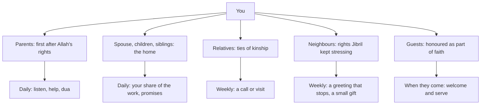

## The story at dinner

On a Sunday evening in March, Hamza's mother begins a long story at dinner: a cousin's wedding thirty years ago, who wore what, who said what to whom. Hamza has heard it before. His phone is face-up beside his plate, and a message from a client lights the screen. He looks at it, types a quick reply, and when he looks up his mother has stopped talking. "Never mind," she says. "It is not important." She starts to clear the plates.

Hamza feels a small, sharp sting. At work he would never look at his phone while his manager was speaking. In the review meeting last week, he listened to Usman's unfair blame for two full minutes without interrupting. But at his own table, with the person who raised him, he could not listen to a story for five minutes.

Ayesha says nothing, but she raises her eyebrows at him. He knows what she means.

Before you read on, make a guess.

```predict
prompt: "A man asked the Prophet, peace be upon him, who most deserves his good company. What did the Prophet say?"
options:
  - id: father
    label: "Your father first, then your mother after him"
  - id: mother
    label: "Your mother, three times, then your father"
correctOptionId: mother
explanation: "He said: your mother. The man asked: then who? He said: your mother. Then who? Your mother. Then who? Your father (Sahih al-Bukhari 5971; Sahih Muslim 2548)."
```

## Your mother, your mother, your mother

Abu Hurairah reported that a man came to the Prophet and asked: who among people most deserves my good company? He said (Sahih al-Bukhari 5971):

> أُمُّكَ

Meaning: Your mother (Sahih al-Bukhari 5971).

The man asked: then who? He said: your mother. Then who? Your mother. Then who? Then your father. The repetition is the teaching. Of all the people in a person's life, the mother comes first, second and third.

Allah places kindness to parents directly after His own worship: your Lord has decreed that you worship none but Him, and that you be kind to parents. If one or both reach old age with you, do not say to them even "uff", do not repel them, and speak to them a noble word. And lower to them the wing of humility out of mercy, and say: my Lord, have mercy on them as they raised me when I was small (Quran 17:23 to 24).

"Uff" is the smallest sound of impatience. The verse forbids even that. A sigh at a long story, an eye-roll at a repeated question, a phone checked while a parent is speaking: these are the modern forms of "uff".

## The story, again

After dinner Hamza finds his mother in the kitchen, washing the plates. He takes the towel and starts drying. After a minute he says, "Ammi, I'm sorry. Tell me the rest of the wedding story." She waves her hand, as if it does not matter. He asks again. She smiles and starts from the beginning.

This time he puts his phone in his pocket, face down, and listens to the end. It takes eleven minutes. Some of it he has heard before. Some of it he has not: a detail about his father, as a young man, that makes them both laugh. When she finishes, she looks lighter than she has all evening.

Afterwards Hamza thinks about how close he came to missing that. Not only the detail about his father, but the look on his mother's face. Eleven minutes, once a week, is a very small price for it. He decides to make it a habit: when his mother starts a story, the phone goes in his pocket, face down, until she finishes.

## The rest of the home

The same week brings three more moments. On Tuesday, the kitchen sink is full of dishes, and Hamza, as usual, leaves them for his mother and Ayesha. On Wednesday, he passes his neighbour, an elderly man whose wife died last year, in the stairwell, and says a quick "salam" without stopping, as he has for months. On Saturday, Ayesha's cousins arrive unexpectedly at lunch, and Hamza, tired, sits in his room until they leave.

None of these is a great wrong. But each touches a right the Sunnah names clearly. Aisha was asked what the Prophet did at home, and she said he served his family, and when the prayer came he went out to it (Sahih al-Bukhari 676). The Prophet said that Jibril kept advising him about the neighbour until he thought he would make the neighbour an heir (Sahih al-Bukhari 6014). And whoever believes in Allah and the Last Day, let him honour his guest (Sahih Muslim 47).

## Musa at home

Musa's version of the same week is smaller and just as real. He leaves his bed unmade and his room for his mother to tidy. He promises to help his little sister Zoya with her reading and forgets. He breaks a cup and says it was already cracked. He does not call his grandmother, who lives with Hamza, all week, though she asks about him every day.

Rida reads the list of family habits from Ayesha's notebook with him on Saturday: honour and serve parents, make dua for them, listen without interrupting, lower your voice with them, keep ties with relatives, love the young and respect the old, manage your own room and things, help with small jobs at home, keep promises, do not shift blame. Musa says it is a long list. Rida says that is why they will take it one line at a time.

## When family is hard

Not every home is like Hamza's. Some parents are difficult, some relationships are strained, and some homes are not safe. The Quran's command to honour parents does not mean obeying them in sin, and it does not ask anyone to accept harm. If your situation at home is hard, the habits in this module can still be practised in the ways that are possible for you, and it is right to seek help from a scholar, a counsellor or someone you trust. You do not need to carry it alone.

## What this module covers

This module has two chapters. Chapter 12.2 is about parents and relatives: the daily habits of honouring parents, listening fully, a lowered voice, help without being asked, dua for them, and keeping ties of kinship with a regular call or visit. Chapter 12.3 is about the home itself and those around it: responsibility for your own space and share of the work, keeping promises, owning mistakes, the rights of neighbours, and honouring guests.

The diagram shows the circles of family life that this module covers.



Each circle has its own rhythm. Parents and the home are daily. Relatives and neighbours fit a weekly rhythm. Guests come when they come, so the habit is a planned welcome. Seeing the rhythms helps choose a cue for each.

## A family's golden rules

Ayesha's notebook ends with a page she calls "our home's golden rules": short sentences that sum up how the family wants to live. Truth is always better than a lie. Pleasing Allah matters more than pleasing people. Learning is a daily habit. Every halal job is honourable. Sin is never made normal. Nobody is mocked. Anger does not make decisions. Haya is who we are. Each day, be a little better than yesterday. This world is not our home; the akhirah is.

The gate at the end of this module asks you to write your own family's golden rules, a handful of sentences, each tied to something you have learned in this course. They can hang on the fridge where the old chart of duas used to be, and this time, because each habit has a cue and a smallest version, they have a better chance of being lived.

<LearningObjectives items={["Explain why parents come first after Allah's rights (Quran 17:23 to 24; Sahih al-Bukhari 5971)", "Honour parents daily: listen fully, a lowered voice, help without being asked, and dua for them", "Keep ties of kinship with a regular call or visit (Sahih al-Bukhari 5986)", "Take responsibility at home: your own space, your share of the work, promises kept, mistakes owned (Sahih al-Bukhari 7138, 676, 33)", "Honour neighbours and guests as part of faith (Sahih al-Bukhari 6014; Sahih Muslim 47)"]} />

## Key words

| Word | Plain English |
|---|---|
| ***Birr al-walidayn*** | Kindness and dutifulness to parents |
| ***Silat ar-rahim*** | Keeping ties of kinship with relatives. In Urdu, *sila rehmi* |
| ***Ra'i*** | Shepherd: someone responsible for others or for something in their care |
| ***Jar*** | Neighbour |
| ***Dayf*** | Guest |
| **Golden rules** | A family's short shared sentences about how they want to live |

## What is in this module

| Chapter | You will practise |
|---|---|
| 12.2 | Parents and relatives |
| 12.3 | Home, responsibility, neighbours and guests |
| 12.4 | A short quiz with five cases |
| 12.5 | Your family plan and your home's golden rules |

**Next:** Parents and relatives.
