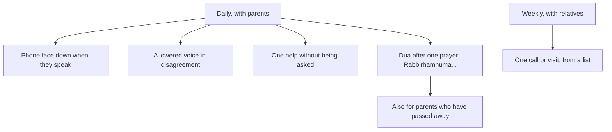

## Eleven minutes

The second telling of his mother's wedding story took eleven minutes. Hamza listened to the end with his phone face down, and saw his mother's face change. It was a small act. It is also exactly the kind of act the Quran asks for when it speaks of parents: not grand gestures once a year, but daily kindness, especially in the small moments where impatience is easiest.

This chapter gives the sources for honouring parents and for keeping ties with relatives, and turns them into a few daily and weekly habits.

Before you step through Hamza's week, make a guess.

```predict
prompt: "Quran 17:23 forbids even the smallest word of impatience to parents. Which word does it name?"
options:
  - id: uff
    label: "'Uff', the smallest sigh of annoyance"
  - id: no
    label: "'No', any refusal at all of what they ask"
correctOptionId: uff
explanation: "Do not say to them even 'uff', do not repel them, and speak to them a noble word (Quran 17:23). The verse forbids the smallest sound of impatience, not every disagreement."
```

Step through the canvas below. It follows a week of honouring parents and keeping ties.

<InteractiveCanvas slug="parents-first" />

The canvas showed five habits: listening fully, a lowered voice, help without being asked, a daily dua for parents, and a Sunday call to a relative.

## Not even "uff"

Allah says (Quran 17:23):

> فَلَا تَقُل لَّهُمَا أُفٍّ وَلَا تَنْهَرْهُمَا وَقُل لَّهُمَا قَوْلًا كَرِيمًا

Meaning: Do not say to them even "uff", do not repel them, and speak to them a noble word (Quran 17:23).

The verse begins: your Lord has decreed that you worship none but Him, and that you be kind to parents (Quran 17:23). Kindness to parents is placed directly after the worship of Allah. Then the verse turns to old age, when parents are often slower, repeat themselves, and need more help: exactly the time when "uff" is most tempting.

Three daily habits follow from this verse. Listen fully: when a parent speaks, the phone goes face down until they finish, as Hamza learned. Lower your voice: in a disagreement, speak more quietly than usual, not more loudly. A noble word: answer with respect even when you disagree, "Ammi, I understand; can I explain why I think differently?"

Honouring parents does not mean obeying them in sin. And disagreeing respectfully is not "uff". What the verse forbids is impatience, contempt and harshness.

## The wing of humility, and a dua

Allah continues (Quran 17:24):

> وَاخْفِضْ لَهُمَا جَنَاحَ الذُّلِّ مِنَ الرَّحْمَةِ وَقُل رَّبِّ ارْحَمْهُمَا كَمَا رَبَّيَانِي صَغِيرًا

Meaning: And lower to them the wing of humility out of mercy, and say: my Lord, have mercy on them as they raised me when I was small (Quran 17:24).

"Lower the wing" is an image of a bird gathering its young under its wing, reversed: now the child, grown, shelters the parent. In daily life it looks like help without being asked: carrying the shopping, fixing the phone, driving to the doctor, sitting with them when they are unwell. The best help is the help they did not have to ask for.

The verse also gives a dua: "Rabbirhamhuma kama rabbayani saghira". It is short enough to say after one prayer every day. It is also a dua for parents who have passed away. Hamza says it daily for his mother, and for his late father.

## Your mother, three times

Abu Hurairah reported that a man asked the Prophet who most deserves his good company, and he said: your mother; then your mother; then your mother; then your father (Sahih al-Bukhari 5971; Sahih Muslim 2548). The repetition speaks for itself. Scholars explain it by the burden a mother carries: pregnancy, birth, nursing and the early years. It does not lessen the father's right; it shows the mother's is greater.

## Ties of kinship

Anas reported that the Prophet said (Sahih al-Bukhari 5986):

> مَنْ أَحَبَّ أَنْ يُبْسَطَ لَهُ فِي رِزْقِهِ، وَيُنْسَأَ لَهُ فِي أَثَرِهِ، فَلْيَصِلْ رَحِمَهُ

Meaning: Whoever would like his provision to be increased and his life to be extended, let him keep ties of kinship (Sahih al-Bukhari 5986).

And in the hadith on mercy from chapter 11.4, the Prophet said that the womb, the bond of kinship, is named after the Most Merciful: whoever keeps it, Allah keeps ties with him, and whoever cuts it, Allah cuts ties with him (Jami' at-Tirmidhi 1924, graded sahih).

Ties of kinship are easy to let slip in a busy life. Months pass without a call to an aunt, a cousin or a grandparent who lives in another city. The habit is a rhythm: one call or visit a week, to a relative you would not otherwise speak to. Hamza's cue is Sunday afternoon, after lunch. He keeps a short list of relatives and works through it, so that over a few months every relative hears from him.

## Children and grandparents

The habits in this chapter are for children too. Musa's version: when his grandmother calls him, he answers instead of letting it ring; he tells her one thing about his week; and on Sundays he calls one relative with his mother. Grandparents are parents of parents; honouring them is part of honouring your own parents, who love them.

The diagram shows the daily and weekly rhythm of honouring parents and keeping ties.



The daily habits are all short, and most attach to moments that already happen: a parent speaking, a disagreement, a prayer. The weekly habit needs a fixed cue, such as Sunday afternoon, and a list, so that the same relatives are not always the ones forgotten.

## Building it the 1% way

Week one: listening. The phone goes face down whenever a parent speaks to you, until they finish.

Week two: the dua. Say "Rabbirhamhuma kama rabbayani saghira" after one prayer each day.

Week three: help. Do one thing each day for a parent without being asked.

Week four: kinship. Make a list of relatives, and call or visit one each week from it.

## Worked example: Ayesha's mother, far away

Ayesha's parents live in another city, four hours away. Follow how she builds the habits at a distance.

**Listening.** She calls her mother every evening for ten minutes, on a walk, with no other screen open.

**Help.** She orders her parents' monthly medicines online and has them delivered, so they never run out.

**The dua.** After Isha, the dua of Quran 17:24 for both her parents and her in-laws.

**Visits.** One weekend a month, she and Hamza drive to see them. Her father, who is not well, waits at the window.

## When parents grow older

The verse speaks of old age directly: "if one or both of them reach old age with you" (Quran 17:23). As parents age, the habits change shape. Listening may mean hearing the same stories many times, and the habit is to listen as if it were the first. Help may mean appointments, medicines and paperwork, and the habit is to take them on before being asked. Patience may mean slower walks, repeated questions and new worries, and the habit is the noble word, every time.

Many people find this the hardest season, especially when they are busy with their own children and work. It is also, according to the verse, the season the Quran speaks to most directly. A small daily habit, ten minutes of real attention, one task taken off their hands, is often what parents value most in those years.

## Where people misunderstand it

The first misunderstanding is "honouring parents means obeying in everything". It does not include obeying in sin, and respectful disagreement is not "uff".

The second is "I can't do much for parents who have passed away". The dua of Quran 17:24 is for them too, and so are charity and good deeds in their name.

The third is "kinship ties are only for close family". Kinship includes aunts, uncles, cousins and grandparents, the relatives most easily forgotten.

## Check your understanding

```quiz
type: mcq
question: "Zain's father asks him the same question about his phone three times in one evening. Zain is tempted to sigh loudly. Which verse speaks to this moment?"
options:
  - "Quran 49:6: verify news"
  - "Quran 83:1: woe to those who give less than due"
  - "Quran 17:23: do not say to them even 'uff'"
  - "Quran 24:30: lower your gaze"
correct: 2
explanations:
  - "That verse is about checking news."
  - "That verse is about measure in trade."
  - "Right. Do not say to them even 'uff', and speak to them a noble word (Quran 17:23). A patient answer the third time is the habit."
  - "That verse is about the eyes."
```

```quiz
type: mcq
question: "Rabia's father passed away two years ago. She feels there is nothing more she can do for him. What does this chapter teach?"
options:
  - "Nothing more is possible, so she should focus on her mother only"
  - "She can make the dua of Quran 17:24 for him daily"
  - "Honouring parents ends when they pass away"
  - "Only her brothers can do anything for him"
correct: 1
explanations:
  - "The dua of the verse continues after death."
  - "Right. My Lord, have mercy on them as they raised me when I was small (Quran 17:24) is for parents living and passed away."
  - "The dua and good deeds in their name continue."
  - "Any child can make dua for a parent."
```

## This week

Put your phone face down whenever a parent speaks, until they finish. Say the dua of Quran 17:24 after one prayer each day. Call one relative you have not spoken to for a while.

**Next:** Home, responsibility, neighbours and guests.
