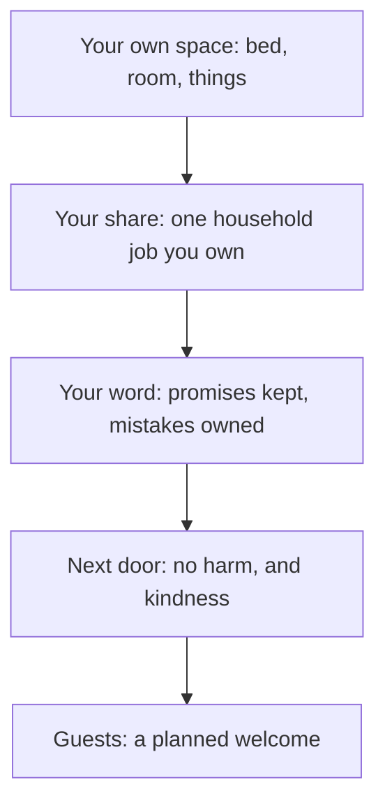

## The dishes

On Tuesday evening, the sink in Hamza's kitchen is full. For years, Hamza has left the dishes for his mother and Ayesha without thinking about it. He works long hours; he assumed that was his share. On Wednesday, in the stairwell, he gives his elderly neighbour a quick salam without stopping, as he has for months. On Saturday, when Ayesha's cousins arrive unexpectedly, he stays in his room.

Each of these is a habit of the home, and each touches a right the Sunnah names. This chapter covers responsibility at home, promises and mistakes, neighbours and guests.

Before you step through Musa's Saturday, make a guess.

```predict
prompt: "Aisha was asked what the Prophet, peace be upon him, did at home. What did she say?"
options:
  - id: rested
    label: "He rested at home, since his work outside was so heavy"
  - id: served
    label: "He served his family, and went out when the prayer came"
correctOptionId: served
explanation: "She said he was in the service of his family, and when the time for prayer came he went out to the prayer (Sahih al-Bukhari 676)."
```

Step through the canvas below. It follows Musa's Saturday at home.

<InteractiveCanvas slug="a-home-that-runs" />

The canvas showed six habits: his own room, helping at home, keeping a promise, owning a mistake, food for a neighbour, and welcoming guests.

## Every one of you is a shepherd

Ibn Umar reported that the Prophet said (Sahih al-Bukhari 7138):

> أَلاَ كُلُّكُمْ رَاعٍ، وَكُلُّكُمْ مَسْئُولٌ عَنْ رَعِيَّتِهِ

Meaning: Every one of you is a shepherd, and every one of you is responsible for his flock (Sahih al-Bukhari 7138).

The hadith continues: the ruler is a shepherd over his people, a man over his household, a woman over her husband's home and children, a servant over his master's property. Everyone, at every level, has a flock. For a child, the flock may be a bed, a room, school things and a younger sibling. For an adult, it is a family and a home. Allah says: O you who believe, protect yourselves and your families from a Fire (Quran 66:6).

> قُوا أَنفُسَكُمْ وَأَهْلِيكُمْ نَارًا

Meaning: Protect yourselves and your families from a Fire (Quran 66:6).

Protecting a family begins with small things done every day: a calm home, prayers on time together, honest speech, the habits of this course lived rather than lectured.

## He served his family

Al-Aswad asked Aisha what the Prophet used to do at home. She said: he was in the service of his family, and when the prayer came he went out to the prayer (Sahih al-Bukhari 676). The best of creation, who carried the greatest responsibility of any human being, helped at home.

Hamza reads this hadith on Wednesday. On Thursday evening he washes the dishes. Ayesha looks at him, then at the sink, then back at him, and laughs. His mother says nothing, but the next morning there is a parantha on his plate that he did not ask for.

The habit is a share, not a gesture. Each person in the house takes one regular job they own: dishes after dinner, taking out the rubbish, folding the laundry, setting the table. A job you own does not need to be asked for.

For children, the share starts with their own space: their bed made in the morning, their room tidy, their shoes in the rack, their school bag packed the night before. Then one small household job suited to their age. Musa's job is setting the table for dinner and helping Zoya with her reading on Tuesdays.

## Promises and mistakes

Abu Hurairah reported that the Prophet said: the signs of a hypocrite are three: when he speaks he lies, when he promises he breaks it, and when he is trusted he betrays (Sahih al-Bukhari 33). Breaking promises is named alongside lying. At home, promises are made casually: "I'll help you with that later", "I'll fix it this weekend", "I'll play with you after this call". Keeping them, or honestly saying "I can't today, can we do Sunday?", is the habit.

Owning mistakes belongs here too. When Musa broke a cup and said it was already cracked, he shifted the blame. The habit is to say "it was me" straight away. Chapter 11.2 showed that admitting your part is honest and makes the rest of what you say believable. In a home, it also teaches younger children that mistakes can be admitted safely.

## Neighbours

Aisha reported that the Prophet said: Jibril kept advising me about the neighbour until I thought he would make him an heir (Sahih al-Bukhari 6014). And Abu Hurairah reported that he said: whoever believes in Allah and the Last Day, let him not harm his neighbour; whoever believes in Allah and the Last Day, let him honour his guest (Sahih al-Bukhari 6018; Sahih Muslim 47).

Neighbour rights have two sides. The first is not harming them: noise late at night, rubbish left outside their door, cars blocking their way, children's games against their wall. The second is kindness: a greeting that stops long enough to ask how they are, food shared, help when they are ill, a visit after a loss.

On Saturday, Hamza knocks on his elderly neighbour's door with a plate of Ayesha's biryani. The man invites him in. He talks about his late wife for half an hour. Hamza realises that his quick "salam" in the stairwell, every day for months, was all the conversation the man had had with anyone in the building.

## Guests

The same hadith says: let him honour his guest (Sahih Muslim 47). Honouring a guest means welcoming them warmly, offering food and drink, giving them your time and attention, and not making them feel they have interrupted. The guests do not need to be expected. Ayesha's cousins arrived unannounced, which is common in many families. The habit is a planned welcome: a simple snack always kept ready, a host who comes out of his room, and a phone put away while they are there.

The diagram shows the circles of responsibility in a home.



Each circle is a little wider than the one before. A person who manages their own space and share of the work finds the wider circles easier, because the habit of responsibility is already there.

## Building it the 1% way

Week one: your own space. Make your bed and tidy your room or desk every morning.

Week two: your share. Choose one household job and own it, without being asked.

Week three: your word. Keep every promise this week, or reschedule honestly; say "it was me" for any mistake.

Week four: neighbours and guests. Stop and talk with one neighbour; keep a simple snack ready for guests.

## Worked example: Musa's week of responsibility

**His space.** Bed made before school. His mother no longer checks.

**His share.** Setting the table for dinner, every day.

**His promise.** Tuesday reading with Zoya, kept even on the day he wanted to play cricket. He goes to cricket after.

**His mistake.** He spills juice on the sofa and calls his mother at once: "It was me. Can I help clean it?"

**The neighbour.** He carries the elderly neighbour's shopping up the stairs on Friday.

Notice that Musa's week needed no new time. Each habit fitted into a moment he already had: the morning, dinner, Tuesday, a spill, the stairs.

## Where people misunderstand it

The first misunderstanding is "housework is not a man's job". The Prophet served his family at home (Sahih al-Bukhari 676).

The second is "small promises at home don't count". Breaking promises is named among the signs of a hypocrite (Sahih al-Bukhari 33), large or small.

The third is "a neighbour's rights are only not harming them". Jibril's repeated advice (Sahih al-Bukhari 6014) points to kindness as well.

## Check your understanding

```quiz
type: mcq
question: "Fahad says helping with housework would lower his standing as the head of the family. Which source answers him?"
options:
  - "Sahih al-Bukhari 676: the Prophet served his family at home"
  - "Sahih al-Bukhari 6412: health and free time, the two blessings"
  - "Quran 49:6: verify news"
  - "Sahih Muslim 2589: backbiting"
correct: 0
explanations:
  - "Right. Aisha said he was in the service of his family, and went out when the prayer came (Sahih al-Bukhari 676)."
  - "That hadith is about time."
  - "That verse is about news."
  - "That hadith is about speech."
```

```quiz
type: mcq
question: "Naila's neighbours play loud music until 1:00, but she plays her own music loudly in the afternoons when her neighbour's baby sleeps. What does this chapter teach about her own habit?"
options:
  - "It is fine, since the neighbours are noisy too"
  - "Neighbour rights apply only to Muslims who pray"
  - "Whoever believes in Allah and the Last Day does not harm his neighbour"
  - "Only the person who started the noise first is responsible for all of it"
correct: 2
explanations:
  - "Another person's wrong does not cancel her responsibility."
  - "The hadith speaks of the neighbour in general."
  - "Right. Let him not harm his neighbour (Sahih al-Bukhari 6018). She can change her own habit and speak gently about theirs."
  - "Each person is a shepherd of their own actions (Sahih al-Bukhari 7138)."
```

## This week

Choose one household job and own it every day. Stop and talk with one neighbour, or take them something small.

**Next:** A short quiz on family, home and neighbours.
