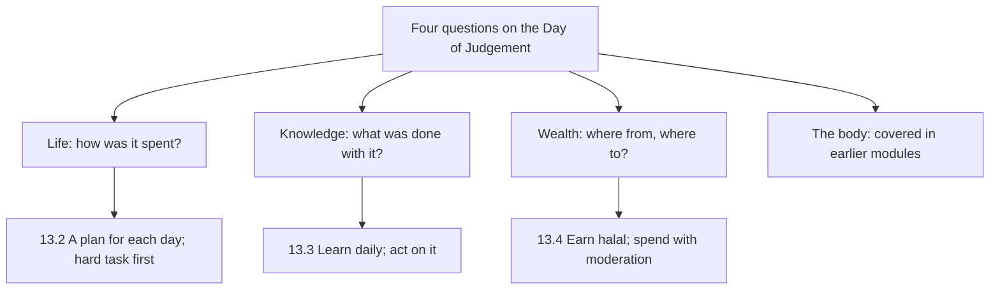

## The lost Saturday

In April, Hamza has a free Saturday for the first time in weeks. On Friday night he makes a mental list: read twenty pages of a book on system design he has been meaning to finish, fix the shelf in the kitchen, call his uncle, take Musa to the park.

On Saturday he wakes after Fajr feeling good. He checks his phone "for a minute". At 10:30 he is still on it. He has a late breakfast, watches a match, naps, scrolls again. At Maghrib he realises that none of the four things on his list has happened. He has not done anything wrong. But the day is gone, and he cannot say where it went.

That evening he reads a hadith on Ayesha's list that he has seen many times without noticing: there are two blessings in which many people are cheated, health and free time (Sahih al-Bukhari 6412). The word "cheated" stays with him. Nobody cheated him. He cheated himself, gently, a few minutes at a time.

## Musa's exam

The same week, Musa has a science exam on Thursday. He knows about it on Monday. On Monday he plays cricket. On Tuesday he watches videos. On Wednesday night at 21:00 he opens his book for the first time, panics, and asks his mother to help him until midnight. On Thursday he is tired, and he forgets things he half-learned the night before.

Rida does not scold him. She asks him to look back at his week with her, day by day, as Hamza looks back at his tracker. Monday, Tuesday, Wednesday. Musa sees it himself: three evenings with an hour each would have been easier than one night of panic.

Before you read on, make a guess.

```predict
prompt: "According to Jami' at-Tirmidhi 2417, what will a person be asked about on the Day of Judgement, before his feet move?"
options:
  - id: four
    label: "His life, his knowledge, his wealth and his body"
  - id: prayers
    label: "Only the number of prayers he prayed on time"
correctOptionId: four
explanation: "A servant's feet will not move until he is asked about his life and how he spent it, his knowledge and what he did with it, his wealth, where he earned it and how he spent it, and his body and how he used it (Jami' at-Tirmidhi 2417, graded sahih)."
```

## Four questions

Abu Barzah reported that the Prophet, peace be upon him, said that a servant's feet will not move on the Day of Resurrection until he is asked about his life and how he spent it, his knowledge and what he did with it, his wealth, where he earned it and how he spent it, and his body and how he used it (Jami' at-Tirmidhi 2417, graded sahih by al-Albani). In the hadith's own count these are five things, because wealth is asked about twice: where it came from, and where it went.

Three of those questions are the subject of this module. Time is life, a little at a time: chapter 13.2 is about discipline and time. Knowledge is the second question: chapter 13.3 is about learning, and acting on what you learn. Wealth is the third, and it has two parts, where it came from and where it went: chapter 13.4 is about halal provision and money. The fourth question, the body, has already appeared in this course: in prayer, in purity, in guarding the eyes and tongue.

## The uncle's shop

Hamza's uncle Tariq runs a small mobile-phone repair shop. On Sunday Hamza helps him for a few hours. A customer brings in a phone with a cracked screen and a battery that drains fast. The screen is easy to replace. The battery, Tariq sees, is fine; the drain is caused by an app. A dishonest repairer could charge for a new battery, and the customer would never know.

Tariq removes the app, replaces the screen, and charges for the screen only. When the customer has left, Hamza asks him why he did not at least mention the battery. Tariq laughs and quotes a hadith his father taught him in the same shop forty years ago: the Prophet put his hand into a pile of grain and found it wet underneath, and said, why didn't you put the wet part on top so people could see it? Whoever cheats is not of me (Sahih Muslim 102). "This shop has fed three generations," Tariq says. "None of it from a lie."

## Hamza's first week with a plan

On Sunday night Hamza writes three tasks on a card and puts it under his phone: twenty pages of the book, fix the kitchen shelf, call uncle Tariq. On Monday after work, the card is the first thing he sees when he picks up his phone. He reads the twenty pages before opening any app. It takes forty minutes. He fixes the shelf on Tuesday. He calls his uncle on Wednesday, and they talk for half an hour about the shop.

He notices three things by Friday. First, writing the tasks the night before means he does not have to decide in the evening, when he is tired and the phone is easier. Second, doing the hardest task first, the reading, makes the rest of the evening feel lighter. Third, he still scrolls, but now the scrolling comes after the important things, not instead of them. He has not become a different person. He has moved one decision to the night before.

## Learning that is not only for school

Hamza also realises that he stopped learning on purpose when he finished university. He learns at work, because he must. But he has not read a whole book in two years, and he has not learned anything new about his deen since his school Islamiyat classes, apart from what this course has given him. Ayesha's list has a line, "something new every day", that he had passed over as a line for children. It is not. It is a line for him too. He decides that, once the time habit is steady, his next habit will be ten pages a day of a book that teaches him something, alternating between his field and his deen. One week a book for work, the next a book about the life of the Prophet, peace be upon him, and so on, ten pages at a time.

## Why these three belong together

Time, learning and money seem like separate subjects. But they share a pattern. Each is a trust, something Allah gave you and will ask you about. Each is wasted in small amounts that do not feel like waste: a minute of scrolling, a page left unread, a small extra charge. And each grows, slowly, with small steady habits, in the same 1% way as everything else in this course.

The diagram shows the three questions this module covers, and the habit at the heart of each.



Each habit is small: a plan written the night before, ten pages a day, an honest bill, a spending note. None of them requires a dramatic change. Together, over years, they answer three of the four questions well.

## What Hamza and Musa decide

Hamza decides on one habit for time: three tasks written the night before, and the hardest one done first. On Sunday night he writes: twenty pages, the shelf, call uncle Tariq. On Monday evening the twenty pages are done before he opens his phone.

Musa decides, with his mother, on one habit for learning: homework at the same time every school day, 17:00, before cricket, at the dining table, phone in the kitchen. For his next exam, an hour each evening for three evenings.

And both of them, after the Sunday in the shop, think about money in a new way. Musa asks his mother whether his pocket money is "halal". She laughs, and says it is, and that chapter 13.4 will explain what makes money good, and what to do with it.

<LearningObjectives items={["Explain why time, knowledge and wealth are trusts that will be asked about (Jami' at-Tirmidhi 2417)", "Plan each day the night before, do the hard important task first, and limit what wastes time", "Learn something every day, ask questions, say 'I don't know' honestly, and act on what you learn", "Earn honestly: no hidden faults, full measure, no cheating (Sahih Muslim 102; Quran 83:1 to 3)", "Spend with moderation, respect money given to you, and keep promises in dealings"]} />

## Key words

| Word | Plain English |
|---|---|
| ***Faragh*** | Free time: one of two blessings people are often cheated of |
| ***Ilm*** | Knowledge, especially knowledge that benefits |
| ***Rizq*** | Provision: everything Allah gives you to live on |
| ***Halal*** | Permitted; earned and used in a way Allah allows |
| ***Ghish*** | Cheating or deceiving in a sale or deal |
| ***Israf*** | Waste or excess in spending. In Urdu, *fazool kharchi* |

## What is in this module

| Chapter | You will practise |
|---|---|
| 13.2 | Discipline and time |
| 13.3 | Learning |
| 13.4 | Halal provision and money |
| 13.5 | A short quiz with five cases |
| 13.6 | Your plan for time, learning and money |

**Next:** Discipline and time.
