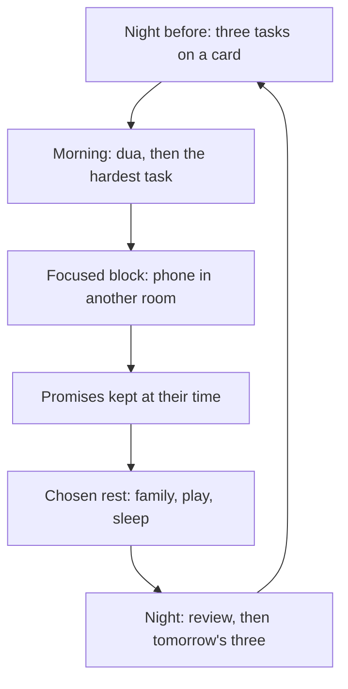

## Where the Saturday went

Hamza's free Saturday disappeared a few minutes at a time: a check of the phone after Fajr, a video, a late breakfast, a match, a nap, more scrolling. No single choice was bad. Together they took a whole day. Musa's exam week went the same way: three evenings lost, one night of panic.

Discipline is often imagined as harshness: waking at 4:00, no rest, no fun. That is not what the Sunnah teaches, and it rarely lasts. Discipline in this chapter is simpler: a plan made in advance, the important thing done first, distractions kept out of reach during focused work, and promises kept. With those in place, rest and play find their own room.

Before you step through Musa's day, make a guess.

```predict
prompt: "Musa has three tasks: a hard maths worksheet, an easy drawing, and tidying his desk. Which should he do first?"
options:
  - id: easy
    label: "The easy drawing, to warm up his mind before the hard work"
  - id: hard
    label: "The hard maths worksheet, while his energy is highest"
correctOptionId: hard
explanation: "Doing the hard, important task first means it gets your best energy, and the rest of the day feels lighter. The Prophet, peace be upon him, told us to be eager for what benefits us and not to give up (Sahih Muslim 2664)."
```

Step through the canvas below. It follows a study day with a plan.

<InteractiveCanvas slug="a-day-with-a-plan" />

The canvas showed five steps: three tasks planned the night before, the hardest first, the phone out of the room, a promise kept over a game, and a review of why time matters.

## Two blessings

Ibn Abbas reported that the Prophet said (Sahih al-Bukhari 6412):

> نِعْمَتَانِ مَغْبُونٌ فِيهِمَا كَثِيرٌ مِنَ النَّاسِ، الصِّحَّةُ وَالْفَرَاغُ

Meaning: There are two blessings in which many people are cheated: health and free time (Sahih al-Bukhari 6412).

The word translated "cheated" describes a bad trade: giving something valuable and receiving little in return. Free time and health are traded every day, often for very little. The hadith does not say free time is bad. It says it is a blessing, and that blessings can be wasted. And chapter 13.1 gave the reason it matters: every servant will be asked about his life and how he spent it (Jami' at-Tirmidhi 2417).

## Plan the night before

The simplest discipline habit is three tasks written the night before. Not a long to-do list; three things that matter for tomorrow. Writing them the night before moves the decision to a calm moment, so that tomorrow you are only doing, not deciding.

Put the list where you will see it first: under your phone, on your desk, on the fridge. Hamza's card under his phone works because the phone is the first thing he picks up after work.

## The hard task first

Abu Hurairah reported that the Prophet said (Sahih Muslim 2664):

> احْرِصْ عَلَى مَا يَنْفَعُكَ وَاسْتَعِنْ بِاللَّهِ وَلاَ تَعْجِزْ

Meaning: Be eager for what benefits you, seek Allah's help, and do not give up (Sahih Muslim 2664).

The same hadith begins: the strong believer is better and more beloved to Allah than the weak believer, and there is good in both. "Be eager for what benefits you" is a direct instruction about priorities. The task that benefits you most is usually the hardest one, and the one most tempting to delay. Doing it first, with a short dua, "O Allah, make it easy", is the habit. Delaying important work is not a rest; it is a weight carried all day.

## Distractions out of reach

Allah praises the one who feared standing before his Lord and held his soul back from desire (Quran 79:40 to 41). Holding back is easiest when the desire is out of reach. During a focused block, the phone goes to another room, notifications off. Musa studies at the dining table with his phone in the kitchen. Hamza reads with his phone face down on the far side of the room. The effort is in the moment you put it away, not in resisting it for an hour.

## Commitments and promises

Keeping a commitment is part of discipline. Breaking promises is named among the signs of a hypocrite (Sahih al-Bukhari 33). When friends invite Musa to a game at the time he promised to help his father, he keeps the promise and plays later. Promises to others also protect your time: they give the day a shape you have agreed to.

## Room for rest

Discipline is not an endless day of work. The Prophet said: the religion is ease, and no one overburdens himself in it without being overcome; so aim for what is right, come close, and be glad (Sahih al-Bukhari 39). Rest, family time, exercise and halal play are good uses of time. A plan with room for them lasts; a plan without room for them breaks in a week. The difference between rest and waste is often only whether it was chosen. Two hours of cricket chosen after homework is rest. Two hours of scrolling that happened by accident is waste.

The diagram shows a simple day with a plan.



The loop closes every night. Each evening's review becomes the next day's plan. Over weeks, the plan gets more realistic, because the review shows what actually fits into a day.

## Building it the 1% way

Week one: three tasks the night before, on a card where you will see it first.

Week two: the hardest task first, with a one-line dua.

Week three: one focused block a day with the phone in another room.

Week four: one chosen rest, planned, so rest stops being something that happens by accident.

## Worked example: Musa's next exam

**Planning.** On Monday, Rida and Musa write three evenings into the calendar: Tuesday, Wednesday, Thursday, 17:00 to 18:00, science.

**The block.** At 17:00 his phone goes in the kitchen. He sits at the dining table.

**The hard part first.** Each evening he starts with the topic he understands least.

**The promise.** On Wednesday friends call at 17:15. He says he will come at 18:00, and goes.

**The result.** Friday's exam feels calm. His mark goes up, but more importantly, he sleeps well on Thursday night.

## Time for workers and parents

For adults with jobs and families, free time comes in small pieces: half an hour after the children sleep, a lunch break, a commute. The same habits work at that size. Write the three tasks for tomorrow on the commute home. Use the first fifteen minutes of a lunch break for the one task that matters most. Keep one evening a week with nothing planned except family.

The prayers help more than people expect. Five fixed times a day divide the day into blocks. Many people find it natural to plan by prayer: before Dhuhr, the hardest work task; between Asr and Maghrib, errands; after Isha, reading and the bedtime routine. The day already has a shape; discipline uses it.

Parents can also teach time to children by example. A child who sees a parent plan the next day, put the phone away during homework help, and keep a promise to play after work learns the habit without a lecture.

Hamza's Saturday the following month looks different. On Friday night he writes three tasks. On Saturday he does the first after Fajr, before his phone. The match and the nap still happen, but in the afternoon, chosen. At Maghrib all three tasks are done, and the rest felt earned, not stolen from something more important.

## Where people misunderstand it

The first misunderstanding is "discipline means no rest". The religion is ease (Sahih al-Bukhari 39); chosen rest is part of a good plan.

The second is "I'll do the hard task when I feel ready". Be eager for what benefits you and do not give up (Sahih Muslim 2664); readiness usually comes after starting.

The third is "free time is wasted unless it is worship". Rest, family and halal play are good uses of time. Waste is time lost by accident.

## Check your understanding

```quiz
type: mcq
question: "Amir plans to study every evening but usually starts at 22:00 after hours on his phone. Which first change fits this chapter?"
options:
  - "Promise himself to try harder every evening"
  - "Study only at weekends, when he has more time"
  - "Stay up later, so that he has more time to study after the phone"
  - "Plan the study block the night before; phone in another room"
correct: 3
explanations:
  - "A promise without a plan relies on willpower at the weakest moment."
  - "Weekend-only study loses most of the week."
  - "Staying up later costs health, the other blessing in Sahih al-Bukhari 6412."
  - "Right. A plan made the night before and distractions out of reach (Quran 79:40 to 41) make the habit easier."
```

```quiz
type: mcq
question: "Sana feels guilty whenever she rests, even after a full day of work. What does Sahih al-Bukhari 39 suggest?"
options:
  - "She is right to feel guilty; every minute of the day must be work"
  - "She should rest only on Fridays"
  - "Rest is good only if she is ill"
  - "The religion is ease; chosen rest is part of a lasting plan"
correct: 3
explanations:
  - "No one overburdens himself in the religion without being overcome (Sahih al-Bukhari 39)."
  - "Rest belongs in every day, in a healthy amount."
  - "Rest protects health, which is itself a blessing (Sahih al-Bukhari 6412)."
  - "Right. Aim for what is right, come close, and be glad (Sahih al-Bukhari 39)."
```

## This week

Write three tasks the night before, every night. Do the hardest one first, with the phone in another room.

**Next:** Learning.
