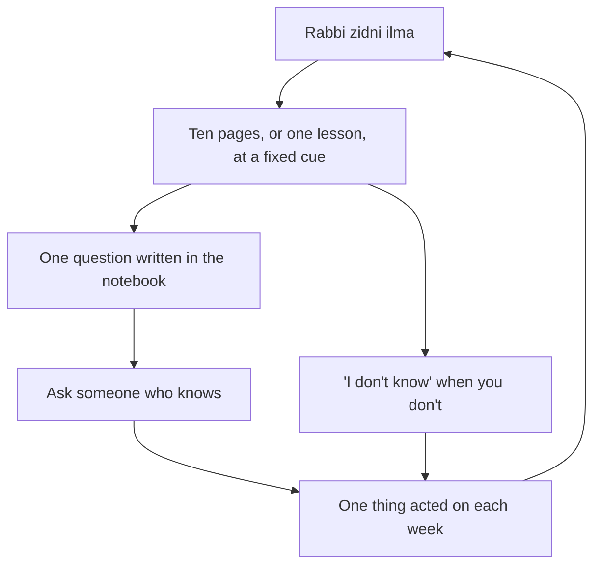

## Two years without a book

Hamza realised in chapter 13.1 that he had not read a whole book in two years, and had learned little about his deen since school. Musa, at twelve, studies every day, but only for exams, and forgets most of it a week later. Both are learning less than they could, for the same reason: learning has no daily habit of its own, only deadlines.

This chapter treats learning as a daily habit, like the Quran page in module 3. Small, steady and attached to a cue.

Before you step through Musa's week, make a guess.

```predict
prompt: "A teacher asks Musa a question he does not know the answer to. What does Quran 17:36 suggest he do?"
options:
  - id: honest
    label: "Say 'I don't know, I'll find out'"
  - id: guess
    label: "Guess confidently, so he does not look foolish"
correctOptionId: honest
explanation: "Do not follow what you have no knowledge of; the hearing, the sight and the heart will all be questioned (Quran 17:36). An honest 'I don't know' is part of learning."
```

Step through the canvas below. It follows a learner's week.

<InteractiveCanvas slug="learning-every-day" />

The canvas showed five habits: ten pages a day, one question asked, an honest "I don't know", homework at a fixed time, and acting on what was learned.

## A path to Paradise

Abu Hurairah reported that the Prophet, peace be upon him, said, in a longer hadith: whoever takes a path seeking knowledge, Allah makes easy for him a path to Paradise (Sahih Muslim 2699). And Allah taught His Prophet a dua (Quran 20:114):

> وَقُل رَّبِّ زِدْنِي عِلْمًا

Meaning: And say: my Lord, increase me in knowledge (Quran 20:114).

"Rabbi zidni ilma" is short enough to say before every study session, every book and every class. It turns learning into worship: you are asking Allah for something He told His Prophet to ask for.

You may have seen the saying "seeking knowledge is an obligation on every Muslim" attributed to Sunan Ibn Majah (224). In that chain it is graded very weak by al-Albani, al-Arna'ut and others, mainly because of an addition about giving knowledge to the undeserving. Some scholars accept the first sentence through other chains, and scholars agree that learning what you need for your own worship and dealings is required. This course builds the habit on Sahih Muslim 2699 and Quran 20:114, which are sound.

## Something new each day

The habit is small: ten pages of a book that teaches you something, or one lesson, or one video from a trusted teacher, every day, at a fixed cue. For Hamza it is after Isha, before his bedtime routine. For Musa it is ten pages of a non-school book after dinner.

Choose books in two areas: your deen and your work or studies. A simple rhythm is to alternate: a book about the life of the Prophet, then a book for work, then a book on the meanings of the Quran. Ten pages a day is about twelve books a year.

## Ask questions

The hadith of Jibril, which this course has met several times, is itself a lesson in learning by asking. Jibril came in the form of a man and asked the Prophet about Islam, iman, ihsan and the Hour, in front of the companions. Afterwards the Prophet said: that was Jibril, who came to teach people their religion (Sahih al-Bukhari 50). The questions were the teaching.

Many learners stay silent because they fear looking foolish. The habit is one question a day or a week: to a teacher, a colleague, a parent or a scholar. Keep a small notebook of questions, as Hamza does for the Quran in chapter 3.4, and bring it to the person who can answer.

## "I don't know"

Allah says: do not follow what you have no knowledge of; the hearing, the sight and the heart, all of these will be questioned (Quran 17:36). Saying "I don't know" honestly is part of that. It is especially important in matters of deen: many harmful ideas spread because someone guessed a ruling instead of saying "I don't know, let me ask". At school and work, too, an honest "I don't know, I'll find out" is respected far more than a confident wrong answer.

## Study on time

For students, the daily learning habit includes homework and revision at a fixed time. The cue matters more than the motivation. Musa's homework at 17:00, before cricket, at the dining table, happens on most days because the time is fixed, not because he feels like it. The same applies to adults studying for a qualification: a fixed block, three or four times a week, does more than a weekend marathon.

## Act on it

The hadith in chapter 13.1 says each person will be asked about his knowledge and what he did with it (Jami' at-Tirmidhi 2417). Knowledge that changes nothing is the weakest kind. The habit is one change a week from what you learned: a new technique at work, a Sunnah tried at home, a mistake you now avoid. This course itself is an example: each chapter ends with "this week", one thing to do.

The diagram shows the daily learning loop.



The loop starts and ends with the dua. Between, the habits are small, and the last box, acting on what you learn, is what turns reading into knowledge.

## Building it the 1% way

Week one: ten pages a day at a fixed cue, starting with "Rabbi zidni ilma".

Week two: a question notebook, with one question asked by the end of the week.

Week three: say "I don't know" honestly at least once, and find out.

Week four: act on one thing you learned, and note what changed.

## Worked example: Ayesha's reading circle

Ayesha wants the whole family to read more. Follow her idea.

**The cue.** Friday after Maghrib, fifteen minutes, everyone in the living room with a book.

**The books.** Each person chooses their own: Hamza a biography of the Prophet, his mother a book of duas, Musa an adventure story, Ayesha a book on raising children.

**The sharing.** At the end, each person says one thing they learned.

**The result.** After two months, Musa has finished three books, and asks his uncle for his biography when he finishes it.

## Learning from good sources

What you learn matters as much as how much. For your deen, choose teachers and books that give their sources, as this course does, and that are recommended by scholars you trust. Be careful with short videos and social media posts about religion that give no references: many contain weak hadith or personal opinions presented as rulings. For your work, choose resources that are current and respected in your field.

Learning with others also helps. A study partner, a reading circle or a weekly class gives the habit a cue and a reason to keep going on the days you would rather not. The companions learned together, around the Prophet, and then taught others.

Hamza starts with a simple pair: ten pages after Isha from a biography of the Prophet, and one technical article on his lunch break. After a month he has finished the biography and is halfway through his next book, and he notices that his questions at work have become sharper.

## Where people misunderstand it

The first misunderstanding is "learning is for school only". Each person is asked about their knowledge (Jami' at-Tirmidhi 2417), at every age.

The second is "saying 'I don't know' is weakness". Following what you have no knowledge of is what the Quran warns against (Quran 17:36).

The third is "the 'obligation on every Muslim' hadith is sahih in Ibn Majah". In that chain it is graded very weak; the habit stands on Sahih Muslim 2699 and Quran 20:114.

## Check your understanding

```quiz
type: mcq
question: "A friend asks Talha whether a certain business deal is halal. Talha is not sure. What does this chapter suggest?"
options:
  - "Say he doesn't know, and suggest asking a scholar"
  - "Give his best guess confidently"
  - "Say it is halal, since most deals of that kind are"
  - "Say it is haram, to be safe"
correct: 0
explanations:
  - "Right. Do not follow what you have no knowledge of (Quran 17:36)."
  - "Guessing in matters of deen is what Quran 17:36 warns against."
  - "Saying halal without knowledge is still a guess."
  - "Declaring something haram without knowledge is also speaking without knowledge."
```

```quiz
type: mcq
question: "Sobia reads many articles but says she remembers almost nothing. Which habit from this chapter helps most?"
options:
  - "Read faster, to cover more articles"
  - "Stop reading, since she forgets anyway"
  - "Act on one thing she learned each week"
  - "Read only on holidays"
correct: 2
explanations:
  - "More reading without use does not fix forgetting."
  - "Seeking knowledge is a path to Paradise (Sahih Muslim 2699)."
  - "Right. Each person is asked about his knowledge and what he did with it (Jami' at-Tirmidhi 2417); using it makes it stick."
  - "A daily habit works better than occasional bursts."
```

## This week

Read ten pages a day at a fixed cue, starting with "Rabbi zidni ilma". Write one question in a notebook and ask it by the end of the week.

**Next:** Halal provision and money.
