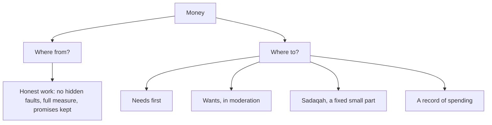

## The battery that was fine

In uncle Tariq's shop, a customer's battery was fine; an app was draining it. A dishonest repairer would have charged for a new battery. Tariq charged for the screen only. "This shop has fed three generations," he said. "None of it from a lie."

Money is one of the four questions in chapter 13.1: where did it come from, and where did it go? This chapter covers both halves: earning honestly, and spending well. It is written for adults with incomes and for children with pocket money, because the habits are the same at every size.

Before you step through the shop and Musa's month, make a guess.

```predict
prompt: "In Sahih Muslim 1015, the Prophet, peace be upon him, describes a traveller raising his hands in dua. Why is his dua at risk of not being answered?"
options:
  - id: short
    label: "His dua was too short and too quiet to be heard"
  - id: haram
    label: "His food, drink and clothing were from haram"
correctOptionId: haram
explanation: "The Prophet mentioned a man on a long journey, dishevelled, raising his hands: 'O Lord, O Lord', while his food, drink and clothing were haram and he was nourished by haram. How can he be answered? (Sahih Muslim 1015)."
```

Step through the canvas below. It follows a day in a shop and a month of pocket money.

<InteractiveCanvas slug="halal-in-hand" />

The canvas showed five habits: no hidden faults, full measure, refusing an easy dishonest profit, moderation between needs and wants, and respecting money given to you.

## Allah accepts only the good

Abu Hurairah reported that the Prophet said: O people, Allah is good and accepts only what is good. Allah commanded the believers what He commanded the messengers: O messengers, eat of the good things and do righteous deeds (Quran 23:51); and O you who believe, eat of the good things We have provided you (Quran 2:172). Then he mentioned the traveller whose food, drink and clothing were haram, raising his hands in dua, and asked: how can he be answered? (Sahih Muslim 1015).

This hadith joins money to worship. Halal earning is not a separate area from prayer and dua; it affects them. Ka'b ibn Ujrah reported a hadith with a stronger warning, that flesh nourished from haram is closer to the Fire (Jami' at-Tirmidhi 614, graded sahih by al-Albani). The course teaches it gently: it is a reason to choose halal carefully, not to despair. Tawbah and returning what was wrongly taken are always open.

## No hidden faults

Abu Hurairah reported that the Prophet passed by a pile of grain, put his hand into it and found his fingers wet. He asked the seller what this was. The seller said the rain had fallen on it. The Prophet said (Sahih Muslim 102):

> أَفَلاَ جَعَلْتَهُ فَوْقَ الطَّعَامِ كَىْ يَرَاهُ النَّاسُ مَنْ غَشَّ فَلَيْسَ مِنِّي

Meaning: Why did you not put it on top of the food so people could see it? Whoever cheats is not of me (Sahih Muslim 102).

The seller had not lied in words. He had hidden a fault. The Prophet still called it cheating. In daily life this covers a lot: a used phone sold without mentioning the cracked camera, a freelance invoice with padded hours, a product listing that hides a defect, a repair charged for work not done. The habit is simple: show the fault.

## Full measure

Allah says: woe to those who give less than due, who take full measure from people, but when they measure or weigh for them, give less (Quran 83:1 to 3). In a modern job, "measure" includes the hours you are paid for, the quality you promised, and the quantity you deliver. An employee who is paid for eight hours and gives six, while billing eight, is giving short measure.

## Keep your word in dealings

Breaking promises is among the signs of a hypocrite (Sahih al-Bukhari 33). In business and work, promises are deadlines, prices, delivery dates and quality. Keeping them, or honestly renegotiating before they are broken, is part of halal provision. A business known for keeping its word is also, as uncle Tariq found, a business that lasts.

Questions about specific kinds of income, interest, contracts and investments are fiqh, and some are complex. Ask a qualified scholar before entering a deal you are unsure about. The habits in this chapter, honesty, full measure and keeping your word, apply in every kind of work.

## Spending with moderation

Allah describes the servants of the Most Merciful (Quran 25:67):

> وَالَّذِينَ إِذَا أَنفَقُوا لَمْ يُسْرِفُوا وَلَمْ يَقْتُرُوا وَكَانَ بَيْنَ ذَٰلِكَ قَوَامًا

Meaning: And those who, when they spend, are neither wasteful nor stingy, but take a middle way between the two (Quran 25:67).

And Allah says: eat and drink, but do not waste; He does not love the wasteful (Quran 7:31). The middle way has two edges. Waste, *israf*, is spending on what is not needed until needs are neglected or debt grows. Stinginess is holding back from what is right: from family, from those in need, from yourself. Between them is a balanced life.

A simple habit helps more than a strict budget: write down what you spend for one month. Most people are surprised where their money goes. Then sort it into needs and wants, and move one want out. For children, the same habit with pocket money teaches the difference between a need and a want before the amounts are large.

## Money given to you

Many people spend money they did not earn: pocket money from parents, a household allowance, a company card, a family business account. Each is a trust. Pocket money is a gift with an expectation: that it is used sensibly. A company card is for company costs. Respecting these trusts is part of halal provision too. Musa's notebook of what he spends, and the small amount he sets aside for sadaqah each Friday (module 14), are how a twelve-year-old practises this.

The diagram shows the two halves of money: where it comes from, and where it goes.



The left branch is the question of earning, the right branch the question of spending. Both are asked about (Jami' at-Tirmidhi 2417). A person can earn honestly and still waste, or spend wisely from something taken wrongly. The habit is both halves together.

## Building it the 1% way

Week one: honesty. In every sale, invoice or deal this week, show the fault and give full measure.

Week two: a record. Write down everything you spend for the week.

Week three: one want. Move one want out of your spending, and notice the difference.

Week four: sadaqah. Set aside a fixed small part of your income or pocket money for charity, as module 14 shows.

## Worked example: Hamza's freelance invoice

Hamza does some freelance work in the evenings. Follow his invoice.

**The temptation.** A task took him seven hours. The client agreed to "up to ten". Nobody would question ten.

**The habit.** He invoices seven, with a note on what was done.

**The fault.** He also mentions a small bug he noticed but has not yet fixed, and offers to fix it free.

**The result.** The client sends two more projects the next month, and says he trusts Hamza's invoices without checking them.

## Debts

Debts deserve a special word. A loan must be paid back (Sunan Abi Dawud 3565), and chapter 11.3 showed how easily small loans are forgotten. If you owe money, keep a written list, pay something regularly even if it is small, and talk honestly with the lender if you cannot pay on time. Avoiding a lender is the opposite of keeping your word. And before borrowing, ask whether the thing is a need or a want.

## Where people misunderstand it

The first misunderstanding is "if I don't lie in words, it isn't cheating". Hiding a fault is cheating (Sahih Muslim 102).

The second is "moderation means always spending as little as possible". Stinginess is also a fault; the middle way is between (Quran 25:67).

The third is "halal is only about food". It is about earning, spending and every deal (Sahih Muslim 1015; Jami' at-Tirmidhi 2417).

## Check your understanding

```quiz
type: mcq
question: "Bilal sells his used laptop online. The battery lasts only an hour, but the buyer does not ask. What does Sahih Muslim 102 teach?"
options:
  - "Say nothing, since the buyer did not ask"
  - "Mention the battery clearly in the listing"
  - "Lower the price slightly without saying why"
  - "Say the battery is fine, since it does work"
correct: 1
explanations:
  - "The grain seller was not asked either; hiding the fault was the cheating."
  - "Right. Why didn't you put it on top so people could see it? Whoever cheats is not of me (Sahih Muslim 102)."
  - "A lower price without the reason still hides the fault."
  - "That is a lie as well as hiding the fault."
```

```quiz
type: mcq
question: "Mahnoor spends most of her salary on clothes and eating out, and borrows at the end of every month. Which verse describes the balance she needs?"
options:
  - "Quran 25:67: neither wasteful nor stingy, but a middle way"
  - "Quran 83:1: woe to those who give less"
  - "Quran 17:36: hearing, sight and the heart will be questioned"
  - "Quran 24:30: lower the gaze"
correct: 0
explanations:
  - "Right. When they spend, they are neither wasteful nor stingy, but take a middle way (Quran 25:67)."
  - "That verse is about short measure in trade."
  - "That verse is about following what you know."
  - "That verse is about the eyes."
```

## This week

Show the fault and give full measure in every deal. Write down everything you spend for one week.

**Next:** A short quiz on time, learning and money.
