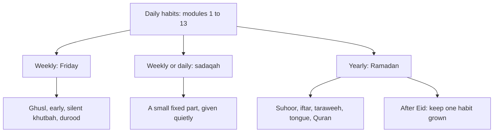

## A rushed Friday

For most of his adult life, Hamza's Friday has followed the same pattern. He works until 12:50, closes his laptop, rushes to the mosque in his office clothes, arrives during the khutbah, sits at the back near the door, checks his phone once during the khutbah "just to see the time", prays, and is back at his desk by 14:00. Jumu'ah is the one prayer of the week he never misses. It is also the one he gives the least.

In April, Baba Rashid, the old man from module 5, asks him after Jumu'ah why he always sits at the back. Hamza says he arrives late. Baba Rashid smiles and says that in his village, Friday began on Thursday night. Clothes were washed on Thursday, nails cut, a ghusl taken on Friday morning, a little attar put on, and the men walked to the mosque an hour early and sat reading Surah al-Kahf until the khutbah. "Friday was the best day of our week," he says. "Now it is the busiest."

## An empty box

Ayesha has a small wooden sadaqah box on the kitchen shelf. It was a wedding gift. On the first day it was put there, everyone put a coin in it. It has not been opened since, because it is almost empty. The family gives sadaqah at Eid, to the mosque appeal in Ramadan, and when someone asks. But there is no weekly habit, and the box shows it.

Musa, staying for the weekend, picks it up and shakes it. "Is this for poor people?" he asks. Ayesha says yes. He takes a coin from his pocket and puts it in, then looks at the box for a moment and asks whether he could put something in every week.

## A Ramadan that came and went

And then there is Ramadan. Last year, like every year, Hamza fasted every day, prayed taraweeh most nights, and finished the Quran once. For thirty days his worship was at its highest. On the day after Eid, almost all of it stopped. His Quran went back on the top shelf (module 3). His taraweeh nights had no continuation. The month had been a burst, not a beginning.

This year, with thirteen weeks of steady habits behind him, he sees Ramadan differently. It is not a month in which to start everything from zero and stop again. It is a month in which the habits he already has can grow, and from which a few can stay grown afterwards.

Before you read on, make a guess.

```predict
prompt: "According to Sahih al-Bukhari 934, what is the ruling on telling the person next to you 'be quiet' during the khutbah?"
options:
  - id: idle
    label: "You have spoken idly; even that breaks the silence"
  - id: fine
    label: "It is fine, since you are helping others to listen"
correctOptionId: idle
explanation: "If you say to your companion 'be quiet' on Friday while the imam is giving the khutbah, you have spoken idly (Sahih al-Bukhari 934). The khutbah is listened to in complete silence."
```

## Three rhythms

The habits of modules 1 to 13 are mostly daily. This module adds two other rhythms: weekly and yearly.

The weekly rhythm is Friday, the best day of the week, with its own Sunnahs: ghusl, clean clothes and fragrance, going early, silence during the khutbah, and abundant durood. Abu Hurairah reported that the Prophet, peace be upon him, said: whoever takes a bath, then comes to the Jumu'ah, prays what is written for him, then listens in silence until the imam finishes the khutbah, then prays with him, his sins between that Friday and the next are forgiven, and three days more (Sahih Muslim 857). Friday is also a natural day for the weekly habits of earlier modules: the fitrah in module 8, the reading circle in module 13, and sadaqah in this one.

Sadaqah can be weekly or daily. Abu Hurairah reported that the Prophet said: charity does not decrease wealth (Sahih Muslim 2588). A small, regular, quiet sadaqah is a habit a child can keep with coins and an adult with a fixed small part of income.

The yearly rhythm is Ramadan, the month of the Quran, of fasting and of the night prayer. Its Sunnahs, suhoor, a prompt iftar, taraweeh, guarding the tongue and extra Quran and charity, fit together into a daily cycle for thirty days.

The diagram shows the three rhythms and how they connect to the daily habits.



The daily habits sit underneath everything. Friday adds to them once a week. Ramadan raises them for a month. The arrow at the bottom right is the one most people miss: what happens after Eid. A Ramadan that leaves one habit permanently larger is a Ramadan that worked.

## What Hamza decides

Hamza starts with Friday, because it comes every week. His plan: Thursday evening, the fitrah habits and clothes ready (module 8). Friday morning, a ghusl before work. At 12:15, laptop closed and a calendar block that colleagues can see. At the mosque by 12:30, sitting near the front, phone switched off. Durood on the walk there and back.

Ayesha opens the sadaqah box and empties its few coins into an envelope for the mosque. Then she makes a family rule: every Friday after Maghrib, each person puts something in the box, however small. On the last Friday of the month, the box is opened and its contents given away together.

And for Ramadan, still a few months away, Hamza writes one line in his notes: "This year, choose one habit to grow and keep after Eid."

## The first new Friday

The next Friday, Hamza follows his plan. On Thursday evening his nails are cut and a clean kurta hangs on the door. On Friday morning he takes a ghusl before work, and puts on a little of the attar Ayesha gave him at their wedding, which he had almost never used. At 12:15 his calendar says "Jumu'ah", and he closes the laptop. A colleague asks whether he is leaving early; he says he is going to the mosque, and the colleague nods.

He arrives at 12:30. The mosque is half empty. He sits in the third row, switches off his phone completely, and says durood quietly until the adhan. When the khutbah begins, he notices something strange: he can hear it. Not just the sound, but the words. For years he arrived during the khutbah, out of breath, his mind still at work. Today he arrived first, and his mind arrived with him.

After the prayer, Baba Rashid catches his eye from the second row and smiles. Hamza walks back to the office slowly, saying durood, and is at his desk by 14:05, five minutes later than usual.

## Musa's box

Musa takes the sadaqah box idea home. Rida finds an old jar and he labels it with marker: "For people who need it". Every Friday he puts in a tenth of his pocket money, which he works out with a calculator the first time and by heart after that. At the end of the first month, the jar holds enough to buy a set of school books for a boy in his building whose father lost his job. Rida delivers them quietly with Musa, who does not tell anyone at school.

He tells his uncle on the phone that night. Hamza asks him how it felt. Musa thinks and says: "Better than the game credits." Hamza laughs, then realises that his own family's box, emptied that same week, had less in it than Musa's jar. A small amount every week, from a twelve-year-old, had beaten a family's good intentions with no cue. It was the same lesson as the first thirteen weeks, in a new place: the habit that happens is the one with a day, an amount and a place.

<LearningObjectives items={["Keep the Sunnahs of Friday: ghusl, clean clothes and fragrance, going early, silence in the khutbah, and much durood (Sahih al-Bukhari 883, 881, 934)", "Give a small, fixed sadaqah regularly and quietly, in money and in things (Sahih Muslim 2588; Sahih al-Bukhari 1423)", "Keep the Sunnahs of a Ramadan day: suhoor, fasting with faith, guarding the tongue, a prompt iftar, taraweeh and extra Quran", "Plan one habit to grow in Ramadan and keep after Eid", "Know which questions are fiqh and need a scholar"]} />

## Key words

| Word | Plain English |
|---|---|
| ***Jumu'ah*** | Friday, and the Friday congregational prayer with its khutbah |
| ***Khutbah*** | The sermon before the Friday prayer |
| ***Sadaqah*** | Voluntary charity, in money, things, help or a kind word |
| ***Zakat*** | The obligatory annual charity on wealth, with its own rules |
| ***Suhoor*** | The meal before dawn in Ramadan. In Urdu, *sehri* |
| ***Iftar*** | Breaking the fast at sunset |

## What is in this module

| Chapter | You will practise |
|---|---|
| 14.2 | Jumu'ah |
| 14.3 | Sadaqah |
| 14.4 | Ramadan |
| 14.5 | A short quiz with five cases |
| 14.6 | Your weekly and seasonal plan |

**Next:** Jumu'ah.
