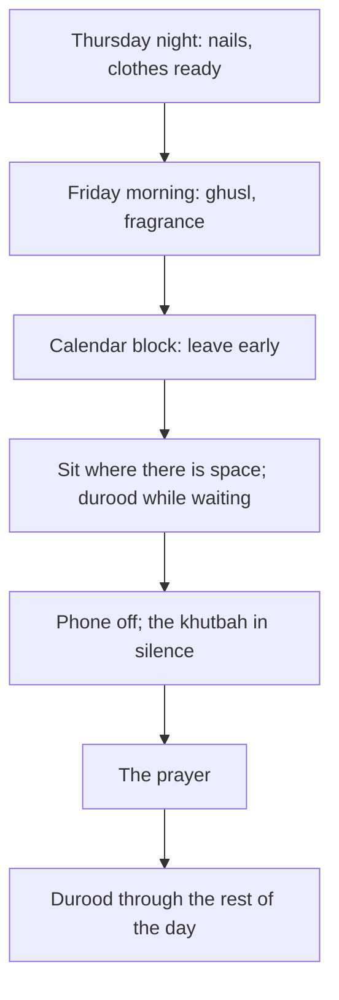

## Friday begins on Thursday

Baba Rashid's village began Friday on Thursday night: clothes washed, nails cut, and on Friday morning a ghusl, a little attar and an early walk to the mosque. Hamza's old Friday began at 12:50, at his desk. The difference was not faith. Both prayed Jumu'ah every week. The difference was preparation, and with it, how much of the day the Friday prayer was allowed to hold.

This chapter gives the Sunnahs of Friday as one chain, from the night before to the prayer, with their sources. It is written for the men who attend Jumu'ah, and it also covers the Friday habits that apply to everyone.

Before you step through Hamza's Friday, make a guess.

```predict
prompt: "In Sahih al-Bukhari 881, going to Jumu'ah in the first hour is compared to sacrificing which animal?"
options:
  - id: hen
    label: "A hen, then"
  - id: camel
    label: "A camel"
correctOptionId: camel
explanation: "Whoever goes in the first hour, it is as if he sacrificed a camel; in the second hour, a cow; in the third, a horned ram; in the fourth, a hen; in the fifth, an egg. When the imam comes out, the angels come to listen to the khutbah (Sahih al-Bukhari 881)."
```

Step through the canvas below. It follows Hamza's Friday from the morning to the prayer.

<InteractiveCanvas slug="a-friday-done-well" />

The canvas showed five Sunnahs in a chain: ghusl and fragrance, going early, sitting without separating people, silence in the khutbah, and much durood.

## Ghusl and fragrance

Salman al-Farisi reported that the Prophet, peace be upon him, said: no man takes a bath on Friday, purifies himself as much as he can, uses his oil or the perfume of his house, then goes out, does not separate two people, prays what is written for him, and then listens in silence when the imam speaks, except that he is forgiven what is between that Friday and the next (Sahih al-Bukhari 883).

> ثُمَّ يُنْصِتُ إِذَا تَكَلَّمَ الإِمَامُ، إِلاَّ غُفِرَ لَهُ مَا بَيْنَهُ وَبَيْنَ الْجُمُعَةِ الأُخْرَى

Meaning: Then he listens in silence when the imam speaks, except that he is forgiven what is between that Friday and the next (Sahih al-Bukhari 883).

This one hadith is almost the whole chain: bathe, clean yourself, fragrance, go, do not push between people, pray, listen. Whether the Friday ghusl is obligatory or strongly recommended is a difference among scholars; follow your scholar. As a habit, it belongs on Friday morning, or before leaving for the prayer.

The night before helps. Module 8 suggested Thursday evening or Friday for the fitrah practices and clean clothes. Laying out a clean kurta or shirt on Thursday night means Friday morning has one less decision.

## Going early

Abu Hurairah reported that the Prophet said: whoever takes a bath on Friday like the bath for janabah and then goes in the first hour, it is as if he sacrificed a camel; in the second hour, a cow; in the third, a horned ram; in the fourth, a hen; in the fifth, an egg; and when the imam comes out, the angels come to listen to the remembrance (Sahih al-Bukhari 881).

For someone who works, "the first hour" may be impossible. The habit is to go as early as your day allows, and earlier than you do now. Hamza's change from 12:50 to 12:15 moved him from arriving during the khutbah to arriving before it. That alone changed what he heard.

A calendar block makes it possible at work, the same tool as module 2 used for Dhuhr and Asr. Many colleagues, Muslim or not, respect a regular Friday block once they know what it is for.

## Sitting with manners

The hadith of Salman includes "does not separate two people" (Sahih al-Bukhari 883). Arriving late often leads to stepping over shoulders to reach a gap at the front. Arriving early removes the temptation. When you arrive, sit where there is space. If the mosque is crowded, the back is a fine place to sit.

## Silence in the khutbah

Abu Hurairah reported that the Prophet said: if you say to your companion "be quiet" on Friday while the imam is giving the khutbah, you have spoken idly (Sahih al-Bukhari 934). Even telling someone else to be quiet breaks the silence. The habit, then, is complete silence: the phone switched off, not only silenced, before the khutbah; no checking the time; no whispering. Sahih Muslim 857 ties the reward of the Friday to listening in silence until the imam finishes.

## Much durood

Aws ibn Aws reported that the Prophet said: among the best of your days is Friday, so send much blessing upon me on it, for your blessings are shown to me (Sunan Abi Dawud 1047, graded sahih by al-Albani). Durood on Friday is a habit for everyone, men and women, at the mosque or at home: on the walk to the prayer, after Asr, at any waiting moment. Whoever sends blessings on the Prophet once, Allah sends blessings on him ten times (Sahih Muslim 408).

## For those who do not attend

Women are not required to attend Jumu'ah, and many pray Dhuhr at home on Friday; some attend the mosque. Travellers and the ill also have allowances. These are fiqh details; follow your scholar. The Friday habits that belong to everyone are the ghusl and cleanliness, much durood, and making Friday a day of more worship and family, not only a busier work day.

The diagram shows Friday as one chain from Thursday night.



Most of the chain is preparation. By the time the khutbah begins, the work of the habit has already been done: the ghusl, the early start, the phone switched off. That is why Friday, more than any other day, rewards planning.

## Building it the 1% way

Week one: the phone. Switch it off completely before the khutbah, every Friday.

Week two: earlier. Leave fifteen minutes earlier than usual, with a calendar block if you work.

Week three: ghusl and clean clothes. Clothes ready on Thursday night, ghusl on Friday morning.

Week four: durood. Choose two Friday cues for durood, such as the walk to the mosque and after Asr.

## Worked example: Musa's school Friday

Musa's school breaks early on Fridays so that boys can attend Jumu'ah.

**Thursday.** His mother cuts his nails and lays out his white kurta.

**Morning.** A quick shower before school counts as his ghusl, and a little attar from his grandfather.

**After school.** He walks to the mosque with two friends instead of going home first, and they arrive before the adhan.

**The khutbah.** His phone stays at home on Fridays. He sits still and listens; afterwards his uncle asks him what the khutbah was about, and he can answer.

## Friday as a family day

Friday can also anchor the family's weekly habits from earlier modules: the fitrah and clean clothes (module 8), the reading circle after Maghrib (module 13), the sadaqah box (chapter 14.3), and a call to a relative (module 12). Ayesha calls it "the day the house gets better". It is not a day off, but a day with more of the good things in it. Each of those habits already has a cue on Friday, so none needs remembering on its own.

Hamza's own Friday shows how the chain changes the day. Arriving early, he hears the whole khutbah. Hearing it, he remembers it. Remembering it, he can talk about it with Musa on the phone that evening, and Friday becomes a day the family shares, not only a prayer he attends.

## Where people misunderstand it

The first misunderstanding is "arriving any time before the prayer is the same". The hours before the khutbah carry different rewards (Sahih al-Bukhari 881).

The second is "a quick 'shh' to someone talking is allowed". Even that is idle speech during the khutbah (Sahih al-Bukhari 934).

The third is "Friday's Sunnahs are only for men at the mosque". Durood, cleanliness and extra worship on Friday are for everyone.

## Check your understanding

```quiz
type: mcq
question: "During the khutbah, the boy beside Ahmed starts talking. What does Sahih al-Bukhari 934 suggest Ahmed do?"
options:
  - "Whisper 'be quiet' to him"
  - "Stay silent himself; even 'be quiet' is idle speech"
  - "Move to another place in the mosque to listen better"
  - "Tell the imam after the prayer"
correct: 1
explanations:
  - "Telling him to be quiet during the khutbah is itself idle speech (Sahih al-Bukhari 934)."
  - "Right. Listen in silence (Sahih al-Bukhari 934; Sahih Muslim 857). A gentle word can come after the prayer."
  - "Moving around during the khutbah disturbs others."
  - "He might gently speak to the boy afterwards, but the question is about the khutbah itself."
```

```quiz
type: mcq
question: "Rida does not attend Jumu'ah at the mosque. Which Friday habit from this chapter is clearly for her too?"
options:
  - "Going in the first hour to the mosque"
  - "Sitting without separating two people"
  - "Silence in the khutbah"
  - "Much durood on Friday"
correct: 3
explanations:
  - "Attending Jumu'ah is not required for women; that habit is for those who attend."
  - "That belongs to those in the congregation."
  - "That belongs to those listening to the khutbah."
  - "Right. Send much blessing upon me on Friday (Sunan Abi Dawud 1047); this is for everyone."
```

## This week

Switch your phone off before the khutbah, or, if you do not attend, choose two Friday cues for durood. Lay out clean clothes on Thursday night.

**Next:** Sadaqah.
