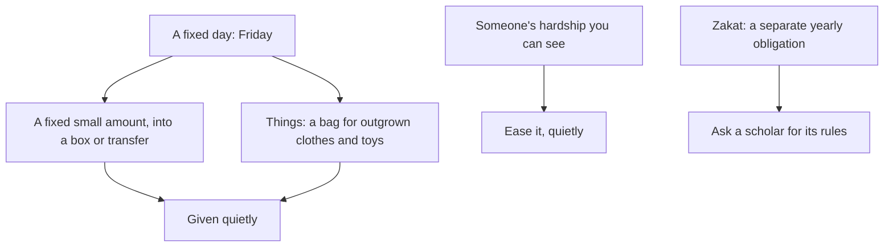

## A jar and a box

Musa's jar, labelled "For people who need it", filled with a tenth of his pocket money every Friday and bought a set of school books after a month. Ayesha's wooden box, a wedding gift with no day and no amount, stayed almost empty for years. The difference was not generosity. Hamza's family is generous at Eid and in Ramadan. The difference was a habit: a fixed day, a fixed small amount, and a fixed place.

This chapter treats sadaqah as a habit of that kind: small, regular and quiet.

Before you step through Musa's sadaqah, make a guess.

```predict
prompt: "Among the seven Allah shades on the Day of Judgement is a person who gives charity in a particular way. How?"
options:
  - id: secret
    label: "So quietly that his left hand does not know what his right hand gave"
  - id: public
    label: "Publicly, so that others see it and are encouraged to give too"
correctOptionId: secret
explanation: "Among the seven is a man who gives charity and hides it, so that his left hand does not know what his right hand spends (Sahih al-Bukhari 1423). Public giving can be good when it encourages others, but the hidden giver is the one named here."
```

Step through the canvas below. It follows Musa's weekly sadaqah.

<InteractiveCanvas slug="quiet-sadaqah" />

The canvas showed four steps: a fixed small amount every Friday, given quietly, things as well as money, and easing a classmate's hardship.

## Charity does not decrease wealth

Abu Hurairah reported that the Prophet, peace be upon him, said (Sahih Muslim 2588):

> مَا نَقَصَتْ صَدَقَةٌ مِنْ مَالٍ وَمَا زَادَ اللَّهُ عَبْدًا بِعَفْوٍ إِلاَّ عِزًّا وَمَا تَوَاضَعَ أَحَدٌ لِلَّهِ إِلاَّ رَفَعَهُ اللَّهُ

Meaning: Charity does not decrease wealth; Allah increases a servant who forgives only in honour; and no one humbles himself for Allah except that Allah raises him (Sahih Muslim 2588).

The first sentence answers the fear that holds many people back: "I cannot afford it." The hadith promises that sadaqah does not truly decrease wealth. Scholars explain that Allah puts blessing in what remains and replaces what is given. The habit does not need a large amount to begin. It needs a fixed one.

## Small, fixed and regular

The 1% way applies to sadaqah as much as to the Quran. Choose a small fixed amount, a fixed day and a fixed place. A tenth of pocket money, a small part of each salary, a coin for every day of the week dropped in a box on Friday. Musa's jar works because the amount is small enough that he never has to decide, and the day is fixed, so he never has to remember.

The most beloved deeds to Allah are the most consistent, even if small (Sahih al-Bukhari 6465). A small weekly sadaqah for a year adds up to more than a single large one at Eid, and it changes the giver more, because it is a weekly act of trust in Allah.

## Quietly

The hadith of the seven under Allah's shade names a person who gives charity and hides it, so that his left hand does not know what his right hand gave (Sahih al-Bukhari 1423). Module 1 taught the cure for showing off: a private record, and the intention for Allah. Quiet sadaqah is the same habit in money. Give through a box, a bank transfer, or by hand without telling others. Musa delivered the books without telling anyone at school.

Giving publicly is not forbidden, and sometimes it encourages others, as when a mosque appeal is announced. But the habit this chapter builds is the quiet one, because it guards the heart.

## Things as well as money

Sadaqah is not only money. Clothes your children have outgrown, washed and folded, toys still in good condition, books you have finished, food shared with a neighbour (module 12). Each is sadaqah when given for Allah. A family habit: a bag in a cupboard where outgrown things go, given away when it is full.

## Easing hardship

Abu Hurairah reported that the Prophet said, in a longer hadith: whoever relieves a believer of a hardship of this world, Allah will relieve him of a hardship of the Day of Resurrection; whoever eases things for one in difficulty, Allah will ease things for him in this world and the next (Sahih Muslim 2699). Sometimes the best sadaqah is not given to an organisation but to a specific person whose hardship you can see: a school fee, a medicine, a bill, a book. Ask quietly, give quietly.

## Zakat is different

Zakat is an obligation on wealth above a threshold, with its own rules about amounts, timing and who may receive it. It is one of the pillars of Islam, not a voluntary habit. This chapter is about voluntary sadaqah. If you have savings or a business, learn the rules of zakat from a qualified scholar or a reliable book of your school, and calculate it each year.

The diagram shows the sadaqah habit.



The top two branches are the weekly habit. The third is the one that comes without warning: a hardship you see. The bottom branch is separate on purpose: zakat is not replaced by sadaqah, and sadaqah is not a substitute for it.

## Building it the 1% way

Week one: a box or a jar, a fixed day, and a fixed small amount.

Week two: a bag for things you no longer need.

Week three: quiet. Give at least once this week without telling anyone.

Week four: easing. Look for one specific hardship you could ease, and ease it.

## Worked example: Hamza's monthly transfer

**The amount.** Hamza decides on a small fixed percentage of his salary.

**The cue.** A standing order on payday, so it leaves before he can spend it.

**The quiet.** It goes to a trusted local charity; he does not mention it to anyone.

**The extra.** The family box on Fridays continues, so the children see giving happen.

**The check.** Once a year, before Ramadan, he calculates his zakat separately, with help from the imam.

## Teaching children to give

Children learn giving best by doing it with their own money, not only by watching their parents give. A jar of their own, a fixed small part of pocket money, and a say in where it goes make sadaqah theirs. Musa chose the school books himself. Zoya, at eight, wants her coins to buy food for the stray cats near the park, and that is sadaqah too: in every living creature there is a reward (Sahih al-Bukhari 2466).

Let children see the result where possible, without making it a show: a book delivered, a bag of clothes taken to a family, a bowl of water filled. The habit grows when they see that their small coins became something real.

## Sadaqah beyond money

The Sunnah describes many acts as sadaqah that cost nothing. Helping a man onto his ride or lifting his luggage onto it, a good word, every step taken to the prayer, and removing something harmful from the path are each sadaqah (Sahih al-Bukhari 2989). Smiling in your brother's face is sadaqah, and so is guiding someone who is lost (Jami' at-Tirmidhi 1956, graded sahih by al-Albani). On weeks when money is tight, the habit can continue in these forms. The fixed day still comes; only the gift changes.

The judging justly between two people that the same hadith names is also sadaqah. A parent settling a quarrel between children fairly, a colleague helping two others agree, an elder reconciling relatives: each is giving something valuable without spending a coin. On a week with no money to spare, the sadaqah habit can still keep its day, with one of these gifts given instead.

## Where people misunderstand it

The first misunderstanding is "I cannot afford sadaqah". Charity does not decrease wealth (Sahih Muslim 2588), and a small fixed amount fits any budget.

The second is "sadaqah must be money". Things, help and easing someone's hardship are sadaqah too.

The third is "my weekly sadaqah covers my zakat". Zakat is a separate obligation with its own rules.

## Check your understanding

```quiz
type: mcq
question: "Asim says he will give sadaqah 'when he earns more'. Which source answers his worry?"
options:
  - "Sahih al-Bukhari 934: silence during the Friday khutbah"
  - "Quran 17:36: following what you know"
  - "Sahih al-Bukhari 6412: health and free time"
  - "Sahih Muslim 2588: charity does not decrease wealth"
correct: 3
explanations:
  - "That hadith is about the khutbah."
  - "That verse is about knowledge."
  - "That hadith is about time."
  - "Right. Charity does not decrease wealth (Sahih Muslim 2588). A small fixed amount can start now."
```

```quiz
type: mcq
question: "Nida gives a large sadaqah every Eid and posts a photo of the receipt online. Which change fits this chapter best?"
options:
  - "Give a small amount weekly as well, quietly"
  - "Keep posting, since it encourages others"
  - "Stop giving, since she might be showing off"
  - "Give only through her family, never herself"
correct: 0
explanations:
  - "Right. Small and consistent (Sahih al-Bukhari 6465), and quiet like the one shaded (Sahih al-Bukhari 1423)."
  - "Public giving can sometimes encourage others, but the habit built here is quiet giving that guards the heart."
  - "The cure for showing off is a renewed intention, not stopping the good deed (module 1)."
  - "She can give herself, quietly."
```

## This week

Set up a box or a transfer, a fixed day and a fixed small amount. Give once this week without telling anyone.

**Next:** Ramadan.
