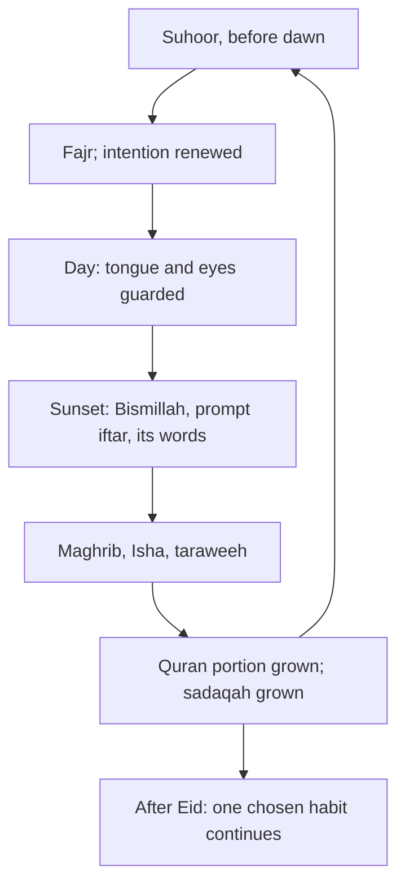

## The month that came and went

Every year Hamza's Ramadan followed the same shape: thirty days of the highest worship of his year, and then, on the day after Eid, almost all of it stopped. His Quran went back to the top shelf. His night prayer ended with taraweeh. Ramadan was a burst.

This year he plans it differently. He already has steady daily habits: the five prayers, a Quran page, adhkar, the night routine. Ramadan will not replace them; it will raise them. And before it starts, he chooses one habit to grow during the month and keep afterwards.

Before you step through a Ramadan day, make a guess.

```predict
prompt: "At sunset in Ramadan, should iftar be delayed a little to be safe, or taken promptly?"
options:
  - id: delay
    label: "Delayed a little after sunset, to be safe"
  - id: prompt
    label: "Taken promptly, as soon as the sun has set"
correctOptionId: prompt
explanation: "People will remain upon good as long as they hasten to break the fast (Sahih al-Bukhari 1957). Once the sun has set, iftar is taken promptly."
```

Step through the canvas below. It follows one Ramadan day.

<InteractiveCanvas slug="a-ramadan-day" />

The canvas showed six Sunnahs in a day: suhoor, fasting with faith and hope, guarding the tongue, a prompt iftar with its words, taraweeh, and extra Quran and charity.

## Fasting with faith

Allah says: O you who believe, fasting has been prescribed for you as it was prescribed for those before you, so that you may attain taqwa (Quran 2:183). The goal of the fast is named in the verse: taqwa, the mindfulness of Allah from module 9. Hunger is the means; taqwa is the aim.

Abu Hurairah reported that the Prophet, peace be upon him, said (Sahih al-Bukhari 38):

> مَنْ صَامَ رَمَضَانَ إِيمَانًا وَاحْتِسَابًا غُفِرَ لَهُ مَا تَقَدَّمَ مِنْ ذَنْبِهِ

Meaning: Whoever fasts Ramadan out of faith and hoping for reward, his previous sins are forgiven (Sahih al-Bukhari 38).

"Out of faith and hoping for reward" is intention, again: the first habit of this whole course (module 1). A fast kept because everyone around you fasts is still a fast. A fast kept with a renewed intention each morning, "for Allah, hoping for His reward", is the one the hadith describes.

## Suhoor

Anas reported that the Prophet said: take suhoor, for there is blessing in suhoor (Sahih al-Bukhari 1923). Waking for suhoor is also practice for Fajr: the same alarm across the room, the same phone outside the bedroom (modules 2 and 6). Many families find that suhoor becomes their most peaceful meal of the year, eaten together in the quiet before dawn.

## Guarding the tongue and eyes

Abu Hurairah reported that the Prophet said: whoever does not give up false speech and acting upon it, Allah has no need of his leaving his food and drink (Sahih al-Bukhari 1903). A fast that keeps the stomach empty while the tongue backbites and the eyes wander misses its own purpose. Module 10's habits, good or silent, the fast turn-away, verifying before forwarding, matter more in Ramadan, not less. Many people find Ramadan the easiest month to start them, because the whole day already feels guarded.

## A prompt iftar, and its words

Sahl ibn Sa'd reported that the Prophet said: people will remain upon good as long as they hasten to break the fast (Sahih al-Bukhari 1957). And Ibn Umar reported that when the Prophet broke his fast he said (Sunan Abi Dawud 2357, graded hasan):

> ذَهَبَ الظَّمَأُ وَابْتَلَّتِ الْعُرُوقُ وَثَبَتَ الأَجْرُ إِنْ شَاءَ اللَّهُ

Meaning: The thirst has gone, the veins are moistened, and the reward is confirmed, if Allah wills (Sunan Abi Dawud 2357).

Many popular iftar duas exist; this one has a sound source. Say Bismillah before the first date or sip of water, as at every meal (module 7), and these words after.

## The night prayer

Abu Hurairah reported that the Prophet said: whoever stands in prayer in Ramadan out of faith and hoping for reward, his previous sins are forgiven (Sahih al-Bukhari 37). Taraweeh in congregation is the most common way. For those who cannot attend, praying at home, even a few rak'ahs, is standing in prayer too. Details of the number of rak'ahs differ between schools; follow your scholar.

## The month of the Quran

Allah says: the month of Ramadan, in which the Quran was sent down as guidance for people (Quran 2:185). Module 3's daily page can grow in Ramadan, for example to a juz a day, to finish the Quran in the month. But the lesson of module 3 still applies: on the hardest day, keep a minimum. A juz plan with a one-page minimum survives a week of illness; a juz plan with no minimum breaks.

Sadaqah grows too. The weekly box of chapter 14.3 might become daily in Ramadan, and the amount a little larger.

## After Eid

Here is the change Hamza makes this year. Before Ramadan, he chooses one habit to grow during the month and keep afterwards. He chooses the night prayer: two rak'ahs before Witr at home, which he will start in Ramadan alongside taraweeh and continue every night after Eid. One habit, chosen in advance, with Ramadan as the season to plant it.

This is the 1% way applied to a year. Each Ramadan leaves one habit permanently larger. After ten years, that is ten habits that began in Ramadan and stayed. It is the same arithmetic as the slider in chapter 1.2: small steps, kept, add up to far more than a single large one, year after year, Ramadan after Ramadan.

The diagram shows a Ramadan day and the line that continues after Eid.



The loop is the daily cycle of the month. The branch at the bottom is what makes Ramadan a beginning rather than a burst: one habit, chosen before the month, that does not stop when the month does.

## Building it the 1% way

Before Ramadan: choose one habit to grow and keep, and prepare its cue.

Week one of Ramadan: suhoor, prompt iftar with its words, and intention renewed each morning.

Week two: the tongue guarded, with one module 10 habit made firm.

Weeks three and four: the Quran portion and sadaqah grown, with minimums for hard days. After Eid: keep the chosen habit, every day.

## Worked example: Musa's first full fasts

Musa, twelve, plans to fast every day of Ramadan for the first time. Follow how his family helps.

**Suhoor.** His mother wakes him; he eats and drinks properly, and prays Fajr with his uncle.

**School days.** He keeps his tongue guarded as a challenge with his cousin: no rude word all day.

**Iftar.** He is in charge of saying the iftar words aloud for the family.

**His chosen habit.** He decides to keep reading ten pages of the Quran's meaning after Ramadan, the habit he grew from the reading circle.

## Those who cannot fast

Some people cannot fast: the ill, travellers, women in certain conditions, the elderly, and others whom the Quran excuses and gives other ways to make up or compensate (Quran 2:185). The details are fiqh; ask your scholar. Not fasting for a valid reason is not a failure of the month. The other habits of Ramadan, the Quran, sadaqah, the night prayer, guarding the tongue, the dua, remain open to everyone, and a person who cannot fast can still make Ramadan the month their chosen habit begins.

## Where people misunderstand it

The first misunderstanding is "the fast is only about food". Whoever does not leave false speech, Allah has no need of his hunger (Sahih al-Bukhari 1903).

The second is "iftar should be delayed to be safe". Hastening it, once the sun has set, is the Sunnah (Sahih al-Bukhari 1957).

The third is "Ramadan habits end at Eid". Choose one to keep, and Ramadan becomes a beginning.

## Check your understanding

```quiz
type: mcq
question: "Waleed fasts every day of Ramadan but spends the afternoons arguing and backbiting at work. Which hadith speaks to him?"
options:
  - "Sahih al-Bukhari 1923: there is blessing in the suhoor meal"
  - "Sahih al-Bukhari 1957: hasten the iftar"
  - "Sahih al-Bukhari 1903: leaving false speech while fasting"
  - "Sahih al-Bukhari 37: standing in prayer in Ramadan"
correct: 2
explanations:
  - "That hadith is about suhoor."
  - "That hadith is about the time of iftar."
  - "Right. Whoever does not give up false speech and acting on it, Allah has no need of his leaving food and drink (Sahih al-Bukhari 1903)."
  - "That hadith is about the night prayer."
```

```quiz
type: mcq
question: "Every year Sana's worship rises in Ramadan and falls back completely after Eid. Which plan fits this chapter?"
options:
  - "Do even more in Ramadan, so the effect lasts longer"
  - "Choose one habit before Ramadan, grow it during the month, and keep it after Eid"
  - "Do less in Ramadan, so the drop afterwards is smaller"
  - "Accept that Ramadan is a special month, and that worship naturally returns to normal"
correct: 1
explanations:
  - "A bigger burst usually means a bigger drop."
  - "Right. One chosen habit that continues makes Ramadan a beginning, the 1% way applied to a year."
  - "Ramadan is the month to raise worship, not lower it."
  - "Worship can return to a higher normal if one habit is kept."
```

## This week

If Ramadan is near, choose the one habit you will grow and keep after Eid. If it is far, write it down now and put a reminder in your calendar a month before.

**Next:** A short quiz on weekly and seasonal habits.
