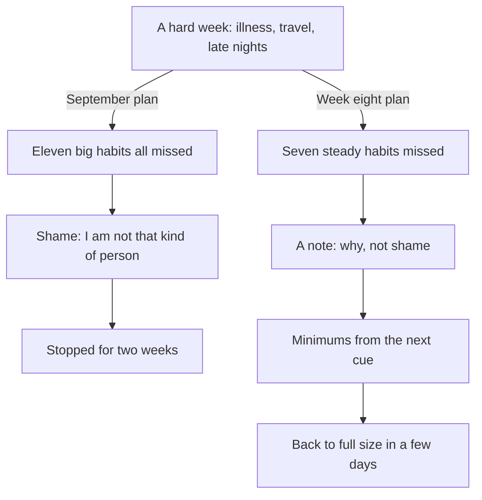

## Week eight

In April, after the modules on daily life, Hamza looks back at one week from his first thirteen that taught him more than any other. It was week eight, in November.

By the end of week seven, Hamza's Notion page has seven habits on it. Maghrib, Isha and Fajr with the first takbir. Amana al-Rasul after Isha. One page of Quran after Fajr, now two on most days. The morning adhkar on the walk home. And, since Monday of week seven, Dhuhr with the first takbir in the office prayer room. He has not missed a single habit for more than two days in a row. For the first time in his life, his worship has a shape he can see.

On Monday of week eight he wakes with a fever. By the afternoon he cannot stand for long. He prays sitting, at home, for two days. He does not read his Quran page; he listens to a little recitation when he can. On Thursday, still weak, he travels with his mother to his cousin's wedding in another city. They stay four nights in a crowded house. The prayers are prayed with the family, sometimes late, because of the guests and the events. The mosque is far. Every night ends after midnight.

When he comes home on Monday of week nine and opens his page, it looks like September. Whole columns of empty boxes. Fajr with the first takbir: zero of seven. Quran page: two of seven. Morning adhkar: one of seven.

## The old thought, again

The thought arrives at once, in the same words as in September: "That is it. I broke it. Seven weeks gone." He feels the same small drop in his stomach. He even notices the old urge: close the page, and start again "properly" next month. It feels responsible. It is actually the same September trap, dressed up as a plan.

This time, he does not close the page. Not because he is stronger than he was in September, but because he knows three things now that he did not know then. He knows the deed he kept for seven weeks was written for him while illness and travel stopped him (Sahih al-Bukhari 2996). He knows that one bad week in a year of small steps bends the line but does not break it, as the canvas in chapter 1.2 showed. And he knows that the restart rule is simple: the next cue, at the usual size, with no debt.

Before you read on, make a guess.

```predict
prompt: "Hamza is home after a week of illness and travel. Which restart is most likely to work?"
options:
  - id: new-month
    label: "Wait for the 1st of next month and start the plan again from week one"
  - id: next-cue
    label: "All seven habits at their smallest version, from the next cue"
correctOptionId: next-cue
explanation: "Waiting for a fresh start turns one hard week into three or four. The habits are still there; they only need their cues back. Starting each at its minimum makes the first day back easy, and the full versions return within days."
```

## What he does on Monday evening

Hamza does not try to "repay" the week. He does not read seven pages, or plan extra adhkar. Instead he does three things that evening.

First, he restarts every habit at its minimum for two days. Maghrib and Isha: leave at the adhan. Amana al-Rasul: the two verses. Tomorrow morning: Fajr, one page, and "Bismillahilladhi" three times on the walk home. Small enough that nothing about tomorrow feels heavy.

Second, he writes a short note next to the empty week: "Ill Mon to Wed, wedding Thu to Sun." Not as an excuse, but as information. When he looks at his page in a month, he will know why that week is empty, and he will not mistake it for a sign that the plan failed.

Third, he makes one decision about his ladder. Asr with the first takbir was week eight's new habit, and it began on the Monday the fever came, so it never really started. He decides to add nothing new in week nine, and to use it only to bring the seven habits back to their full size. Asr moves to week ten, and every later step moves back two weeks with it. His last new habit, Surah al-Mulk, now arrives in week thirteen, and his steadying weeks move past the end of his Notion page, into the next thirteen weeks. That is fine. The page was a plan, not a promise to anyone.

## What the week taught him

The diagram shows what happened to the same kind of bad week in September and in week eight.



Look at what is the same and what is different. The hard week is the same kind of week; life did not become easier between September and November. What changed is what Hamza did after it. In September, the missed days became a verdict about who he is. In week eight, they became a note on a page and a plan for the next cue. The habits did not survive because the week was easy. They survived because the restart was easy.

There is also a quieter lesson. Hamza notices that by Wednesday of week nine, Fajr and the Quran page were back at their usual size, and by Friday everything was. Seven weeks of practice had made the habits strong enough to return quickly. A habit that is steady before a hard week comes back faster after it. That is one more reason to build slowly.

## The capstone, in short

The capstone of this course asks you to do what Hamza did on 1 October, with everything you have learned since. You will write your own 13-week 1% plan: the habits you want to build, in the order you will add them, one a week. Each habit will have its cue, its anchor, its smallest version and its source. Your plan will say where your private tracker lives, how you will count, when you will review each week and what your adding rule is. And it will say what you will do after a hard week, before the hard week comes.

Then you will review it. If you have been running your plan while taking this course, you will review the real weeks you have: which habits held, which slipped, and why. Most people reach the capstone with three to six weeks of real tracking, not thirteen, and that is expected. A review of five honest weeks is worth more than a description of thirteen imagined ones. If you prefer, you can review one of the provided cases instead, which count exactly the same.

Finally, you will walk your mentor through your plan in five minutes. Your mentor will never ask to see your tracker or your record of worship. They will ask about the plan: why this order, what this minimum is, what happens in a week like Hamza's week eight. The aim is a plan you can defend and keep, not a score to show.

## Why this module matters

Every plan in this course will meet a week like Hamza's week eight. It may be an illness, a journey, exams, a new baby, a loss in the family, a heavy month at work. Nothing in this course can prevent those weeks. What this module can do is make sure that each one bends your plan without breaking it.

In chapter 15.2 you will learn to keep a tracker that helps you instead of judging you: counting days done rather than streaks, writing a few words on missed days, reviewing once a week, and changing one thing at a time. You will also learn the rule for when to add the next habit, and how tawbah, turning back to Allah, fits into a restart. Chapter 15.3 is a mixed review with cases from every module. In chapter 15.4 you build your capstone: your own 13-week 1% plan. Chapter 15.5 is the final checklist, your toolkit, and a look back at the list you made in module 1.

<Callout type="info" title="If a hard week is very heavy">
Some hard weeks are about more than habits: a loss, an illness that does not pass, a weight you carry for a long time. If you feel overwhelmed for a long time, talk to your mentor today, and if you can, to a doctor or counsellor too. This course does not replace professional care.
</Callout>

<LearningObjectives items={["Keep a private tracker that counts days done, with a few words on each missed day", "Review your week on one fixed day, find the habit with the most misses and its cause, and change one thing", "Use a clear rule to decide when to add your next habit", "Restart after a hard week at the next cue, at your minimum, with tawbah where you fell short and no growing debt", "Build and defend a 13-week 1% plan that adds one habit a week, with cues, minimums, sources, a tracker and a restart plan"]} />

## Key words

| Word | Plain English |
|---|---|
| **Days done** | How many days out of seven you did a habit, in any version, counted without needing a streak |
| **Weekly review** | A fixed time each week to count, find one cause and change one thing |
| **Adding rule** | Your own rule for when you are ready to add the next habit, for example five of seven days for every habit so far |
| **Restart** | Coming back to a habit at its next cue, at its minimum, after a miss |
| ***Tawbah*** | Turning back to Allah after falling short: stopping, regretting and asking forgiveness |

## What is in this module

| Chapter | You will practise |
|---|---|
| 15.2 | A tracker that helps, a weekly review and the adding rule |
| 15.3 | A mixed review with fresh cases from every module |
| 15.4 | Your capstone: your 13-week 1% plan |
| 15.5 | The final checklist, your toolkit and a look back |

**Next:** A tracker that helps: days done, the weekly review and restarting.
