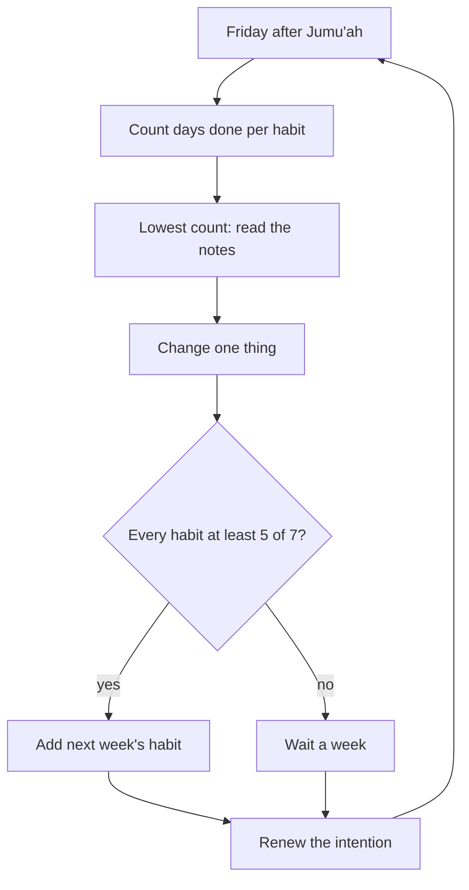

## Two ways to count

In September, Hamza counted his habits the way many apps do: as streaks. Nine days in a row, then zero. A streak only knows two things: unbroken, or broken. When it breaks, it shows a zero, and a zero looks like nothing was ever done.

Since 1 October, he has counted differently. For each habit, each week, he counts days done: how many of the seven days he did the habit in any version, full or minimum. Fajr with the first takbir: four of seven. Quran page: six of seven. A four is not a zero. It is information: three days slipped, and there is a reason somewhere.

Before you step through his Friday review, make a guess.

```predict
prompt: "In one week, Fajr with the first takbir was 4 of 7 for Hamza, and every other habit was 6 or 7 of 7. His rule is to add the next habit only when every habit so far is at least 5 of 7. Should he add next week's new habit?"
options:
  - id: add
    label: "Yes, add it, so the ladder stays on schedule"
  - id: wait
    label: "No, wait a week and fix Fajr first"
correctOptionId: wait
explanation: "His own rule says wait. Adding a new habit on top of a slipping one makes both harder. One week of waiting, with one change to fix Fajr, keeps the whole ladder steady."
```

Step through the canvas below. It follows Hamza's weekly review after Jumu'ah.

<InteractiveCanvas slug="weekly-review" />

The canvas showed a review in five steps: count days done, find the habit with the most misses and its cause in the notes, change one thing, apply the adding rule, and renew the intention. It took about ten minutes. It turned a week of ticks into one decision.

## Days done, and a few words

The tracker itself can be very simple. Hamza's is a table in a private Notion page: one row for each habit, one column for each day. In each box he writes a tick for the full version, an "m" for the minimum, or nothing. On a missed day he writes two or three words: "slept 00:30", "client call", "travel". A paper card in a drawer works just as well. What matters is three things: it is private, it counts days done, and it has room for a few words.

The few words are the most useful part. Without them, a missed day is only a gap. With them, a month of gaps becomes a pattern. In week six, Hamza's notes on three missed Fajrs all said the same thing in different words: late nights. That pointed at one cause, not three, and so at one change.

Count the minimum as done. A day you said "Bismillahilladhi" three times instead of your full adhkar set is a day the habit was kept. Counting it as a miss would teach you that the minimum is pointless, and then you would stop using it on exactly the days it protects you.

## The weekly review

Once a week, on a fixed day, Hamza spends about ten minutes with his tracker. He chose Friday after Jumu'ah, because he is already in a calm frame of mind and the week is nearly over. His review has five questions, always in the same order.

**How many days done, for each habit?** He counts and writes the numbers. No judging yet.

**Which habit had the most misses, and what do the notes say?** He looks for the habit with the lowest count and reads his few words. Usually one cause appears.

**What one thing will I change?** One change, not three. If he changes three things and the next week is better, he will not know which one helped.

**Am I ready for the next habit?** His rule: every habit so far at least five of seven. If yes, next week's habit begins on Monday. If no, he waits a week.

**What is my intention?** He ends by renewing it: the tracker is a tool for worship, not the worship itself, and not something to show anyone. Actions are by intentions (Sahih al-Bukhari 1).

The diagram shows the review as one loop that runs every week.



One caution about the review. It treats your voluntary habits as things you can shrink, pause or wait on. Your obligatory prayers are not like that. A low count for "Fajr with the first takbir" is a reason to plan better for the congregation, never a reason to stop praying Fajr. The review only ever decides how you will keep the obligation better next week.

The loop never ends in "fail". Both answers to the adding question are good: add, or wait. Over thirteen weeks, this loop runs thirteen times, and each time it makes the plan a little better fitted to the real life it has to survive. That is the 1% idea applied to the plan itself.

## Restarting, with tawbah

Some misses are only about a plan: a late night, a call that ran long. Others touch something deeper. A prayer was missed altogether, or delayed past its time without reason. A whole week slipped and you did not try. For these, a restart is not only a new plan. It is also a turning back to Allah.

Allah describes the people of taqwa as those who, when they do something wrong or wrong themselves, remember Allah and ask forgiveness for their sins, and do not persist knowingly in what they did (Quran 3:135).

> ذَكَرُوا اللَّهَ فَاسْتَغْفَرُوا لِذُنُوبِهِمْ

Meaning: They remember Allah and ask forgiveness for their sins (Quran 3:135).

And the Prophet, peace be upon him, said: if you did not sin, Allah would replace you with people who sin, then ask Allah's forgiveness, and He forgives them (Sahih Muslim 2749). This hadith does not encourage sin. It shows that falling short and turning back is what Allah expects of human beings. The person who turns back is not a failure. He is doing exactly what he was created to do.

So a full restart has two parts. Turn back to Allah: stop, regret, ask forgiveness. Then restart the habit at its next cue, at its minimum, with no growing debt. And leave "if only" behind. The Prophet said: be keen on what benefits you, seek Allah's help, and do not give up; and if something befalls you, do not say "if only I had done this", for "if only" opens the door to the work of Satan (Sahih Muslim 2664).

## Worked example: Asma's month

Asma is a nurse who has been running her plan for five weeks. She has five habits. Follow her review at the end of week five.

**Days done.** Isha at the start of its time: 7. Quran, half a page after Isha: 6. Adhkar after Isha: 7. Fajr at the start of its time: 3. Morning adhkar: 3.

**The lowest count and its notes.** Fajr and the morning adhkar are both 3, and both fail on the same days. Her notes say "night shift" on all four. The two habits are linked: the adhkar follow Fajr.

**One change.** On night-shift days, she moves her alarm to fifteen minutes before Fajr, prays at work in the staff room, and says her morning adhkar there, before going home to sleep. One change, which covers both habits.

**The adding rule.** Two habits are below five of seven. She waits a week before adding the adhkar after Maghrib.

**The intention.** She writes one line at the bottom of her card: "For Allah, not for a perfect page."

## Where people misunderstand it

The first misunderstanding is "a broken streak means I failed". Days done shows what you did. Four of seven is not zero.

The second is "the minimum does not count". It counts. Counting it as a miss teaches you to abandon the version that protects your hardest days.

The third is "after a bad week I should start the whole plan again". Restart each habit at its next cue, at its minimum, with tawbah where you fell short. Most habits come back in days.

## Check your understanding

```quiz
type: mcq
question: "Irfan's habit app shows a streak of zero for Quran reading, because he missed yesterday after reading 26 days in a row. He feels he has 'lost everything'. Which change fits this chapter?"
options:
  - "Count days done: 26 of the last 27, with a note on the miss"
  - "Start a new streak today and try harder not to break it"
  - "Delete the app, since tracking worship makes him feel worse"
  - "Read double today, so the streak can be restored"
correct: 0
explanations:
  - "Right. Days done shows what he actually did. One miss with a note is information, not a loss."
  - "A new streak will show zero again at the next miss. The way of counting is the problem."
  - "A private tracker that counts days done can help him. The problem is the streak, not tracking."
  - "Doubling creates a debt and does not change how he counts."
```

```quiz
type: mcq
question: "In her weekly review, Nimra finds that her evening adhkar were 3 of 7, and her notes say 'guests', 'guests', 'tired', 'guests'. She plans to change her anchor, her set and her time all at once. What does this chapter suggest?"
options:
  - "Change all three, since the habit clearly is not working"
  - "Change one thing, such as a minimum for guest evenings"
  - "Drop the evening adhkar until her family has fewer guests"
  - "Add a new habit next week to make up for this one"
correct: 1
explanations:
  - "If she changes three things and next week is better, she will not know which change helped."
  - "Right. Her notes point to one cause, guests. One change aimed at it, such as a short minimum, tests it clearly."
  - "Guests are part of her life. A minimum keeps the habit through them."
  - "Her adding rule would say wait, not add, when a habit is at 3 of 7."
```

## This week

Set up your tracker: private, one row per habit, room for a few words. Choose your review day and time. Write your adding rule in one sentence.

**Next:** Mixed review: fresh cases from every module.
