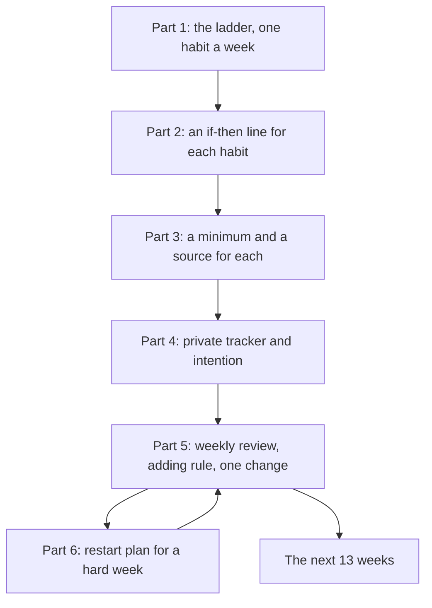

## Your turn

This is the capstone of the course. You will build one 13-week 1% plan from start to finish, and then review it honestly. You will not need any new tools. You will use the tools you already have, in order: the ladder from module 1, the if-then plans from module 2, the minimums from modules 3 to 6, the daily-life habits of modules 7 to 14, and the tracker, the review and the restart from module 15.

Your ladder may draw from anywhere in the course. Most people's first thirteen weeks are mostly the worship habits of modules 2 to 6, because the prayers are the anchors everything else leans on. But a habit from modules 7 to 14, such as Bismillah and Alhamdulillah at meals, a weekly hygiene day, or a planned sentence against backbiting, can sit on your ladder too. Choose by the same three questions as always: what you nearly do already, what it attaches to, and its smallest version. The rest of the course is your map for the thirteen weeks after these, and the ones after that.

Be clear about the calendar. At the course's pace, most learners reach this chapter with three to six weeks of their own plan running, not thirteen. That is expected. Write your plan for all thirteen weeks, review the real weeks you have, and say how many weeks your review covers. If you have not run a plan of your own, or prefer not to use it, review one of the three provided cases below. They count exactly the same.

Your mentor will never ask to see your tracker or your record of worship. The rubric grades your plan and your reasoning only.

## The six parts

Your plan has six parts. Each one comes from a module you have finished.

**Part 1: the ladder.** List the habits you will build, in the order you will add them, one per week. For each one, say what it attaches to. Say which habit you nearly did already, and why it is first. Keep at least one week near the end with no new habit, for steadying.

**Part 2: the habit lines.** For each habit, write one if-then line: the cue and the first action. "If I hear the adhan for Maghrib, then I close the laptop and make wudu." For prayers, name the real obstacle the line answers.

**Part 3: the minimums and sources.** For each habit, write its smallest version, with its size, and one sound source for the habit, with its collection and number. Use the sources in this course, or check any new one for its grading.

**Part 4: the tracker and intention.** Say where your tracker lives, who can see it, how you count (days done, with the minimum counted), and what you write on a missed day. Write your intention line, and your rule for sharing: the idea, not the score.

**Part 5: the review.** Say your review day and time, and your adding rule. Then review your real weeks, or the provided case: the days done for each habit, the habit with the most misses, its cause, and the one change you made or will make.

**Part 6: the restart.** Write what you will do after a hard week, before it comes: the minimums from the next cue, a few words on why, tawbah where you fell short, and what happens to your ladder.

## Worked example: Hamza's first eight weeks

Here is how Hamza wrote parts 5 and 6, at the end of week nine. Parts 1 to 4 are the plan you followed through this course.

**Part 5: the review.** "My review is Friday after Jumu'ah, about ten minutes, and my adding rule is every habit at least five of seven. My review covers eight weeks. Maghrib and Isha with the first takbir: 6 or 7 of 7 every week since weeks one and two. Amana al-Rasul: 7 of 7 every week, including two minimums. Fajr with the first takbir: 2, 4, 6, 6 in weeks four to seven, then 0 in week eight. Quran page: 5 to 7 of 7 in weeks five to seven, with two make-ups before Dhuhr, then 2 in week eight. Morning adhkar: 4 and 6 in weeks six and seven, then 1 in week eight. Dhuhr: 5 of 7 in week seven. The habit with the most misses, before week eight, was Fajr. My notes on its missed days said 'slept 00:30', 'phone in bed', 'deployment'. One cause: late nights. My change in week five: phone on the charger in the hall at 22:00. Fajr rose from 4 to 6 of 7 and stayed there."

**Part 6: the restart.** "Week eight: ill Monday to Wednesday, a wedding Thursday to Sunday. I wrote that next to the week, not a judgement. On Monday evening I restarted every habit at its minimum for two days, and asked Allah's forgiveness for the prayers I delayed without need at the wedding. By Wednesday Fajr and the Quran page were back at full size, and by Friday everything was. My ladder moved back two weeks: Asr in week ten, al-Mulk in week thirteen. My rule for the next hard week: the same, before it comes."

Notice what makes Hamza's review strong. It uses numbers, not feelings. It reads the notes to find one cause, and shows one change and what it did. The bad week is described, not hidden, and the restart is specific: what, when, and what happened to the ladder. Nothing in it is a score to show anyone. It is a plan to keep.

The diagram shows how the six parts connect, from the first habit to the next thirteen weeks.



The loop between parts 5 and 6 is the heart of the plan. Every week the review runs; every hard week the restart runs; and each time, the plan fits your life a little better. The last arrow points beyond the course. A plan that you can review and restart does not end in week thirteen.

## Choosing your plan or case

Use your own plan if you have run it for at least two weeks, and you are willing to describe it in plain terms. You never need to share anything you would rather keep private: you may say "a prayer" instead of naming which one, or describe days done without describing why. If you have not run your own plan, choose the case below that is closest to your life.

## Provided case 1: Usman's office weeks

Usman is 30, a data analyst who works in an office five days a week. He lives with his parents, eight minutes from a mosque. He prays all five prayers, but mostly at home and late. His ladder, as he wrote it: week 1, Isha with the first takbir; week 2, the adhkar after Isha; week 3, Fajr with the first takbir; week 4, one page of Quran after Fajr; week 5, Maghrib; week 6, morning adhkar; weeks 7 and 8, Dhuhr and Asr at the office prayer room. His minimums were not written down. He keeps a streak in a habit app and posts his streak in a group chat on Fridays "to stay accountable".

His first six weeks, days done: Isha 7, 7, 6, 7, 7, 6. Adhkar after Isha 6, 7, 7, 7, 6, 7. Fajr 3, 2, 4, 2 (from week 3). Quran 2, 3, 1 (from week 4). Maghrib 6, 5 (from week 5). Morning adhkar 1 (week 6). His notes are empty, but he remembers that he watches football until about 1:00 on three nights a week. He added a new habit every Monday regardless of the counts. Write his review and his plan for the next seven weeks.

## Provided case 2: Hafsa's home weeks

Hafsa is 26, a freelance translator who works from home, with a one-year-old son. She prays at home. Her ladder: week 1, Dhuhr at the start of its time; week 2, Asr at the start of its time; week 3, the last two verses of al-Baqarah after Isha; week 4, morning adhkar after Fajr; week 5, the adhkar after Dhuhr. Her minimums: the two verses; one dhikr three times. Her tracker is a private card on her fridge, counting days done, with notes.

Her first five weeks, days done: Dhuhr 6, 7, 7, 6, 7. Asr 4, 5, 6, 6 (from week 2), notes: "baby nap ended", "client call". Amana al-Rasul 7, 7, 7 (from week 3). Morning adhkar 5, 3 (from week 4), notes: "baby awake at Fajr" three times. Adhkar after Dhuhr 6 (week 5). Her son was ill in week five, and she says that week "felt like failure", although her counts barely changed. Write her review and her plan for the next eight weeks.

## Provided case 3: Bilal's exam term

Bilal is 20, a university student in a hostel with a mosque on campus. His ladder: week 1, Maghrib with the first takbir; week 2, Isha; week 3, Quran, five verses after Isha; week 4, the adhkar after Maghrib; week 5, Fajr with the first takbir. His tracker is a private note on his phone, counting days done. His adding rule is five of seven.

His first seven weeks, days done: Maghrib 7, 7, 6, 7, 7, 2, 1. Isha 6, 7, 7, 6, 2, 1 (from week 2). Quran 6, 7, 6, 1, 0 (from week 3). Adhkar after Maghrib 7, 6, 1, 1 (from week 4). Fajr 3, 0, 0 (from week 5). Weeks 6 and 7 were exams; he studied in the library until 2:00 most nights, and prayed Maghrib and Isha there, alone and late. He waited to add a habit in weeks 6 and 7, as his rule said, but now feels "the whole plan is gone". Write his review and his plan for the next six weeks.

## How your mentor will read it

Your mentor reads your plan with the table below. The rubric grades your plan and reasoning only, never your faith or your record of worship.

| Part | Met | Partly | Not yet |
|---|---|---|---|
| 1. The ladder | One habit a week, in an order with reasons, each attached to something steady, with a steadying week | An order, but no reasons or no anchors | All habits at once, or no order |
| 2. Habit lines | An if-then line for each habit; prayers name their obstacle | Lines for some habits, or vague lines | No lines |
| 3. Minimums and sources | A sized minimum and a sound source for each habit | Some minimums or sources missing | No minimums, or an unsourced or weak hadith presented as sound |
| 4. Tracker and intention | Private, days done with minimums counted, notes on misses, an intention line and a sharing rule | Two of these missing | A public score, or no tracker |
| 5. The review | Days done for each habit, the lowest one with its cause, and one change with its result or test | A review with no cause, or several changes at once | No review |
| 6. The restart | Minimums from the next cue, a note, tawbah where needed, and the effect on the ladder | A restart with a debt, or no ladder decision | "Start again next month", or none |

**Pass rule:** parts 5 and 6 must be Met, and no part can be Not yet.

## Your five-minute walk-through

When your mentor reads your plan, they will ask you to walk them through it in five minutes, in writing, by voice note or on a call. Spend about one minute on the ladder and why its first habit is first. Spend about two minutes on the review: the numbers, the lowest habit, its cause and your change. Spend about one minute on your restart plan. Use the last minute for what you would do differently in the next thirteen weeks. You do not need slides. Your plan is enough.

## Submit your plan and review

```openquestion
prompt: "Write your 13-week 1% plan and review, from your own plan or one provided case (Usman, Hafsa or Bilal). Include the six parts. First, the ladder: your habits in order, one a week, each with what it attaches to, and a steadying week. Second, an if-then line for each habit. Third, a sized minimum and a sound source for each habit. Fourth, your tracker, how you count, your intention line and your sharing rule. Fifth, your review: your review day, your adding rule, days done for each habit, the habit with the most misses, its cause and one change. Sixth, your restart plan for a hard week, and what happens to your ladder."
required: true
minWords: 300
allowSpeechInput: true
allowUrl: true
urlRequired: false
urlLabel: "Voice note link (optional)"
urlHint: "An audio link your mentor can open without signing in. Audio only is fine."
modelAnswer: "Mentor key. Usman: a Met review names that he added a habit every week regardless of counts (Fajr at 2 to 4 and Quran at 1 to 3 should have paused the ladder under a five-of-seven rule); the cause in his memory is late football nights, which hit Fajr and the Quran page after Fajr together; one change, such as the phone and television off by 22:30 on match nights or watching highlights the next day, aimed at Fajr; minimums written for each habit (for example one page becomes five verses; the morning adhkar become Bismillahilladhi three times); the streak app replaced by days done; the Friday streak post replaced by sharing the method only (Sahih Muslim 1893; Sahih al-Bukhari 6499); the ladder paused until Fajr and the Quran are at five of seven, with Dhuhr and Asr pushed back. Hafsa: a Met review shows that week five was not failure: her counts held, and that is what steady habits look like (Sahih al-Bukhari 2996 for illness, here her son's, may be mentioned only as encouragement, not a ruling); the lowest habit is the morning adhkar, cause her son awake at Fajr; one change, such as saying the minimum while holding him, or moving the morning adhkar to his first nap within the morning; Asr's cause is the nap ending or a call, with a calendar block for client calls; she may add the next habit since all but one are at five or more, or wait one week: either is Met with a reason. Bilal: a Met review reads weeks six and seven as an exam season, not the end of the plan; it restarts every habit at its minimum from the next cue (Maghrib with the first takbir at the campus mosque, five verses becoming three); it notes Fajr never settled because nights were late before exams too; one change, such as a fixed end to library study at 23:00 after exams, or Fajr minimum at the start of its time in the hostel; tawbah where prayers were delayed without need; the ladder resumes with no new habit for two weeks. Common Partly answers across cases: several changes at once; a debt ('read double'); no ladder decision; a source without its number. Not yet: 'start again next month', posting progress, or a weak hadith presented as sound. Do not grade anyone's faith."
```

**Next:** The course checklist, your habit toolkit, a look back at the list you made in module 1, and your plan for the next 13 weeks.
