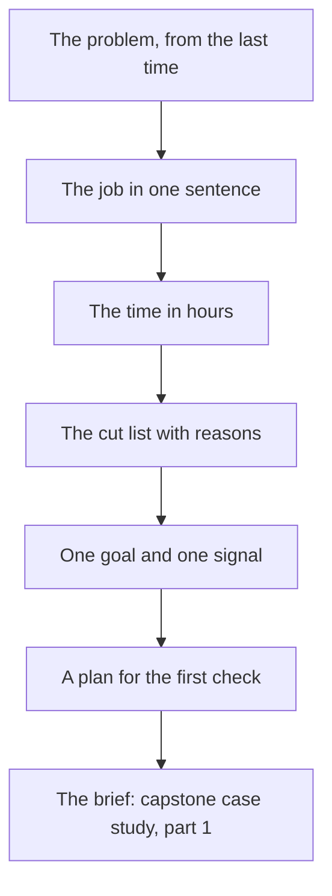

## What you make, and why it matters

You will write one page that answers the questions of this module for a real project. The page holds six things: the problem you heard, the job as one sentence, and your time in hours. It also holds a cut list with a reason for each cut, one goal with one signal you can watch, and a plan for the first check with three to five people. Use your own project, or use Wasel, the provided case further down. Both routes are open to you.

This page is not homework that you finish and forget. It is the first part of your capstone in chapter 7.6. When you build the case study page for your redesign, the problem and the job in this brief become its opening. The signal becomes the way you show that something changed. Writing it now, before you draw any screen, is the point. It is much cheaper to find that you are building the wrong thing on paper than after a week of work.

If your project belongs to a client or an employer, do not put their screens or data into an AI tool, and do not show them in public, without permission. Course 13 teaches that habit in full. Plan for about 40 minutes of writing. The thinking about the problem can take longer if you decide to ask classmates about the last time they were stuck, which is the best way to start. The diagram shows the order of the steps, and how the brief feeds the capstone.



## The steps

1. Ask two or three people about the last time the problem happened, and write the problem in one sentence.
2. Write the job: "When I ..., I want to ..., so that ...", with no feature in it.
3. Set your time in hours, and say how many hours a week that is.
4. List every feature or idea, and sort each into must have, nice to have (marked with a tilde) or not now.
5. For the three cuts that are hardest to accept, write a no with four parts: the item, who it affects, what happens without it, and what you do instead.
6. Write one goal, one signal as "x of y" with a time, and one failure signal.
7. Plan the check: the task in one sentence, three to five people, how you will ask permission, what you will write down, and the date.

Step 1 comes first because everything else depends on it. If the problem is a guess, the job will be a guess, and the cut list will cut the wrong things. Ask about the last time it happened, and listen for a day, a place and what the person tried. If you cannot ask anyone this week, write the problem as a person's story from your own experience and mark it as unchecked.

Step 2 makes the problem small enough to build for. A good job names a situation, an action in the person's own words and a result in their life. Take the app out of the sentence. If it still makes sense, it is a job. If it no longer makes sense, you wrote a feature or a persona.

Step 3 comes before the cut list on purpose. Time is the one thing you cannot add. Count the hours you really have, not the hours you hope for. Classes, work and a weak connection all take time, and your number should still hold in a bad week.

Step 4 is where the time becomes real. For each item ask three questions: does the job fail without it, who is affected, and what does the person do today? Then put the item in one bucket only. If you have more must haves than hours, move something down.

Step 5 teaches you to say no to people, including yourself. A cut with no reason will come back as an argument. A cut with four parts is short, kind and easy to check. Choose the cuts that tempt you most, because those are the ones you will have to defend.

Step 6 turns the brief into something you can test. A signal is something you can watch a person do. Write it as a ratio, such as "4 of 5", because a raw count grows by itself. Add a time when it matters, and add one failure signal, because failure is often easier to see than success.

Step 7 is the part most people skip. Without a plan, the check never happens, and the brief stays only a page. Write the task, choose the people, decide what you will write down, and put a date on it.

## Worked example: Maryam's brief for Halaqa

Maryam wrote her brief in one evening, after she had asked classmates about the last time they were stuck before an exam. Her problem line says that students with an exam close and a topic they do not understand cannot find classmates to revise with. Adel could not tell how to join an online group. Rawan searched for her course and found no group. The brief shows that the stories were different, but the moment was the same.

Her job is the sentence from chapter 1.3: when an exam is a few days away and she is stuck on a topic, she wants to find two or three classmates to revise with tonight or tomorrow, so that she does not study alone. Her time is 12 hours over two weeks, which is 6 hours a week, or about two hours on each of three evenings.

For the cut list, she asked the questions of each of the fourteen features. Group search and create group are must haves, and the call link for online groups is part of create group. Notifications and calendar sync are nice to haves, marked with a tilde. The other ten are not now: chat, voice rooms, streaks, badges, the leaderboard, profile themes, dark mode, polls, file sharing and the AI summary of notes. Her estimate is 8 hours for the must haves and the reshaped screens, and 2 hours for the check. Eight plus two is ten, so 2 of the 12 hours are spare, enough for one small nice to have and not for voice rooms.

Her goal is that a student joins a study group for an upcoming exam. Her signal is how many of five classmates join a group on their first visit, and how long it takes. Her failure signal is pressing Back twice on the first screen and closing the app. She already has a starting point: in her first check of the current app, 2 of 5 joined a group. She writes her target as 4 of 5 in about two minutes, and she writes that a target is a hope and not a promise.

Her plan for the check is simple. The task: "Find a group for Thursday's exam and join it." The people: five new classmates who are revising for an exam. They did not take part in her first check, and they are not Adel or Rawan, because those two know the app. She will ask permission, use her own phone with private chats closed, write down who finished and how long, and not help. The date is the Thursday after the two weeks end.

Here is the choice she got wrong first. In her first draft, the entry for voice rooms said: "Not now: too hard to build." A classmate who read it asked a fair question. Hard for whom? The reason was about Maryam, not about the students, and it did not say what happens without voice rooms. She rewrote it with the four parts. The item: voice rooms. Who it affects: students in online groups. What happens without it: they can still meet, because the real problem Adel had was a missing call link. What she does instead: add a call link to create group, and look again at voice rooms only if students still get stuck. The second version is longer, but it is a reason that Adel could check and accept.

## The provided case: Wasel

If you have no project of your own, write the brief for Wasel. Everything you need is in this section, and nothing needs a laptop. Wasel is a print and copy shop near the university gate, owned by Sami. It is open from 8 am to 6 pm. Black and white pages cost 0.50 shekels a page, colour pages cost 2 shekels a page, and binding costs 5 shekels. An order sent before noon is ready by 4 pm. In exam weeks Wasel gets about 30 to 40 orders a day. Most of its customers are students printing assignments.

Sami's nephew Karam built an order app for Wasel in one evening, with an AI tool. The app has a landing page, an order form with the fields File, Copies, Colour and Pickup time, and an order status page. This module is not about how those screens look. Later modules are. Here you decide what the app is for and what it should not do.

The job, in the course's template, is this: when an assignment is due tomorrow morning and I have no printer, I want to send the file from my phone and collect it printed on my way to class, so that I do not wait in line or miss the deadline.

Sami and Karam have ten ideas on the table. Karam has 6 hours this week, in the evenings, to improve the app. Sort the ideas, with a reason for each, and keep the job in front of you.

1. Upload a file from the phone
2. Choose copies, colour or black and white, and binding
3. Pick a pickup time
4. See the status of an order
5. Show the price total before the student sends the order
6. Pay online
7. Loyalty points for regular students
8. A chat with Sami
9. An AI helper that suggests print settings
10. Dark mode

Notice that Wasel's count of 30 to 40 orders a day is useful to Sami, but it cannot tell him whether the app helped. A student could have walked in and ordered at the counter. A signal for Wasel must be something you can watch a student do with the app. For example: how many of five students send a complete order from their phone on their first visit, and how long it takes.

## Rubric

Your mentor reads your brief with this table. Each part is Met, Partly or Not yet.

| Part | Met | Partly | Not yet |
|---|---|---|---|
| The job | Situation, action and result are written, and no feature is named | All three parts, but a feature, a tool or a kind of person slips in | A part is missing, or it reads like a persona or a feature list |
| Time and cut list | Hours stated, six or more items sorted, every not now item has a four-part no | Hours stated and items sorted, but some nos have only one or two parts | No hours, no cut list, or every item is a must have |
| Goal and signal | One goal, a signal written as x of y with a time, and one failure signal | A signal you can watch, but the ratio, the time or the failure signal is missing | Only a count, such as page views, or only an opinion |
| The check | A one-sentence task, three to five people, permission, notes and a date | A task and people, but permission, notes or a date is missing | No task, or no plan to watch people |

**Pass rule:** no part is Not yet, and at most one part is Partly.

## How your mentor will read it

A mentor reads the job line first. They ask one question of it: if I read this to a friend, would the friend know what to put first on the home screen? If yes, the rest of the page usually holds up. If the job names a feature, such as "I want to use a chat", the mentor will say so before reading further. The same is true if it describes a kind of person. The cut list and the signal that follow have no solid base.

The common weak answer has three marks. The job is a list of what the app does. The cut list says "later" with no reason, or the reason is that the feature is hard. The signal is a count, such as downloads, sign-ups or page views. Each of these feels natural, because they are the first things most builders write. Each one can be fixed with a sentence, which is why the mentor points to them.

The follow-up question mentors often ask is: "What would you do if only 2 of 5 people finished the task?" A good reply says what the fellow would look at first: where the people stopped, and what they said. It also says what they would fix before the second check. It says that they would use different people for it. Another common question is: "What would make you move one item back from not now to must have?" The answer should point to something a person did in the check, not to a feeling.

You can answer by voice with your phone's microphone, and you may add a photo of a handwritten page. A short answer that is honest about what you have not yet checked is better than a long one that pretends everything is known.

```openquestion
prompt: "Submit your one-page brief for your own project, or for Wasel. Include seven parts. 1) The problem, in one sentence, and who told you or how you know. 2) The job as 'When I..., I want to..., so that...'. 3) Your time in hours. 4) Your cut list: at least six items sorted into must have, nice to have and not now, with a four-part no for your three hardest cuts. 5) One goal and one signal written as x of y with a time, and one failure signal. 6) The task and the people for your first check, and how you will ask permission. 7) The date."
required: true
minWords: 150
allowSpeechInput: true
allowUrl: true
urlRequired: false
urlLabel: "Link (optional)"
urlHint: "A link to a photo or document of your brief. Do not include other people's names or private messages."
modelAnswer: "Mentor key for Wasel: The job must match the case (send the file from the phone, collect on the way to class, no waiting or missing the deadline) and name no feature. The time is Karam's 6 hours this week. A good sort puts the steps of the job in must have: upload a file, choose copies and colour, pick a pickup time, and see the order status. The price total is a fair nice to have. Online payment, loyalty points, a chat with Sami, the AI helper and dark mode are not now, each with a four-part no, for example: loyalty points, which affect regular students only, change nothing about sending a file tonight, so they wait. Accept a different sort for status and for the price total if the reason ties to the job. The goal is that a student sends an order from their phone; the signal is x of 5 students who send a complete order on their first visit, with the time it takes; the failure signal is giving up before sending or asking Sami for help. The common wrong answer uses '30 to 40 orders a day' as the signal, which is a count. The check names a task, three to five students, permission and a date. Model answer for a different case: Jad runs a sports club's pitch booking app (fictional). Problem: members miss matches because the next match's time and place sit inside a chat; three members told him so. Job: when the next match is coming and I am not sure of the time or the pitch, I want to see both in one place, so that I do not go to the wrong pitch. Time: 8 hours over two weeks. Must have: next match card. Nice (~): reminders. Not now: league table, photos, shop. No for league table: it affects keen members, nothing breaks for finding the next match, and it stays on the later list. Goal: members find the next match. Signal: x of 5 members who name the time and pitch within 10 seconds of opening the app. Failure: opening the chat to look. Check: five members on Thursday, with permission, one task, no help."
```

**Next:** In 1.7 you answer five graded cases on problems, jobs, scope and signals.
