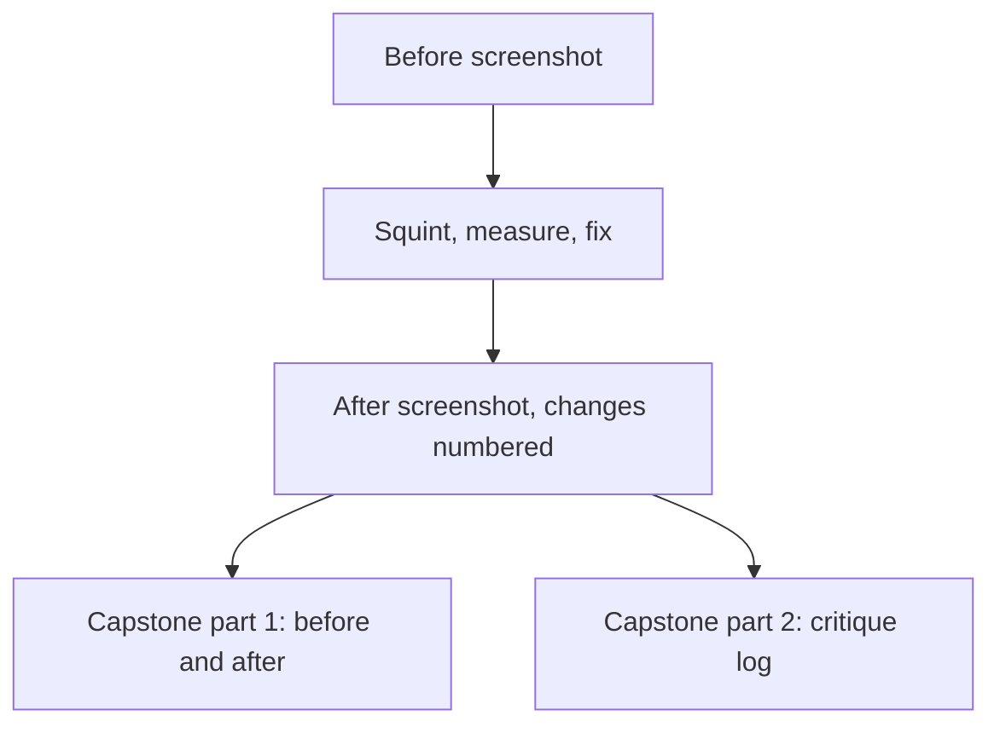

## What you make

You fix one screen. You hand in a screenshot of it before, a screenshot after, the numbers you measured, and a numbered list of changes. Each number appears on the after screenshot, and each has a reason: the rule it follows and what it did to the screen.

This output becomes part of your capstone in chapter 7.6. The capstone asks for before and after screenshots of at least three screens, with every change numbered. This is the first of them, and the numbered reasons become the start of your critique log. A mentor reads it now so that you learn what a good reason looks like before you have to write ten of them.

Plan about 40 minutes. You need a screen of your own project, and a way to take a screenshot on your phone or laptop. If you have no project yet, use the Wasel page described below. You need no design tool. Paper and a phone camera work, and so does a text list of the changes. The privacy habit from course 13 applies: if the screen belongs to a client or an employer, do not share it without their permission.



## The steps

**Step 1: choose one screen and keep a before screenshot.** Pick the screen a person sees first, or the screen where they must act, such as a sign-up or an order. Take the screenshot before you touch anything. You cannot show a change you did not record, and the first version is the evidence that you changed something.

**Step 2: squint and write down what comes first.** Use the squint test from chapter 2.2. Write one sentence for what you see first, and one for what should come first according to the job in module 1. If the two sentences differ, you have found your main problem. Writing it down matters because a mentor cannot see your eyes.

**Step 3: list what is on the screen in numbers.** Write down the text sizes and the body line height. Write down the gaps inside groups and between groups. Write down every text colour with its background. Then measure each text pair with the formula from chapter 2.5, or with a contrast checker you trust. Numbers show you problems that your eyes forgive, such as a grey that is 4.48 to 1.

**Step 4: fix in four passes and number each change.** First hierarchy: choose one first thing and give it the strongest signals. Then type: three sizes at most, body 16 or more with a line height of about 1.5. Then space: pick one step, put less space inside groups and more between them. Last colour: one accent for the main action, every text pair at 4.5 to 1 (3 to 1 for large text), and no message in colour alone. Work in this order because a later pass should not undo an earlier one. Write a short line each time you change something, and give it the next number.

**Step 5: squint and measure the after.** Take the after screenshot. Squint again and write what you see first. Measure the text pairs you changed. If two things still compete, quiet one of them. Stop when the squint matches the first sentence you wrote in step 2.

**Step 6: write a reason for every number.** For each change, write three parts in one or two lines. Write the rule you followed and what you saw change. For at least one change, also write what you gave up. A change with no reason is a taste choice, and taste is what module 4 teaches you to explain.

## A worked example: Maryam fixes Halaqa's Find a group screen

Maryam works on the screen where her first check with five classmates went badly. In that check, 2 of 5 classmates joined a group in their first visit. She keeps the before screenshot. It shows five bold lines of text at 14 and three outlined buttons of the same size. The description is 13 with a line height of 1.2. The gap between everything is 8.

Her squint sentence for step 2 is: "I see an even grey and no first thing." The sentence for what should come first is: "The soonest group with seats left, and how to join it." Those two do not match, so hierarchy is her first pass.

In step 3 she lists her numbers. The time and place are #999999 on white, which is 2.85 to 1. The "2 seats left" text is amber, #F59E0B on white, which is 2.15 to 1. Both fail the 4.5 bar. Her sizes are 14, 13, 12 and 11, which is four sizes and none of them 16.

Here is the choice she got wrong first. For the Join button she chose amber, because it was the brightest colour and the squint test showed it clearly. She wrote white text on the amber and moved on. When she measured the pair in step 5, it was 2.15 to 1. The squint test had shown that the button was strong, but it had not shown that the label was unreadable. She changed the button to blue, #2563EB, with white text. That pair is 5.17 to 1. She now measures every new colour pair before she uses it. She also noticed that her reason for blue was the number, not what blue is said to mean.

Her final list has eight numbered changes. (1) The group's name goes from 14 to 22 bold, so it comes first. (2) Join becomes the only filled button, and "Create a group" becomes a small quiet button, so the squint shows two shapes. (3) The text sizes go to three: 22, 16 and 13. (4) The description goes from 13 at 1.2 to 16 at 1.5, which is the common start for body text. (5) The time and place go from #999999 to #595959, which is 7.00 to 1. (6) "2 seats left" goes from amber to dark semibold at 16, so colour is not carrying it and the contrast passes. (7) Her step is 4. The lines inside a group are 4 apart and the gap between groups goes from 8 to 16, so three groups show. (8) The feature buttons move into one line that says chat, polls and voice rooms are in the menu, so the screen shows what the job needs.

For change 2 she wrote what she gave up. "Create a group" is now small, and a host who wants to start a group has to look for it. She decided that was acceptable because most visits are to join a group, and she will watch for it when she repeats the check with classmates after module 3. She did not claim a result. This practice only changes how the screen looks and reads, and her next check measures whether more people join.

## The provided case: Wasel's landing page

Use this case if you have no project, or if you prefer not to share your own screens. Wasel is a print and copy shop near a university gate. It is open from 8 am to 6 pm. Black and white pages cost 0.50 shekels each, colour pages 2 shekels, and binding 5 shekels. An order sent before noon is ready by 4 pm. The shop's owner asked a relative to build an order page in one evening with an AI tool. The job of the page is: "When an assignment is due tomorrow morning and I have no printer, I want to send the file from my phone and collect it printed on my way to class, so that I do not wait in line or miss the deadline."

The landing page is drawn on a phone 360 wide, on a white page. From top to bottom it has a purple glow block, then three cards, then the facts. Every gap on the page is 8. In module 5 you will look at the words. Here you keep the words and fix hierarchy, type, space and colour. The table gives every part with its size, colour and measured ratio. Each ratio comes from the WCAG formula.

| Part | Size and weight | Colour pair | Ratio |
|---|---|---|---|
| Pill "AI-powered" | 11 regular | #A78BFA on #EDE9FE | 2.29 to 1 |
| Headline "Revolutionize your printing experience" | 26 bold | white on the glow, #8B5CF6 at the left end | 4.23 to 1 |
| Same headline | 26 bold | white on the glow, #E879F9 at the right end | 2.46 to 1 |
| Line "Seamless, powerful and effortless." | 14 regular | white on the glow | 4.23 to 2.46 across the glow |
| Button "Get started" | 13 bold | white on #A78BFA | 2.72 to 1 |
| Cards "Fast", "Secure", "Smart" | 14 bold, all equal | #333333 on white | 12.63 to 1 |
| Facts: the three prices, the 4 pm promise and the opening hours | 11 regular, line height 1.1 | #999999 on white | 2.85 to 1 |

The facts at the bottom are the real answer to the customer's job, and they are the smallest, palest text on the page. Your task is to decide what comes first for a student who needs a printout by tomorrow, and to make the page match your decision. You can redraw the page on paper, list the changes as text, or use any tool you like. Choose your first thing, three sizes at most, a spacing step, and colours that pass. For colours that pass with white text, you may use #7C3AED (5.70 to 1) or #2563EB (5.17 to 1). For text on white, #595959 gives 7.00 to 1 and #333333 gives 12.63 to 1.

## The rubric

| Criterion | Met | Partly | Not yet |
|---|---|---|---|
| One thing first | Squint before and after, first thing named and fits the job | After squint written, but the first thing is unnamed or does not fit | No squint check written |
| Type and space | Three or fewer sizes, body 16+ at about 1.5, named step, inside smaller than between | Two of those four are true | One or none is true |
| Colour and contrast | Every text pair measured and written, all at 4.5 (3 for large text), nothing by colour alone | All pairs measured, but one still fails or one is unmeasured | Pairs not measured, or several fail |
| Reasons | Every change numbered on the after screenshot, with a rule and effect; one gives up something | Every change has a reason, but no rule or nothing is given up | Several changes have no reason |

**Pass rule:** no part is Not yet and at most one part is Partly.

## How your mentor will read it

Your mentor looks at the after screenshot first, squints at it, and says what they see first. Then they read your sentence from step 2. If the two agree, the hierarchy works. After that they check the numbers: the sizes, the step, and the contrast ratios. They will usually repeat one ratio with the formula to see that you measured it and did not guess.

The most common weak answer says "I made it cleaner and more modern" and lists changes with no numbers. A second weak answer makes everything bigger, which leaves an even grey at a larger size. A third fixes the contrast of the grey text and leaves the three equal cards and the glow competing with the real answer. A fourth rewrites the words of the page. That is module 5's work, and here it hides whether the layout was fixed.

The follow-up question your mentor usually asks is: "Which one change mattered most, and how do you know?" A strong reply points to something visible. It can be the squint before and after, or a ratio that went from 2.85 to 7.00. A weak reply says "it looks better". You can answer in a short voice note.

## Submit your fixed screen

Write the six parts in order. Short sentences and a numbered list are fine. You can dictate your answer with your phone's microphone, and add a link to your screenshots if you have one.

```openquestion
prompt: "Hand in your fixed screen, for your own project or for Wasel's landing page. Say which. 1. Your squint sentences: what you saw first before, and what should come first. 2. The numbers before: the text sizes, the gaps inside and between groups, and every text colour pair with its ratio. 3. Your numbered changes, each with the rule it follows and what you saw change. 4. The numbers after: the sizes, your spacing step, and the ratio of every pair you changed. 5. What you saw first in your after squint. 6. One thing you gave up, and one change you tried that did not work and why."
required: true
minWords: 220
allowSpeechInput: true
allowUrl: true
urlRequired: false
urlLabel: "Link to your screenshots (optional)"
urlHint: "A folder or album with your before and after screenshots. Not needed for the Wasel case if you describe your changes in words."
modelAnswer: "Mentor key for Wasel. Must be present: (1) a named first thing that fits the job, for example the promise to send a file and collect it printed by 4 pm with one clear button, or the headline and the button; (2) three sizes at most, body and facts at 16 or more with a line height of about 1.5; (3) a named step, such as 4, with less space inside groups than between them (for example 4 inside and 16 or 24 between); (4) every text pair measured, none under 4.5 (3 for large text): the facts move from 2.85 to at least 4.5, for example #595959 at 7.00, the button label moves from 2.72, for example white on #7C3AED at 5.70, the pill from 2.29, the headline off the glow or onto a darker glow; (5) numbered changes, each with a rule; (6) one thing given up. Accept any first thing with a reason that fits the student's job. Common wrong answers: the facts fixed but the glow and three equal cards still competing; everything made larger; the words rewritten. Model answer for a different case. Hiba builds a booking page for a sports club. Before: I saw the club name first, large and purple; what should come first is the next free court time. Numbers before: sizes 30, 18, 16, 14, 13 and 11; gaps all 10; court times 13 in #AAAAAA on white, 2.32 to 1; Book button white on #A78BFA, 2.72. Changes: 1. Next free time 13 to 24 bold: most important thing largest. 2. Club name 30 to 13 grey: now quiet. 3. Sizes to 24, 16 and 13. 4. Times #AAAAAA to #595959, 7.00 to 1. 5. Book white on #1D4ED8, 6.70 to 1. 6. Step 4: inside 4, between 16. After: sizes 24, 16, 13; I saw the free time first, then Book. Given up: the club name is easier to miss, and I will ask a member whether they notice it. One change that failed: I tried 8 inside and 8 between; the squint showed one smear."
```

**Next:** In chapter 2.7 you answer five graded cases on hierarchy, type, space and contrast.
