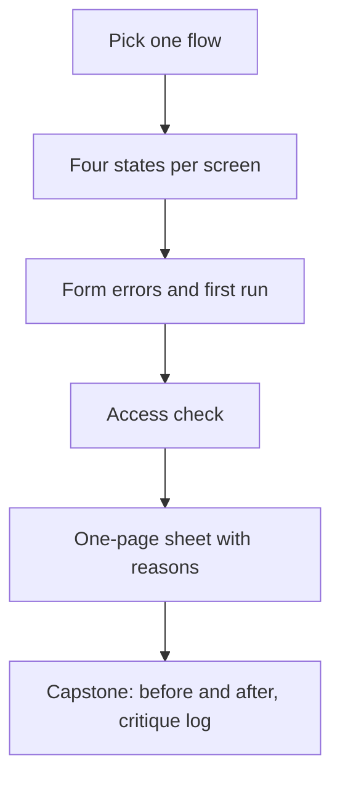

## What you make

You make a one-page sheet of the unhappy paths of one flow. A flow is the series of screens a person passes to finish one job, such as finding a study group and joining it. The sheet says, in the exact words the person would read, what each screen shows when it is empty, loading or broken. It also covers the form errors, the first run and an access check. For every choice it says what you gave up.

This sheet is an input to your capstone in 7.6. The screens you fix here are good candidates for its before and after screenshots and its critique log. The sheet needs no pictures. Exact words and a photo of a paper sketch are enough. Never put a client's or an employer's screens or data in your answer without permission. Course 13 teaches that habit.



Each step feeds the next, and the last box is why the sheet exists.

## The steps

1. Choose one flow and list its screens.

Pick one job and the three to five screens a person passes to finish it. Write the screens in order, with one line about what each one shows.

2. Write the three unhappy states of every screen that shows data.

Write the empty, loading and error states in your exact words, using the order of checks from 3.2. For loading, note how long the wait can last on weak data, and choose the indicator by that length. "Add a loader" is not a design. A person on weak data reads the words.

3. Take the one form in the flow and write it again.

Write each label, each hint and at least two error texts, using the patterns from 3.3. For each error, say when it appears and when it clears. Then say what happens to the person's input if sending fails.

4. Write the first run.

Say which screen a new person sees first, what the valuable moment is, and how many steps lie between opening the app and that moment. If you need help text, write it as a hint beside one control. Do not write a tour.

5. Run the access check on the flow.

Answer seven questions with "yes" or with the fix. First, are the targets about 44 to 48, or at least 24 with space? Second, does the Tab order follow the page, as in the 3.4 picture? Third, is there a visible focus style? Fourth, does colour carry a message alone, and is text at least 4.5 to 1 (use the grey table in 2.5)? Fifth, does every meaningful image have words and every decoration an empty alt? Sixth, does each motion have a job and a reduced-motion version? Seventh, does the layout fit 320 pixels, and what moves in Arabic?

6. Cause the unhappy paths on purpose.

Switch the phone to flight mode before you open the screen, to see the error. For the wait, open the screen where the signal is weak, such as a stairwell. Clear the data to see the empty state. Type a bad value to see the form errors. To check the Tab order, list the controls in the order the page code gives them. Or ask a friend with a laptop to press Tab and read the order aloud. Then search the style sheet for `outline: none` to check focus. Nothing here needs developer tools.

7. Write the one-page sheet, with a reason and a cost for each choice.

Put the work in one table with four columns: screen, state, the exact words, and what the person can do next. Under it, write three lines of reasons, one for each choice that cost you something. A choice with no cost is rarely a choice.

## Worked example: Maryam's Halaqa

Maryam chooses the flow "find a group for Thursday's exam and join it". It has three screens: the list of tonight's groups, a group's page with the Join button, and the Start a group form for the case when nothing fits.

On the list screen she writes the three states. For loading she writes a spinner, "Finding groups...", a bar that reads "Loaded 3 of 8 groups", and the line "Your connection is slow. This can take about 12 seconds." She picks a bar and a line because Bashar's wait in the library was 12 seconds, over the 10 second limit from 3.2. For the error she writes "Groups did not load. The connection dropped before the list arrived." with a Try again button.

For the empty state she first writes "No results. Try again." This is the choice she got wrong first. In her next check Bashar taps Try again three times, waiting for a list that does not exist. Empty is not an error, because nothing failed. She rewrites it: "No groups yet. A group has a time, a place and seats. You can start one in a minute." with a Start a group button.

On the group page, tapping Join shows a spinner with "Joining the group..." for about two seconds. It is her one motion, and it has a job. For a reader who asked for reduced motion, she shows a pill that says "Joining" and a line of words. She also writes the failure that only happens in real life: the last seat is taken while the student is deciding. The message is "This group just filled. Two other groups meet tonight." with a See them button.

In the form she writes labels above the four fields: Course, When, Where and Seats. Under When the hint is "For example, tomorrow 5 pm". Under Where it is "Library, online or cafe". For Seats the error is "Seats must be 1 or more. Others need room to join." It shows when the student leaves the field and clears when the value is valid. If sending fails, the message is "Your group was not saved. The connection dropped. Everything you typed is kept." That forces her to store a draft on the phone, about an hour of work, and she says so in her reasons.

For the first run she deletes the four-step tour. The first screen is tonight's groups, with Join and the hint "Tap Join to hold a seat." The steps to the first Join are three: open, see the groups, tap Join.

Her access check finds three fixes. The Join button was 36 by 36 pixels, so she makes it 44 pixels tall and full width. Reading the page code, she finds that focus reaches Seats before Where, because she had reordered the fields with CSS. She moves them in the code. In the Arabic card the Join button moves to the left, but her CSS keeps a gap on the wrong side. She changes margin-left to margin-inline-start. She tested each state by causing it, and her reasons list what she gave up: the tour, the loading shimmer, and an hour for a new feature.

## The provided case: Wasel

If you have no project, use Wasel, a print and copy shop near the university gate. It is open from 8 am to 6 pm. Black and white pages cost 0.50 shekels each, colour pages cost 2 shekels each, and binding costs 5 shekels. Orders sent before noon are ready by 4 pm. In exam weeks the shop gets about 30 to 40 orders a day. The job: a student with an assignment due tomorrow and no printer sends the file from a phone and collects it printed on the way to class.

Sami's nephew Karam built the order app in one evening with an AI tool. Two screens belong to this practice. The order form has four fields that show only a placeholder: "File", "Copies", "Colour?" and "Pickup time". It has no hints and a small "Submit" button. When something is wrong, the field gets a red border and one message at the top says "Invalid input". The order status screen shows a spinner with no words that never ends on a slow connection. While orders load it says "No orders". When the upload fails it says "Something went wrong", and the file is lost.

Your customer is a student, Anwar, who must hand in a 24-page assignment tomorrow at 8:30 am. At 11 am, in the library, on weak data, he wants 3 black and white copies. The printing is 24 times 3 pages, which is 72 pages, so 36 shekels. He sends the order, and the connection drops during the upload.

These facts from the code and the style sheet answer the seven access questions:

- Submit is 80 by 28 CSS pixels. The two choices under "Colour?" are round buttons, 16 by 16 pixels with 6 pixels between them.
- The page shows File, Copies, Colour?, Pickup time, Submit. The code lists File, Pickup time, Copies, Colour?, Submit.
- The style sheet sets `outline: none` on every field and button and adds no other focus style.
- Errors show as a red border only. The placeholder grey is #999999 on white, which is 2.85 to 1.
- The upload icon that opens the file picker has no name. A decorative wavy line under the title has the alt text "wave".
- The only motion is the status spinner. It turns forever and has no reduced-motion rule.
- The page was drawn for a wide desktop first. At 320 pixels wide the Pickup time field runs off the right edge. The page is English only, left to right, with no `dir`, and the style sheet puts `margin-left` on every label.

Do steps 2, 3, 4, 5 and 7 for Wasel on these two screens. For step 4, a new customer's valuable moment is sending a first order, so say how the first screen leads to the order form. Write your answers as the design you would give Wasel. Use only the facts above and do not invent prices or times. When a choice needs a fact the case does not give, such as what happens to an order sent after noon, write "ask the shop" in your reasons.

## Rubric

Your mentor reads your sheet with this table. Each row asks what they can see in your words.

| Part | Met | Partly | Not yet |
|---|---|---|---|
| Four states | Empty, loading and error in exact words for every data screen; none leaves the person guessing | One state missing on one screen, or one state with no words about what is happening | Two or more missing, or "Something went wrong", a bare spinner or a blank is kept |
| Form | Visible labels, a hint, two errors in words with the fix, when each shows, and input kept after a failed send | Errors in words, but the timing, the hint or the kept input is missing | A placeholder kept as the label, an error by colour only, or "Invalid input" kept |
| First run | The first screen, the valuable moment and the steps between are named; help sits beside a control, with no tour | The first screen and the moment are named, but the steps or the help are missing | A tour or an empty first screen is kept, or the valuable moment is not named |
| Access and reasons | All seven answered from the stated facts or your own check, with the fix; each choice has a reason and a cost | Five or six questions answered, or reasons without a stated cost | Four or fewer answered, or no reasons |

**Pass rule:** no part is Not yet, and at most one part is Partly.

## How your mentor will read it

Your mentor reads the exact words first, because the words are the design. In each state they ask one thing: does the person know what is happening and what to do next? The common weak answer is advice without words, such as "add a loading indicator, show friendly errors". The follow-up question is usually: "It is second 3, and Bashar is on a weak connection. What does he see, what does he read and what can he do?"

## Submit your sheet

Write your answer in the order of the steps. Short sentences and lists are fine, and you can dictate it by voice. Put quotation marks around every piece of screen text.

```openquestion
prompt: "Hand in your sheet for one flow, from your project or from Wasel. 1) The flow and its screens, in order. 2) For each screen that shows data, the empty, loading and error states in your exact words. 3) One form: its labels, hints, at least two error texts, when each error shows and what happens to the input if sending fails. 4) The first run: the first screen, the valuable moment and the steps between. 5) Your answers to the seven access questions, and three choices with the reason and what you gave up. For Wasel, answer for the order form and the order status screen."
required: true
minWords: 200
allowSpeechInput: true
allowUrl: true
urlRequired: false
urlLabel: "Link (optional)"
urlHint: "A folder of screenshots or sketches, or a page that holds your sheet. Not needed for Wasel."
modelAnswer: "Mentor key for Wasel. Order status screen. Loading: a spinner with words. For the upload, a bar with a percentage, for example 'Sending your file: 45%. About 20 seconds left.' 'No orders' must never show while orders load. Empty: 'You have no orders yet. Send your first file.' with a button 'Send a file'. This is not an error. Error: 'Your file did not send. The connection dropped. Your file and settings are kept. Try again.' The file stays chosen. Order form: labels above the fields (File, Copies, Colour or black and white, Pickup time). Hints such as 'Orders sent before noon are ready by 4 pm' and 'Black and white is 0.50 shekels a page, colour 2'. Errors in words go under their field with the fix. Examples: 'Choose a file to print' and 'Copies must be 1 or more'. Each shows after the person leaves the field and clears when valid. No 'Invalid input'. A full-width button 'Send my order'. First run: the first screen shows the upload button and the 4 pm promise, with a hint beside the button and no tour. The steps are open, choose a file, send. The seven access answers must come from the stated facts. One: Submit at 80 by 28 meets the AA floor of 24 but is under 44 tall, so make it full width and at least 44 tall. The Colour? buttons at 16 by 16 with 6 between fail AA, because the 24 pixel circles around centres 22 apart overlap. Grow them to about 44 with space. Two: the code order puts Pickup time before Copies, so move the fields in the code. Three: remove outline: none and add a :focus-visible style. Four: show each error in words under its field. The placeholder #999999 at 2.85 to 1 fails 4.5 to 1, so use labels and a darker grey such as #767676 for hints. Five: give the upload icon the name 'Choose a file', and give the wavy line an empty alt. Six: the spinner has a job but needs words. Under reduced motion it needs a still indicator with words. Seven: build for 320 pixels so Pickup time fits, use margin-inline-start, and set dir when an Arabic version exists. Reasons with costs: for example keeping the file after a failed upload costs storage and time. Accept different wording if every state says what is happening and what to do next. For a pickup time after noon the case gives no promise, so 'ask the shop' is a good answer. The common wrong answer says 'add a better spinner' and 'friendly errors' with no words. Model answer for a different case. A volunteer builds a queue page for a clinic desk. Her flow has two screens, the queue and 'Add a patient'. Queue loading: 'Loading the queue...' and, over 10 seconds, a bar with 'About 14 seconds'. Empty: 'Nobody is waiting. Add the first patient.' with a button. Error: 'The queue did not load. The connection dropped. Try again.' Form: labels above the fields, and the error 'Enter a name.' shown after the field is left. Input is kept if sending fails. First run: the queue itself, with a hint beside the Add button. Access: 48 tall buttons, status as words and colour. She names what she gave up: a welcome page, and an hour spent on the saved draft."
```

**Next:** In 3.8, a quiz of five cases checks the habits from this module on fresh examples.
