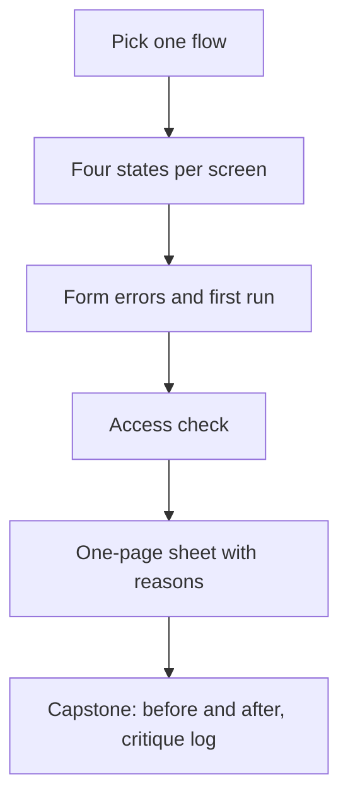

## What you make

You make a one-page sheet of the unhappy paths of one flow. A flow is the series of screens a person passes to finish one job, such as finding a study group and joining it. The sheet says, in the exact words the person would read, what each screen shows when it is empty, loading or broken. It also says how the form handles a mistake, what a brand-new person sees first, and which access checks the flow passes. For every choice it says what you gave up.

This sheet is an input to your capstone in 7.6. The capstone asks for before and after screenshots of at least three screens, each change numbered, and a critique log with a reason for each change. The screens you fix here are good candidates for both, because the unhappy paths are where the before and after differ most. The sheet needs no pictures. Exact words and a sketch on paper are enough, and a photo of the sketch counts. If your project is for a client or an employer, do not put their screens or data in your answer without permission. Course 13 teaches that habit.



The diagram shows the order of work. Each step feeds the next: you cannot write a good error until you know the screen, and you cannot say what you gave up until you have made the choices. The last box is the reason the sheet exists. Everything on it can become a numbered change in the capstone.

## The steps

1. Choose one flow and list its screens.

Pick one job and the three to five screens a person passes to finish it. One flow is enough because the habits of this module repeat on every screen, and a small flow can be finished in about 40 minutes. Write the screens in order, with one line about what each one shows.

2. Write the four states of every screen that shows data.

For each such screen, write the empty, loading and error states in your exact words, using the order of checks from 3.2: loading first, then error, then empty. For loading, note how long the wait can last on weak data, and choose a spinner with words, or a bar with a time, by that length. The full state you already have. The reason to write exact words is that "add a loader" and "show an error message" are not designs. A person on weak data reads the words.

3. Take the one form in the flow and write it again.

Write each label, each hint and at least two error texts, using the patterns from 3.3. For each error, write when it appears, which is after the person leaves the field, and when it clears, which is as soon as the value is valid. Then write what happens to the person's input if sending fails. This is where forms lose people, so the words and the timing matter more than the look.

4. Write the first run.

Say which screen a new person sees first, what the valuable moment is, and how many steps lie between opening the app and that moment. If you need help text, write it as a hint beside one control. Do not write a tour. The reason is the arithmetic from 3.6: every step in front of the valuable moment is a place where the person can stop.

5. Run the access check on the flow.

Ask seven questions of each screen. Are the targets about 44 to 48? Can you reach every control with a keyboard? Is the focus visible? Does colour carry meaning alone? Does every meaningful image have words and every decoration an empty alt? Does any motion have a job and a reduced-motion version? Does the screen work from the small size first, and in right to left? Answer each one with "yes" or with the fix. These are the questions of 3.4 and 3.5.

6. Cause the unhappy paths on purpose.

Switch the phone to flight mode before you open the screen, to see the error. In a browser, use the developer tools to slow the connection, to see the wait. Clear the data to see the empty state. Type a bad value to see the form errors. Watching your own screen fail is the only way to find the state you forgot. If a classmate can try the first run while you watch quietly, as in 1.5, do that too.

7. Write the one-page sheet, with a reason and a cost for each choice.

Put the work in one table with four columns: screen, state, the exact words, and what the person can do next. Under the table, write three lines of reasons, one for each choice that cost you something. Say what you gave up. A choice with no cost is rarely a choice. The capstone's critique log asks for the same things: what was wrong, the rule, the change and what was given up.

## Worked example: Maryam's Halaqa

Maryam chooses the flow "find a group for Thursday's exam and join it". It has three screens: the list of tonight's groups, a group's page with the Join button, and the Start a group form for the case when nothing fits.

On the list screen she writes the three states in her exact words. For loading she writes a spinner, "Finding groups for Data structures...", a bar that reads "Loaded 3 of 8 groups", and the line "Your connection is slow. Your search is kept." She picks a bar and a line because Bashar's wait was 12 seconds, over the 10 second limit from 3.2. For the error she writes "Groups did not load. The connection dropped before the list arrived. Your search is kept." with a Try again button. For the empty state she first writes "No results. Try again." She had copied her error pattern.

Her next check with Bashar shows the problem. He taps Try again three times, waiting for a list that does not exist. Empty is not an error, because nothing failed. She rewrites it: "No groups for Data structures yet. A group has a time, a place and seats. You can start one in a minute." with a Start a group button. This is the choice she got wrong first. The fix cost only a little thought: the empty state says why it is empty and offers a start, and the error state says what failed and offers a retry.

On the group page, tapping Join shows a spinner with "Joining the group..." for about two seconds. It is her one motion, and it has a job. For a reader who asked for reduced motion, she shows a pill that says "Joining" and a line of words. She also writes the failure that happens only in real life: the last seat is taken while the student is deciding. The message is "This group just filled. Two other groups meet tonight for Data structures." with a See them button. Without it, the student would be stuck after deciding.

In the Start a group form she writes labels above the fields. Under Day and time she writes the hint "For example, tomorrow 5 pm". For Seats she writes the error "Seats must be 1 or more. Others need room to join." The error shows when the student leaves the Seats field and clears as soon as the value is valid. If sending fails, the message is "Your group was not saved. The connection dropped. Everything you typed is kept." That one line forces her to store a draft on the phone, about an hour of work, and she says so in her reasons.

For the first run she deletes the four-step tour. The first screen is tonight's groups, with Join and the hint "Tap Join to hold a seat. You can leave any time." The steps from opening the app to the first Join are three: open, see the groups, tap Join.

Her access check finds two fixes. The seats showed only a green or red dot; she keeps the colour and adds the words "Full" and "2 seats left". Her icon buttons were 32 pixels wide; she pads them to 48. She tested each state by causing it: flight mode for the error, a slowed connection for the wait, and a cleared list for the empty state. In her reasons she lists what she gave up: the welcome tour, the shimmer on the loading boxes, and an hour that she could have spent on a new feature. Her sheet fits on one page.

## The provided case: Wasel

If you have no project, or you want to practise on a case that is fully written out, use Wasel. Wasel is a print and copy shop near the university gate. It is open from 8 am to 6 pm. Black and white pages cost 0.50 shekels each, colour pages cost 2 shekels each, and binding costs 5 shekels. Orders sent before noon are ready by 4 pm. In exam weeks the shop gets about 30 to 40 orders a day, mostly from students who print assignments. The job a customer hires the app for is written in the course template:

> "When an assignment is due tomorrow morning and I have no printer, I want to send the file from my phone and collect it printed on my way to class, so that I do not wait in line or miss the deadline."

The shop's order app was built in one evening with an AI tool. Two of its screens belong to this practice. The order form has four fields that show only a placeholder: "File", "Copies", "Colour?" and "Pickup time". It has no hints. It has a small button that says "Submit". When something is wrong, the field gets a red border and one message at the top says "Invalid input". The order status screen shows a spinner with no words, and on a slow connection the spinner never ends. While orders are still loading, it says "No orders". When the upload fails, it says "Something went wrong", and the file is lost, so the customer must choose it again.

Your customer is a student, Anwar, who must hand in a 24-page assignment tomorrow at 8:30 am. At 11 am, in the library, on weak data, he wants 3 black and white copies. At 0.50 shekels a page, the printing is 24 times 3 pages, which is 72 pages, so 36 shekels. He sends the order, and the connection drops during the upload.

Do steps 2, 3, 4 and 7 for Wasel on these two screens, and do step 5 as far as the facts allow. For step 4, a new customer's valuable moment is sending a first order, so say how the first screen leads to the order form. You cannot try the real app, so write your answers as the design you would give Wasel. Use only the facts above and do not invent prices or times. Sometimes a choice needs a fact the case does not give, such as what happens to an order sent after noon. Then write "ask the shop" in your reasons instead of guessing.

## Rubric

Your mentor reads your sheet with this table. Each row asks what they can see in your words.

| Part | Met | Partly | Not yet |
|---|---|---|---|
| Four states | Empty, loading and error in exact words for every data screen; none leaves the person guessing | One state missing on one screen, or one state with no words about what is happening | Two or more missing, or "Something went wrong", a bare spinner or a blank is kept |
| Form | Visible labels, a hint, two errors in words with the fix, when each shows, and input kept after a failed send | Errors in words, but the timing, the hint or the kept input is missing | A placeholder kept as the label, an error by colour only, or "Invalid input" kept |
| First run | The first screen, the valuable moment and the steps between are named; help sits beside a control, with no tour | The first screen and the moment are named, but the steps or the help are missing | A tour or an empty first screen is kept, or the valuable moment is not named |
| Access and reasons | All seven questions answered with yes or a fix; each choice has a reason and a stated cost | Five or six questions answered, or reasons without a stated cost | Four or fewer answered, or no reasons |

**Pass rule:** no part is Not yet, and at most one part is Partly.

## How your mentor will read it

Your mentor reads the exact words first, because the words are the design. In each state they look for one thing: does the person know what is happening and what to do next? They check that the empty state is not written as an error, and that "Something went wrong" and "Invalid input" are gone. Then they read your reasons. A choice with a cost, such as an hour spent to keep a draft, shows that you decided on purpose.

The common weak answer is advice without words: "add a loading indicator, show friendly errors, validate the inputs". It sounds right, and it could be written without opening the screen. A strong answer could be handed to a developer, who would know exactly what to put on the screen.

The follow-up question your mentor usually asks is: "It is second 3, and Bashar is on a weak connection. What does he see, what does he read and what can he do?" Answer it with your words and one sentence about how many seconds the wait can last. If you do not know the wait, say how you would find it.

## Submit your sheet

Write your answer in the order of the steps. Short sentences and lists are fine, and you can dictate it with your phone's microphone. Use quotation marks around every piece of screen text, so that your mentor can see exactly what the person reads.

```openquestion
prompt: "Hand in your sheet for one flow, from your project or from Wasel. 1) The flow and its screens, in order. 2) For each screen that shows data, the empty, loading and error states in your exact words. 3) One form: its labels, hints, at least two error texts, when each error shows and what happens to the input if sending fails. 4) The first run: the first screen, the valuable moment and the steps between. 5) Your answers to the seven access questions, and three choices with the reason and what you gave up. For Wasel, answer for the order form and the order status screen."
required: true
minWords: 200
allowSpeechInput: true
allowUrl: true
urlRequired: false
urlLabel: "Link (optional)"
urlHint: "A folder of screenshots or sketches, or a page that holds your sheet. Not needed for Wasel."
modelAnswer: "Mentor key for Wasel. Order status screen. Loading: a spinner with words and, for the upload, a bar with a percentage, for example 'Sending your file: 45%. About 20 seconds left.' 'No orders' must never show while orders load. Empty: 'You have no orders yet. Send your first file.' with a button 'Send a file', not an error. Error: 'Your file did not send. The connection dropped. Your file and settings are kept. Try again.' with the file still chosen. Order form: labels above the fields (File, Copies, Colour or black and white, Pickup time) with hints such as 'Orders sent before noon are ready by 4 pm' and 'Black and white is 0.50 shekels a page, colour 2'; errors in words under their field with the fix, for example 'Choose a file to print.' 'Copies must be 1 or more.' 'Choose a pickup time from 4 pm to 6 pm.'; each shown after the person leaves the field and cleared when valid; no 'Invalid input'; a full-width button 'Send my order'. First run: the first screen shows the upload button and the 4 pm promise, with a hint beside the button and no tour; the steps are open, choose a file, send. Access: a button of about 44 to 48, a visible focus ring, words as well as red on every error, and direction set in the HTML. Reasons with costs: for example keeping the file after a failed upload costs storage and time, and a bar costs the number of seconds that the app must estimate. Accept different wording if every state says what is happening and what to do next. For a pickup time after noon the case gives no promise, so 'ask the shop' is a good answer. The common wrong answer says 'add a better spinner' and 'friendly errors' with no words. Model answer for a different case. Reem is a volunteer who builds a queue page for a clinic desk. Her flow has two screens, the queue and 'Add a patient'. Queue loading: 'Loading the queue...' and, when it takes over 10 seconds, a bar with 'About 14 seconds'. Empty: 'Nobody is waiting. Add the first patient.' with a button. Error: 'The queue did not load. The connection dropped. Try again.' Form: labels above the fields, the error 'Enter a name.' shown after the field is left, input kept if sending fails. First run: the queue itself, with a hint beside the Add button. Access: 48 tall buttons, status as words and colour. She names what she gave up: a welcome page, and an hour spent on the saved draft."
```

**Next:** In 3.8, a quiz of five cases checks the habits from this module on fresh examples.
