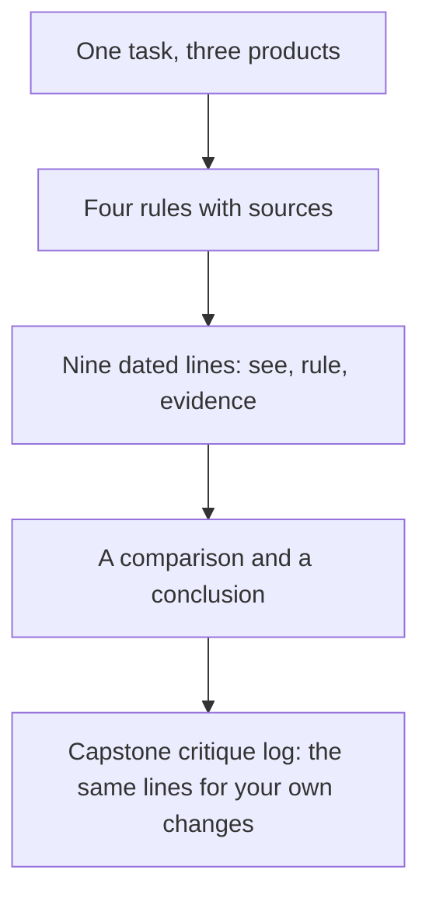

## What you make, and why it matters

You make a critique log: a short, dated record of three products that do the same task. Each line names what you see, the rule it follows or breaks, and the evidence. You also compare the three products, say what you would copy and what you would avoid, and name the rule on your list that has the weakest source.

This is the first draft of part 2 of your capstone. In module 7 you will hand in a critique log about your own redesign. Each of those lines says what was wrong, the rule or evidence, the change, and what you gave up. The skill is the same: a line that a stranger can check. It is safer to learn it on other people's products first. You have no pride in them, and no choice of your own to defend.

Plan about 40 minutes. You need one task, three products, four rules, nine lines, one comparison and one conclusion. Everything fits on a phone. If you cannot open three products, the Wasel case below gives you all three order forms in words. Then you can do the whole exercise without any account.



What to notice: the rules come before the lines, and the lines come before the conclusion. The takeaway is that a conclusion without lines is an opinion, and lines without rules are only notes.

## The steps

1. **Pick one task and three products.**

Choose a task that a real person does in about two minutes, such as booking a room, ordering a print or joining a group. Choose three real products that do the same task. You must be able to open them without paying or signing up. The reason is that a difference between products only means something when the task is the same. Use products you already know if you can. Never type your own ID, a phone number or a classmate's details into a product you are only studying.

2. **Write four rules before you look.**

Each rule needs a short name, its kind (standard, research, heuristic or practice) and its source. Take them from the Good and Best lists in chapter 4.2. Examples are contrast of 4.5 to 1, a label that stays visible, relevant content only, or one clear first thing when you squint. The reason to write them first is that rules written afterwards tend to favour the product you liked. Do not use a rule that failed a check in chapter 4.5.

3. **Collect the screens, with the date.**

Take two or three screens of the task from each product. Use one phone on one day, and write the date on each. Write "needs an account" if the next step is locked, and stop there. The reason is that products change without warning, and a note without a date cannot be checked later. Keep screenshots for your own study. If you publish your log, describe the screens in words.

4. **Write three lines per product.**

Each line has three parts. The first is what you see, with the date. The second is the rule it follows or breaks. The third is the evidence: a measurement, a standard, or something the maker wrote and where you found it. Write "not tested" where you could not check. The reason is that this form leaves no room for a feeling or a guess. If you find yourself writing "probably" or "they want", the sentence belongs outside the log.

5. **Compare, and place each product on the scale.**

For each rule, write one sentence on how the three products differ. Then place each product on the four-level scale for this task, as far as you can check, and write "cannot tell" where a check needs people. The reason is that the scale makes you say what the screens cannot show you yet.

6. **Write a conclusion.**

Name one thing you would copy and one you would avoid, each with a reason. Then name the rule on your list with the weakest source, and say what would make you drop it. The reason is that a conclusion shows whether your rules did any work.

## A worked example on Halaqa

Maryam wants to improve how a student joins a study group, which is the job from module 1. Her task is "join a study group for an exam". She chooses three joining apps and keeps their first two screens on 9 November, all from her phone, with no account. The three apps in this example are made up. She calls them App 1 (a club sign-up app), App 2 (an event app) and App 3 (a library room booking page).

She writes four rules. Normal text needs a contrast ratio of at least 4.5 to 1, which is a standard. A label stays visible above its field, which is a heuristic from NN/g and a practice at GOV.UK. Show only what the job needs, which is the eighth of the ten usability heuristics. One clear first thing when you squint, which is a heuristic from NN/g. She also wrote a fifth rule at first: every page within three clicks.

Her mentor asked where the fifth rule came from. Maryam realised she had read it in a blog and never checked it. In chapter 4.5 she had already seen that the rule failed its test. A study of 44 people and 620 tasks found that success did not depend on click count. She had used it to mark App 3 down for needing four taps. She dropped the rule and the mark. She kept her four other rules, and she judged App 3 again with the relevance rule: the first screen shows only what the job needs. This was her one wrong choice, and the fix took ten minutes.

Her lines are specific. For App 1 she wrote: "9 Nov: the first screen has five fields that use placeholders only. This breaks the rule that a label stays visible. GOV.UK keeps labels visible and says placeholders disappear when you type." For App 2 she wrote: "9 Nov: the Join label is pale grey on white and measures 2.9 to 1 with a contrast checker. Normal text needs 4.5 to 1 (a standard)." For App 3 she wrote: "9 Nov: the first screen lists only the rooms that are free tonight. This follows the rule to show only what the job needs. Not tested: what happens after I tap a room."

She did not write why any of the makers made their choices, because she does not know. When she was tempted to write that App 2 hides its prices to collect sign-ups, she saw that she had only seen a missing price. She wrote the missing price instead, with the date.

Her comparison says that App 3 comes closest to her job because tonight's rooms lead, App 1 loses on labels, and App 2 loses on contrast. She places App 1 at Average, and App 2 at Average because of the contrast. She places App 3 at Good on the checks she could verify, with "cannot tell" for the check with people. She would copy App 3's idea of putting tonight first into Halaqa, whose job is to find classmates to revise with tonight or tomorrow. She would avoid App 1's long form. Her weakest rule is the squint test, because it is a heuristic and not a measurement. She would drop it if three classmates found the Join button fast on a screen where two things were equally strong.

## The provided case: Wasel

If you have no project, or you cannot open three products, use Wasel. Wasel is a print and copy shop near the university gate, owned by Sami. It is open from 8 am to 6 pm. Black and white pages cost 0.50 shekels each, colour pages cost 2 shekels each, and binding costs 5 shekels. Orders sent before noon are ready by 4 pm. In exam weeks it gets about 30 to 40 orders a day. Sami's nephew Karam built the order app in one evening with an AI tool. The job is: "When an assignment is due tomorrow morning and I have no printer, I want to send the file from my phone and collect it printed on my way to class, so that I do not wait in line or miss the deadline."

Your task is "send a file to be printed and choose when to collect it". You compare three order forms, all written out here in full. Use these four rules. Normal text needs a contrast ratio of at least 4.5 to 1 (a standard). A label stays visible above its field (a heuristic and practice). An error sits next to its cause, says what is wrong in words and says what to do next (a heuristic, and WCAG 3.3.1 asks for text). A finger target is about 44 to 48 pixels high, with 24 as the AA floor (a standard and design-system guidance).

Wasel's order form has four fields with placeholders only: "File", "Copies", "Colour?" and "Pickup time". It has no hints. It has a small button labelled "Submit". When something is wrong, the field shows a red border and nothing else, and one message at the top of the screen says "Invalid input".

Nuqta Copy is another shop, made up for this exercise. Its form has four fields, and every label sits above its field and stays visible. The pickup field has a hint: "Orders sent before noon are ready by 4 pm". Under the fields, a line shows the price as you change things, for example "12 pages, black and white: 6.00 shekels". The text is dark grey, #333333 on white, which measures 12.6 to 1. One wide button, 48 pixels high, says "Send my order". If the time is too early, a message under the field says "Choose a time after 4 pm today".

Safha Print is a second shop, also made up. Its form has five steps, one question on each, with the line "Step 2 of 5" and a Back link. Every label is visible. The hint text is #999999 on white, which measures 2.85 to 1. The Next button is 30 pixels high. No price is shown until step 5. If a field is empty, a red message under it says "This field is required".

Write nine lines, three for each form, using the same three parts. Take the date from today.

## Rubric

| Part | Met | Partly | Not yet |
|---|---|---|---|
| Same task, same rules | One task, three products, four rules written first, each with a kind and a source | Rules named, but two or fewer have both a kind and a source | Different tasks, or fewer than three rules |
| Three-part lines | Nine lines or more, each with a date, what you see, the rule and the evidence | Six lines with all three parts, or nine lines with a part missing in a few | Fewer than six full lines, or mostly opinions |
| Nothing guessed | No guess about a maker's reasons, nothing described unseen, no rule that failed in 4.5 | One slip that you marked or fixed | Two or more slips |
| Comparison and conclusion | Compares on two rules or more, copy and avoid with reasons, weakest rule named | Two of the three present | One of the three, or none |

**Pass rule:** no part is Not yet, and at most one part is Partly.

## How your mentor will read it

Your mentor looks first at the dates and at whether each line has all three parts. A line with no date, or with a rule but no evidence, is the first thing they circle. Then they check that the three products really did the same task. They also check that your four rules were written before the lines, and are not tuned to your favourite product.

The common weak answer is a log of preferences: "App B is cleaner", "App C feels modern". Those sentences are opinions, so they cannot be checked and they give the maker nothing to change. The second weak answer is a log full of guesses about why a company did something. Both come from writing the conclusion first and the lines afterwards.

The one follow-up question your mentor usually asks is: which rule on your list has the weakest source, and what would make you drop it? A good answer names a rule, says what kind of source it has, and describes something you could watch or measure that would change your mind. You can dictate your answer with your phone's microphone, and you may add a link to your screenshots.

## Your turn

```openquestion
prompt: "Submit your critique log. 1) Name the task and the three products, or say you used the Wasel case. 2) List your four rules, each with its kind and its source. 3) Write three dated lines for each product: what you see, the rule it follows or breaks, and the evidence. 4) Write one paragraph that compares the three products on at least two rules, and place each product on the four-level scale, or say 'cannot tell'. 5) Name one thing to copy and one to avoid, each with a reason. 6) Name the rule with the weakest source and what would make you drop it."
required: true
minWords: 200
allowSpeechInput: true
allowUrl: true
urlRequired: false
urlLabel: "Link (optional)"
urlHint: "A link to your log, or to a private folder of your screenshots. A log written in the box needs no link."
modelAnswer: "Mentor key for Wasel: the task is to send a file to be printed and choose a pickup time, and the four rules are the ones given. Wasel lines: the four fields use placeholders only, which breaks the visible-label rule (GOV.UK says placeholders disappear). The error is a red border and 'Invalid input' at the top. It does not sit next to its cause, does not say what is wrong, and colour alone is not enough (WCAG 3.3.1 asks for the error in text). The Submit button is small, so its target is likely under 44 to 48, but it should be marked 'not measured'. Nuqta lines: labels visible, a hint about the 4 pm promise, the price shown before sending, an error under the field with a next step, a 48 pixel button, text at 12.6 to 1. Safha lines: hint text at 2.85 to 1 fails contrast. The 30 pixel Next button is under the 44 to 48 aim. 'This field is required' does not say what to enter. Placement: Wasel is Average. Nuqta is Good on the checks that words can show, with 'cannot tell' for the check with people. Safha is Average because contrast fails. A strong answer would copy Nuqta's visible labels, its hint and its error in words, and would avoid Safha's pale hints. The weakest rule is the target size of Wasel's button, because it was not measured. Accept any wording that has dated, three-part lines and a comparison. The common wrong answer says 'Nuqta is nicest'. Other weak answers guess why Karam or the shops built the forms, or use the three-click rule to mark down Safha's five steps. Model answer for a different case: Hazem compares three clinic pages for the task 'book a visit for tomorrow'. His rules are contrast 4.5 to 1 (standard), visible labels (heuristic), show only what the job needs (heuristic) and error next to its cause (heuristic). A line for Page X: '12 Nov: the first screen asks for an insurance number before a date. This breaks the rule to show only what the job needs. Not tested: whether it can be skipped.' He copies Page Y's list of free times first and avoids Page X's long first form. He names the relevance rule as the weakest, because it is a heuristic. He would drop it if five patients finished faster with the extra field."
```

**Next:** In 4.7 you answer five graded cases on the scale, defaults, critiques and evidence.
