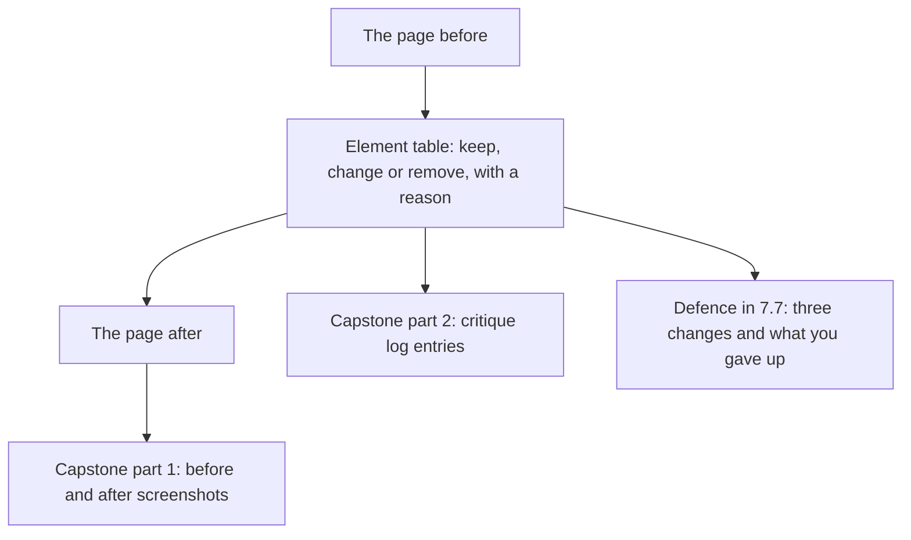

## What you make, and why it matters

You take one page and remove the generic look from it, in the screen and in the words. The page can be the first page of your own project, or the Wasel landing page that this chapter provides in full. Use a page you are free to show. If it belongs to a client or an employer, ask permission before you share its screens, or use Wasel. You hand in three things. The first is the page before and after. The second is a table with a decision and a reason for every element on it. The third is the one bold choice you made, with its reason.

This output is the base of two parts of the capstone in chapter 7.6. The before and after of this page becomes one of the screens in part 1, the before and after screenshots. The table of reasons becomes entries in part 2, the critique log. Each entry needs what was wrong, the rule or evidence, the change and what you gave up. You will also defend three of your changes in chapter 7.7. The reasons you write now are the reasons you will say aloud then, so write them as if a stranger will read them.



The diagram shows that the table sits in the middle. Both the new page and your later defence come out of it. A page that was changed without a table gives you nothing to defend. That is why this chapter asks for the table first and the new page second.

## The steps

1. Save the before: a screenshot, or the page written top to bottom in your notes app, with its exact words.
2. List every element: each text, button, picture, card, icon, colour band and movement.
3. Mark each one Keep, Change or Remove, with one reason that names what it does for the person.
4. Test every sentence: could a hundred products say it? Replace each failing one with a price, a time, a thing a user did or a thing you gave up.
5. Put the real content first, in the order the person asks.
6. Choose one bold choice and write its reason in one sentence.
7. Check the floor: contrast ratios, a visible focus mark, motion, and a small phone.
8. Save the after, and finish the table.

Step 1 comes first because you cannot judge a change you did not record. A phone screenshot takes a few seconds. If your tool does not let you take one, copy the words into your notes app and describe the colours and shapes in one line each. The before is also the evidence that your page really started as generic, which matters when a reviewer sees only the after.

Step 2 asks for a full list because the generic look hides in small parts. A fade on a section, a small arrow on a link, an icon tile and a pill are easy to overlook. Each one is a decision somebody did not make. A full list also keeps you honest, because you cannot skip the parts you like.

Step 3 is the centre of the chapter. A reason that names what an element does for the person, such as "tells Nour the price", is checkable. A reason such as "looks cleaner" is not. If you find that the only reason you have is about looks, mark the element Change or Remove, or give it a job.

Step 4 applies chapter 5.3 to every sentence, including button labels and error messages. Step 5 applies chapter 5.4: facts first, in the order a person asks, with few boxes. Step 6 asks for one bold choice, not two. If you find two, the squint test will tell you which one to keep.

Step 7 keeps the page usable. Compute contrast with the WCAG formula or any checker: 4.5 to 1 for normal text, 3 to 1 for large text. Press Tab on a laptop, or ask a friend to, and look for a visible focus mark. Turn on reduced motion in your phone settings and look again. Open the page at the width of a small phone. Step 8 closes the loop: the final table shows what you kept, changed and removed, and why.

## A worked example: Maryam's Halaqa

Maryam, whom you met in modules 1 to 4, built Halaqa with an AI coding tool. Its first page has seven parts. A soft purple and blue glow sits behind the top section. A pill says "AI-powered". The headline reads "Supercharge your studying", with the line "Connect, collaborate, succeed." beneath it. Three cards with icon tiles say "Connect", "Collaborate" and "Succeed". A button says "Get started". At the bottom, in light grey, a line says that Halaqa has groups for exams, tonight or tomorrow. The groups meet in a library room, online or at a cafe. That grey is #999999 on white, which is 2.85 to 1, so it fails the contrast rule.

She wrote the table first. The glow said nothing about study groups, so she removed it. The pill told a student how the page was built, and a student wants a group, so she removed it too. The AI summary of notes is one of her 14 features, and it can be shown inside the app, at the moment a student opens notes. The headline and the line failed the hundred products test, because a hundred apps could say "Supercharge your studying". The three cards held claims with nothing to compare. The button did not say what happens. The grey line held the only real content on the page.

Her first attempt was wrong. She removed the glow, the pill, the headline, the line, the three cards and the grey line. What was left was the word "Halaqa" and a button. The page looked calm, but a student could not tell whether any group existed tonight. She had removed the real content together with the decoration, because the real content had been sitting in the small grey line. She remembered that a minimalist screen shows relevant information only, and that this is not the same as showing fewer things. The group list was the relevant part.

Her second attempt started from the content. The headline became "Find a study group for your exam, tonight or tomorrow." The picture became two real groups from her own data. The first was Data structures, exam Thursday, tonight at 8 pm in library room 2, with 2 seats left. The second was Statistics 101 revision, tomorrow at 5 pm, online, with 4 seats left. The button became "Find a group". She kept the two group cards on purpose, because they hold a time and a number of seats that a student compares. She kept the phone's own font, because it needs no download on weak data.

Her one bold choice was the time on the first group, "Tonight 8 pm", set larger than everything else. Her reason, in one sentence, was this. Her job statement says "tonight or tomorrow", and the student's worry is studying alone the night before an exam, so the time decides whether she can go. She gave up the first screen as a place to list features.

Then she checked the floor. Her small lines changed from #999999 to #595959, which is 7.0 to 1. The large time passed at 3 to 1 or better. A Tab press on a laptop showed a focus mark on the button. Nothing moved, and the page fitted a narrow phone.

Maryam does not yet know whether the new page works better, and she wrote that in her notes. She plans to run her check of five classmates again after the whole redesign, because a drawing is not a test.

## The provided Wasel case

If you have no project, use Wasel's landing page. Everything you need is on this page, and you can do the whole task on a phone, in a notes app or on paper.

Wasel is a print and copy shop near the university gate, owned by Sami. It is open 8 am to 6 pm. Black and white pages cost 0.50 shekels, colour pages cost 2 shekels, and binding costs 5 shekels. Orders sent before noon are ready by 4 pm. In exam weeks it gets about 30 to 40 orders a day, mostly from students printing assignments. Karam built the page in one evening with an AI tool. The job, in the course template, is this:

> When an assignment is due tomorrow morning and I have no printer, I want to send the file from my phone and collect it printed on my way to class, so that I do not wait in line or miss the deadline.

The page has eight elements, from the top:

1. A purple glow behind the top section.
2. A pill that says "AI-powered".
3. The headline "Revolutionize your printing experience".
4. The line "Seamless, powerful and effortless."
5. A glowing button that says "Get started".
6. Three identical cards with tinted icon tiles, which say "Fast", "Secure" and "Smart".
7. A small grey line: "0.50 shekels a page. Ready by 4 pm."
8. A small grey line: "Open 8 am to 6 pm, near the university gate."

Do all eight steps on this page. Make a table with one row for each of the eight elements, and add rows for anything you add. Write the new headline, the button label and every other sentence, using only the facts above. Write the order of your new page from the top. Name your one bold choice and give its reason. For the floor, choose your text colour and give its ratio on a white background. If you have no checker, use these values. They were computed with the WCAG formula. Colour #595959 gives 7.0 to 1, #767676 gives 4.54 to 1, #777777 gives 4.48 to 1, #999999 gives 2.85 to 1, and black gives 21 to 1. Keep one default on purpose and say why.

## How you will be judged

| Part | Met | Partly | Not yet |
|---|---|---|---|
| Every element has a reason | All elements listed (8 or more for Wasel), each marked with a reason that names what it does for the person | All are listed, but one or two reasons say only "looks better" or "cleaner" | An element is missing, or more than two reasons are about looks only |
| The words pass the test | Every sentence is cut or replaced with a price, a time, a user action or a trade-off, and the button says what happens | One generic sentence remains | The headline is still a sentence a hundred products could say |
| Real content first, one bold choice | Real content comes first in the order the person asks, and one bold choice has a reason tied to the job | The order is right, but the reason is missing or two things are bold | Boldness is spread over several places, or no real content is on the first screen |
| The floor and one kept default | Ratios computed (4.5 to 1, large 3 to 1), focus, motion and small phone checked, one default kept with a reason | One floor check is missing | No floor check, or every default was removed without a reason |

**Pass rule:** no part is Not yet, and at most one part is Partly.

## How your mentor will read it

A mentor reads your table first. They look at the reasons before they look at the new page, because the page can be good by accident and the reasons cannot. They check that each reason says what an element does for the person. They also check that at least one element was kept on purpose, so they know you did not simply delete everything with a gradient in it.

The most common weak answer is a restyle. The glow is gone and the colour has changed. But the three cards still say "Fast", "Secure" and "Smart", and the headline is still a sentence a hundred products could say. The page looks different and says the same. The second most common weak answer is the one Maryam made first: everything is deleted, and the page no longer tells the person anything. Both come from changing how the page looks without asking what it should say.

The follow-up question a mentor usually asks is: "How would you check that the thing you made large is the thing a student looks for first?" A good answer names a small check, such as showing the screen to three students for a few seconds and asking what they noticed. An honest "I have not tested it yet, and this is how I would" is better than an invented result. You can answer by typing, or by dictating with your phone's microphone.

```openquestion
prompt: "Submit your de-slopped page. Include five parts. 1) The page before, as a list of its elements or a link to a screenshot. 2) A table with every element marked Keep, Change or Remove, and one reason for each that names what it does for the person. 3) Your new words: the headline, the button and every other sentence. 4) The order of the new page from the top, and your one bold choice with its reason. 5) Your floor checks with the contrast ratios you found, and one default you kept on purpose with its reason."
required: true
minWords: 180
allowSpeechInput: true
allowUrl: true
urlRequired: false
urlLabel: "Link (optional)"
urlHint: "A folder or page with your before and after screenshots. Leave it empty if you describe the pages in words."
modelAnswer: "Mentor key for Wasel: the glow is removed because it says nothing about printing; the 'AI-powered' pill is removed because a student wants pages printed, not a note about how the page was built; the headline is replaced with something like 'Send your file now. Pick it up printed by 4 pm.'; 'Seamless, powerful and effortless.' is removed, or replaced by 'Orders sent before noon are ready by 4 pm.' so that the promise keeps its condition; 'Get started' becomes 'Upload a file'; the three claim cards are replaced by the price list (black and white 0.50 shekels a page, colour 2, binding 5), as cards or a list, because a student compares prices; the small grey lines move up, and the opening hours with the place (8 am to 6 pm, near the university gate) stay. Acceptable bold choices: the 4 pm time, with a reason tied to the missed-deadline worry. Floor: dark text such as #595959 (7.0 to 1) or darker for small text, at least 3 to 1 for the large time, a visible focus mark on the button, no looping motion, and a layout that fits a narrow phone. A kept default with a reason is expected, for example the phone's own font because it needs no download, or price cards because they hold things to compare. The common wrong answer restyles only: the colour changes but 'Fast, Secure, Smart' and a vague headline remain, or everything is deleted and the price list is lost. Model answer for a different case: Razan redesigned the page of a tutoring centre. Her table had nine rows. She removed a gradient and a badge, replaced 'Unlock your potential' with 'Maths and physics for grade 12, Saturdays at 10 am, 8 students at most', replaced three icon cards with the weekly timetable, and changed 'Learn more' to 'Book a seat'. Her bold choice was '8 students at most', because her centre's reason to exist is attention for each student. She kept the system font to save data. Her ratio for small text was #595959 on white, 7.0 to 1. She wrote that she had not yet shown the page to parents and would ask three of them what they noticed first."
```

**Next:** In chapter 5.6, five graded cases check whether you can spot and remove the generic look in screens and in words.
