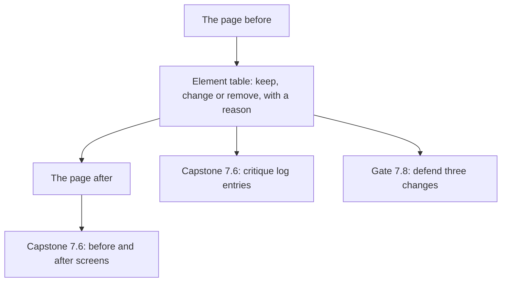

## What you make, and why it matters

You take one page and remove the generic look from it, in the screen and in the words. The page can be the first page of your own project. It can also be the two Wasel screens that this chapter provides in full: the order form and the order status screen. Use a page you are free to show. If it belongs to a client or an employer, ask permission before you share its screens, or use Wasel.

You hand in three things. The first is the page before and after. The second is a table with a decision and a reason for every element on it. The third is the one bold choice you made, with its reason.

This output is the base of the capstone in chapter 7.6. The before and after becomes one of the screens in part 1, and the table of reasons becomes entries in the critique log. Each entry needs what was wrong, the rule or evidence, the change and what you gave up. You will also defend three of your changes in chapter 7.8. Write the reasons as if a stranger will read them, because you will say them aloud later.



The table sits in the middle. The new page and your later defence both come out of it. A page that was changed without a table gives you nothing to defend, so make the table first and the new page second.

## The steps

1. Save the before: a screenshot, or the page written top to bottom in your notes app, with its exact words.
2. List every element: each text, button, field, picture, card, icon, colour band and movement.
3. Mark each one Keep, Change or Remove, with one reason that names what it does for the person.
4. Test every sentence: could a hundred products say it? Replace each failing one with a price, a time, a thing a user did or a thing you gave up.
5. Put the real content first, in the order the person asks.
6. Choose one bold choice and write its reason in one sentence.
7. Check the floor: contrast, a visible focus mark, motion, a slow connection and a small phone.
8. Save the after, and finish the table.

Step 1 comes first because you cannot judge a change you did not record. If your tool does not let you take one, copy the words into your notes app and describe the colours and shapes in one line each.

Step 2 asks for a full list because the generic look hides in small parts. A fade on a section, an arrow on a link, an icon tile and a pill are easy to overlook. Each one is a decision somebody did not make.

Step 3 is the centre of the chapter. A reason that names what an element does for the person, such as "tells Nour the price", can be checked. A reason such as "looks cleaner" cannot. If the only reason you have is about looks, mark the element Change or Remove, or give it a job.

Step 4 applies chapter 5.3 to every sentence, including button labels and error messages. Step 5 applies chapter 5.4: facts first, in the order a person asks, with few boxes. Step 6 asks for one bold choice, not two. If you find two, the squint test will tell you which one to keep.

Step 7 keeps the page usable, and every check works on a phone. For contrast, find your colour pair in the table of common greys in chapter 2.5, or work the formula in that chapter's fold. The rule is 4.5 to 1 for normal text and 3 to 1 for large text. For focus, read the Tab order drawn in chapter 3.4, then write your own order for your controls, from the top. If you cannot read the code, ask a friend with a laptop to press Tab and read the order aloud. On a laptop you can also press Tab and look for a visible mark. For motion, turn on reduced motion in your phone's accessibility settings and look again. For a slow connection, switch on flight mode and open the page, or try it on a weak signal. Then view the page at the width of a small phone. Step 8 closes the loop: the final table shows what you kept, changed and removed, and why.

## A worked example: Maryam's Halaqa

Maryam, whom you met in modules 1 to 4, built Halaqa with an AI coding tool. Its first page has seven parts. A soft purple glow sits behind the top section. A pill says "AI-powered". The headline reads "Supercharge your studying", with the line "Connect, collaborate, succeed." beneath it. Three cards with icon tiles say "Connect", "Share" and "Succeed". A button says "Get started". At the bottom, in light grey, a line says that Halaqa has groups for exams, tonight or tomorrow. That grey is #999999 on white, which is 2.85 to 1, so it fails the contrast rule.

She wrote the table first. The glow said nothing about study groups, so she removed it. The pill told a student how the page was built, and a student wants a group, so she removed it too. The headline and the line failed the hundred products test, because a hundred apps could say "Supercharge your studying". The three cards held claims with nothing to compare. The button did not say what happens. The grey line held the only real content on the page.

Her first attempt was wrong. She removed the glow, the pill, the headline, the line, the three cards and the grey line. What was left was the word "Halaqa" and a button. The page looked calm, but a student could not tell whether any group existed tonight. She had removed the real content together with the decoration, because the real content had been sitting in the small grey line. She remembered that a minimalist screen shows relevant information, not fewer things.

Her second attempt started from the content. The headline became "Find a study group for your exam, tonight or tomorrow." The picture became two real groups from her own data. The first was Data structures, exam Thursday, tonight at 8 pm in library room 2, with 2 seats left. The second was Statistics 101 revision, tomorrow at 5 pm, online, with 4 seats left. The button became "Find a group". She kept the two group cards on purpose, because they hold a time and a number of seats that a student compares. She kept the phone's own font, because it needs no download on weak data.

Her one bold choice was the time on the first group, "Tonight 8 pm", set larger than everything else. Her reason was this. Her job statement says "tonight or tomorrow", and the student's worry is studying alone the night before an exam, so the time decides whether she can go. She gave up the first screen as a place to list features.

Then she checked the floor. Her small lines changed from #999999 to #595959, which is 7.0 to 1. The large time passed at 3 to 1 or better. She read the Tab order in chapter 3.4 and wrote hers: the two group cards, then the button. Nothing moved, and the page fitted a narrow phone. Maryam does not yet know whether the new page works better, and she wrote that in her notes. She plans to run her check of five classmates again after the whole redesign, because a drawing is not a test.

## The provided Wasel case: order form and order status

If you have no project, use these two Wasel screens. You saw Wasel's landing page fixed in chapters 5.2 and 5.4. These two screens are different, so the choices are yours. Everything you need is on this page, and you can do the whole task on a phone, in a notes app or on paper.

Wasel is a print and copy shop near the university gate, owned by Sami. It is open 8 am to 6 pm. Black and white pages cost 0.50 shekels, colour pages cost 2 shekels, and binding costs 5 shekels. Orders sent before noon are ready by 4 pm. In exam weeks it gets about 30 to 40 orders a day, mostly from students printing assignments. Karam built the app in one evening with an AI tool. The job, in the course template, is this:

> When an assignment is due tomorrow and I have no printer, I want to send a file by phone and collect it, so that I do not miss the deadline.

The order form and the order status screen have eight elements:

1. The four fields show only a placeholder: "File", "Copies", "Colour?" and "Pickup time". There are no labels and no hints.
2. The placeholder grey is #999999 on white.
3. A small button says "Submit". It is 80 by 28 pixels.
4. A wrong field gets a red border and nothing else.
5. One message at the top of the form says "Invalid input".
6. The order status screen shows a spinner with no words. On a slow connection it never ends.
7. While orders are still loading, the status screen says "No orders".
8. When an upload fails, the status screen says "Something went wrong". The file is lost, so the student must choose it again.

Your student is Nour. She has a 10-page file and needs 2 black and white copies before class tomorrow. That is 10 pages times 2 copies, which is 20 pages, so 10 shekels at 0.50 shekels a page.

Do all eight steps on these two screens. Make a table with one row for each element, and add rows for anything you add. Write the new words using only the facts above, and do not invent prices, times or rules. If a choice needs a fact the case does not give, such as what happens to an order sent after noon, write "ask the shop". Write the order of each new screen from the top. Name your one bold choice and give its reason. For the floor, give the ratio of your text colour on white. If you have no checker, use the table of greys in chapter 2.5. It agrees with these values from the WCAG formula. #595959 gives 7.0 to 1, #767676 gives 4.54 to 1, #777777 gives 4.48 to 1, #999999 gives 2.85 to 1, and black gives 21 to 1. Keep one default on purpose and say why.

## How you will be judged

| Part | Met | Partly | Not yet |
|---|---|---|---|
| Every element has a reason | All elements listed (8 or more for Wasel), each marked with a reason that names what it does for the person | All are listed, but one or two reasons say only "looks better" or "cleaner" | An element is missing, or more than two reasons are about looks only |
| The words pass the test | Every sentence, label and message is cut or replaced with a fact, and each button says what happens | One generic sentence or message remains | Two or more generic sentences remain, or a message still says only "Invalid input" or "Something went wrong" |
| Real content first, one bold choice | Real content comes first in the order the person asks, and one bold choice has a reason tied to the job | The order is right, but the reason is missing or two things are bold | Boldness is spread over several places, or no real content is on the first screen |
| The floor and one kept default | Ratios found, focus order written, motion, slow connection and small phone checked, one default kept with a reason | One floor check is missing | No floor check, or every default was removed without a reason |

**Pass rule:** no part is Not yet, and at most one part is Partly.

## How your mentor will read it

A mentor reads your table first and the new page second, because a page can be good by accident and the reasons cannot. The most common weak answer is a restyle: the colour changes, but the words stay generic, or everything is deleted and the facts are lost. The usual follow-up question is: "How would you check that the thing you made large is the thing a student looks at first?" Name a small check, such as showing the screen to three students for a few seconds. An honest "I have not tested it yet, and this is how I would" is better than an invented result.

```openquestion
prompt: "Submit your de-slopped page. Include five parts. 1) The page before, as a list of its elements or a link to a screenshot. 2) A table with every element marked Keep, Change or Remove, and one reason for each that names what it does for the person. 3) Your new words: every title, label, button and message. 4) The order of the new page from the top, and your one bold choice with its reason. 5) Your floor checks with the contrast ratio you found, and one default you kept on purpose with its reason. For Wasel, answer for the order form and the order status screen."
required: true
minWords: 180
allowSpeechInput: true
allowUrl: true
urlRequired: false
urlLabel: "Link (optional)"
urlHint: "A folder or page with your before and after screenshots. Leave it empty if you describe the pages in words."
modelAnswer: "Mentor key for Wasel, order form and order status screen. A strong answer lists all eight elements. Each has a decision and a reason that names what it does for the student. Four things are expected in the words. 'Submit' becomes a button that says what happens. 'Invalid input' becomes a message beside each wrong field that says the fix. The four fields get visible labels and at least one hint that only Wasel can write, such as the price per page or the before-noon rule. 'No orders' never shows while orders load, and afterwards it becomes a sentence with a next step. The bare spinner gets words. 'Something went wrong' becomes what failed, that the file is kept, and what to do. At least one fact that only Wasel can state sits on each screen, such as a price, the noon rule, 4 pm or the place. One bold choice is named with a reason tied to the job and the deadline worry. Acceptable choices are the pickup time on the form or the total in shekels. The floor is checked. The grey #999999 (2.85 to 1) becomes #595959 (7.0 to 1) or at least #767676 (4.54 to 1). The button grows from 80 by 28 pixels to about 44 pixels tall. No error relies on a red border alone. For a reader who reduces motion, words replace the spinner's movement. A kept default with a reason is expected, such as the phone's own font. Accept different wording if each message says what is happening and what to do. The common wrong answer restyles and keeps the generic messages, or deletes the placeholders and leaves nothing to read. Model answer for a different case: Razan redesigned the page of a tutoring centre. Her table had nine rows. She removed a gradient and a badge. She replaced 'Unlock your potential' with 'Maths and physics for grade 12, Saturdays at 10 am, 8 students at most'. She replaced three icon cards with the weekly timetable, and she changed 'Learn more' to 'Book a seat'. Her bold choice was '8 students at most', because her centre exists to give each student attention. She kept the system font to save data. Her ratio for small text was #595959 on white, 7.0 to 1. She wrote that she had not yet shown the page to parents. She would ask three of them what they noticed first."
```

**Next:** In chapter 5.6, five graded cases check whether you can spot and remove the generic look in screens and in words.
