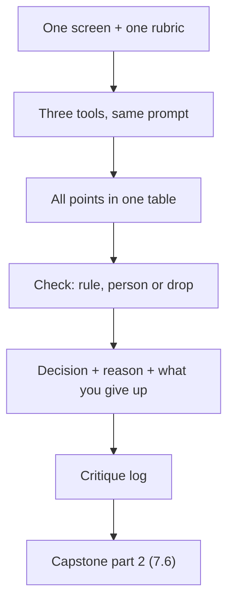

## What you make

You make a three-opinion critique of one screen. It is a short table with one row for every point the tools raised. The columns are: the point, which tool said it, the check you ran, the result, your decision, and what you give up. Under the table you write a few sentences on where the tools disagreed and what you did not check.

This output matters for the capstone. In chapter 7.6 you hand in a critique log. That log must hold at least one AI point that you checked and accepted. It must also hold one that you rejected with a reason. This chapter makes those entries. It also builds the habit behind them: an AI opinion is a question, and your decision is a separate step that comes after a check. The method is the course's inference from research on AI judges and AI critiques. No study has tested it on your screens, so your notes should say what you checked and what you did not.

Plan about 40 minutes. Ten to set up and ask, twenty to check, ten to write. If you have no project, use the provided Wasel case further down. It needs no AI account and no laptop.

## The steps



The picture shows the path of one point. It enters from a tool, meets a check, leaves with a decision and ends in the log that the capstone collects. Nothing goes straight from a tool to your screen.

**1. Pick one screen and write the rubric first.** Choose a screen from your own project, ideally one a person must finish, such as a form or a first screen. Write the person, the device and the job in one sentence. Then write five checks: what is seen first, text size and contrast, space and grouping, labels and error words, and the words on buttons. Write them before you read any answer. If you write the checks after you read the answers, you will pick the checks that make the answers look right.

**2. Choose three tools from different companies, and check each one opens for you.** At the time of writing (checked 2026-10-25), three examples are Gemini, ChatGPT and Claude. Gemini and ChatGPT are for people 13 or over, with a guardian's permission under 18 for ChatGPT. Claude is for people 18 or over. Check whether each opens for you, at your age. If only two open, use two and make the third opinion your own pass with a paper checklist, and label it as yours. If none opens, do the Wasel route below, because the checking step is the skill. Different companies matter because each model has habits and favourites, and three chats with one model share the same habits.

**3. Make the screenshot safe.** Use your own app, or a screen you have permission to share. Remove real names, phone numbers and any private data. Never paste a client's or employer's screens or data into an AI tool without permission; course 13 teaches the full habit. Do not shrink the screenshot much to save data. A button looks smaller in a small picture, and the tool may judge the picture instead of the screen.

**4. Ask each tool the same prompt, in a fresh chat.** Use the prompt from chapter 6.3. It holds your sentence about the person and the five checks. It asks for what the tool sees, the rule it uses and a way you could check. It ends with the words "no score, no verdict". Ask short answers. Save each answer under the tool's name before you read the next one. The reason is simple: if you read all three at once, the loudest voice will colour how you read the rest.

**5. Put every point in one table.** Merge points that say the same thing and note which tools said it. Mark the points where the tools disagree. A disagreement is useful, because it often shows a matter of taste, and taste cannot be measured.

**6. Sort each point and run the check.** For each point, choose: check a rule, ask a person, or drop. For a rule point, measure, and write the number. For a person point, write the question, who you will watch and what you will look for, and watch two or three people if you can. If you cannot find anyone today, write the plan and mark the decision "test later". For a point to drop, write the reason in one line: it names no problem. Remember that three tools agreeing is not a check.

**7. Decide, and write what you give up.** Each decision is change, leave or test later. Write the reason and the cost. Cutting a field gives up the data in it. Making a button taller gives up space on a small screen. If you leave a point alone, you give up what the fix would have gained. Writing the cost shows that you chose.

**8. Make the changes that passed a check, and look again.** Apply them and open the screen in a browser. A fix that only exists in your notes is not a fix. Then write the three or four sentences under the table.

## Worked example: Maryam's create-group screen

Maryam uses the screen from 6.1: the form where a student starts a new group. It has four labelled fields (Course, When, Where with a hint, Seats) and a Create group button. Her sentence: a university student, on a phone, the night before an exam, wants to start a group in under a minute. She writes her five checks.

Her first try was a mistake. She pasted the screenshot into three tools and wrote: "Rate this screen from 1 to 10 and tell me how to fix it." The scores came back as 6, 8 and 7, and each tool had a different list of fixes. She stared at the numbers and could not say what an 8 meant. Eight of what? Which check had the tool failed or passed? She had also started to think of the 8 as the winner, which is a way of letting a number decide. She deleted the scores and started again with the rubric, a request for evidence and "no score, no verdict".

The second round gave her a table of seven distinct points once she merged the repeats. She sorted them.

Two points named a number. The tools said the grey hint text under Where was too light. She measured: the hint is #767676 on white, and the WCAG formula gives 4.54 to 1. Normal text needs 4.5 to 1, so it passes by a small margin. Decision: leave it, and write a note not to make the grey any lighter. All three tools said the Create group button was too small. She measured it in her browser's inspector: 44 pixels tall and 164 wide. That is inside the aim of about 44 to 48, and far above the AA floor of 24. The three tools agreed, and all three were wrong about her button. She suspected the reason: she had sent the screenshot at about 40% of its size to save data, so the button looked small. Decision: leave it. She gave up nothing, and she noted that agreement is not evidence.

Two points were about words and states. One tool asked: what does the person see if Seats is empty? She tried it. Only the border turned red, with no words. That breaks the rule that colour must not be the only signal. Decision: change it. She added the message "Enter how many seats, for example 4" next to the field. Tool three told her to rename the button to "Get started". She checked the rule that a button says what happens. "Create group" says it, and "Get started" does not. Decision: leave the name, and write the reason. It was her rejected point for the capstone log.

Three points were about people. Tools one and three said that four fields were too many. No rule gives a limit, so she asked three classmates to start a pretend group for a Thursday exam, and watched. All three finished. Two stopped at Seats and asked: does that number include me? Nobody stopped at the other fields. Decision: keep four fields and add the hint "Including you" under Seats. She gave up one more line of text. Tool one said students might prefer a time list. All three classmates typed "Tonight, 8 pm" without trouble. Three people is a small sample, so her decision was test later, after the next version. The last point was the purple header from tool three. It named no problem a student has. Decision: leave it, because it names nothing to check.

Her table ended with two changes, four points left alone and one marked test later. Under the table she wrote three things. The tools disagreed on fields, hints and the button. She had measured two things and watched three people. She had not checked the screen on a very small phone. That sentence cost her a minute and made the log honest.

## The provided Wasel case

Use this if you have no project, or if no AI tool opens for you. Wasel is a print and copy shop near the university gate, owned by Sami. It is open 8 am to 6 pm. Black and white printing is 0.50 shekels a page, colour is 2 shekels a page and binding is 5 shekels. Orders sent before noon are ready by 4 pm. In exam weeks, it gets about 30 to 40 orders a day. Sami's nephew Karam built the order app in one evening with an AI tool.

The job: "When an assignment is due tomorrow morning and I have no printer, I want to send the file from my phone and collect it printed on my way to class, so that I do not wait in line or miss the deadline."

The screen is the order form, on a phone 375 CSS pixels wide. It has four fields with placeholders only: "File", "Copies", "Colour?" and "Pickup time". There are no labels and no hints. The placeholder text is #999999 on white. A small button says "Submit". It is 80 pixels wide and 28 pixels tall, with plenty of space around it. When a field is wrong, its border turns red. At the top, one message says "Invalid input". It does not say which field is wrong.

Three AI tools looked at this form. Their answers are invented for this exercise. Below are nine points.

| # | Tool | Point |
|---|---|---|
| 1 | One | The grey placeholder text is hard to read. |
| 2 | One | Make the screen feel more modern. |
| 3 | One | The Submit button is too small. |
| 4 | Two | Show the total price before the customer submits. |
| 5 | Two | The button should say what happens, not "Submit". |
| 6 | Two | Use a gradient background to look more premium. |
| 7 | Three | "Invalid input" does not say which field is wrong. |
| 8 | Three | Customers may not know which file types the shop accepts. |
| 9 | Three | I give this form 5 out of 10. |

Your task is the same as Maryam's from step 5 on. Write your rubric of five checks first. Sort the nine points. For each rule point, compute or observe the result from the facts above. For each person point, write the question, who you will watch (a classmate who has printed an assignment recently is a good choice) and what you will look for. For each point you drop, write the reason. Then decide, give a reason and name what you give up. If an AI tool does open for you, you may also describe the form to it in words and add its points to your table. Do not include personal data.

## The rubric

| Part | Met | Partly | Not yet |
|---|---|---|---|
| A fair setup | Rubric written first; one prompt for every tool (or points listed by tool); nothing private; three sources named | Three of those four | Two or fewer, or a different prompt for each tool |
| Every point checked | At least seven points sorted; each rule point has a number; each person point has a question, who and what to watch | One point without a check | Two or more points without a check, or a score treated as a finding |
| Decisions with reasons | At least three decisions with a reason and a cost; one AI point accepted after a check, one rejected with a reason | Reasons given but no cost named, or only one of accepted and rejected | A tool's fix copied with no check |
| Honest limits | Says where the tools disagreed, what was not checked, and marks "test later" where no person was available | One of those three is missing | Claims an AI tool proved something, or reports a result nobody measured |

**Pass rule:** no part is Not yet and at most one is Partly.

## How your mentor will read it

Your mentor will go straight to the check column. They are looking for numbers and questions, not for good fixes. A contrast ratio with its two colours tells them that you ran a check. So does a button height in pixels. So does a sentence such as "I asked three classmates to start a group and watched where they stopped". A column that says "tool suggested this, so I did it" tells them you did not.

The most common weak answer is a list of fixes with every one accepted, usually the ones all three tools agreed on. It often also treats the tool that sounded most sure as the right one. The second most common weak answer rejects everything because "AI is often wrong". That is also a decision with no check.

The follow-up question your mentor usually asks is: "Which point did you reject, and what would have made you accept it?" A strong reply names a check. For example: "If the button had measured 28 pixels, I would have accepted it." If you can say what evidence would have changed your mind, your rejection is a judgment and not a mood.

```openquestion
prompt: "Submit your three-opinion critique of one screen: your own, or Wasel's order form. Include: 1) your screen, the person and the job in one sentence, and your five checks. 2) Which three tools you used (or that you used the provided points), and the prompt in one line. 3) A table with one row per point (at least seven): the point, which tool, bucket (rule, person or drop), the check and its result, your decision, and what you give up. 4) Two or three sentences on where the tools disagreed and what you did not check."
required: true
minWords: 200
allowSpeechInput: true
allowUrl: true
urlRequired: false
urlLabel: "Link (optional)"
urlHint: "A folder of your screenshot and the three answers, or a page with your table. Do not link anything private."
modelAnswer: "Mentor key for Wasel. Rubric: the five checks written first. Point 1, the grey placeholder: rule; #999999 on white is 2.85 to 1, below 4.5 to 1, so it fails; change it (the stronger fix is a visible label above each field, with the placeholder gone). Point 2, more modern: drop; it names no problem. Point 3, Submit too small: rule; 28 pixels tall passes the AA floor of 24, but is below the aim of 44 to 48; so the point is partly true; change it to at least 44 pixels. Point 4, total price: person; the question is whether students want to see the price before they send; watch two or three; test later or change after watching. Point 5, say what happens: rule; a button names its action; rename it, for example to 'Send my print order'; accept any name that says what happens. Point 6, gradient: drop; it names no problem. Point 7, Invalid input: rule; the message does not name the field, and the red border is colour alone; change it to words next to the field. Point 8, file types: person; watch someone upload a file; test later or add a hint. Point 9, 5 out of 10: drop; a score names no rule. At least three decisions must have a reason and a cost, with one accepted point and one rejected point. Accept any wording that sorts the points this way and gives checks that could be run. Common wrong answers: accepting all nine; treating the 28 pixel button as fine because 28 is above 24, without the aim of 44 to 48; calling the total price a rule; dropping the grey text because tools are often wrong. Model answer for a different case. Osama is building a booking screen for a sports club. Rubric: first thing seen, text and contrast, space, labels and errors, button words. Tools: three from different companies; one did not open for him, so his third opinion is his own paper pass, labelled as such. Seven points. Rule: the date field's hint is #8A8A8A on white, 3.45 to 1, fails, so he darkened it to #595959 (about 7 to 1), and gave up a lighter look. Rule: the Book button is 40 pixels tall, below the aim of 44, so he raised it to 46, and gave up 6 pixels of space. Person: the tools said the pitch picker has too many choices; he watched two teammates book a pitch; both paused at the second list; he combined the two lists into one and tests again next week. Drop: 'make it feel sporty'. Rejected with a reason: 'rename Book to Get started'; Book says what happens. Where the tools disagreed: the button size, which he measured. Not checked: a very small phone, and a screen reader."
```

**Next:** The quiz in 6.5 gives you five cases on briefs, skills, tool access and AI critique. Then the gate in 6.6 asks where an AI opinion stops and your judgment starts.
