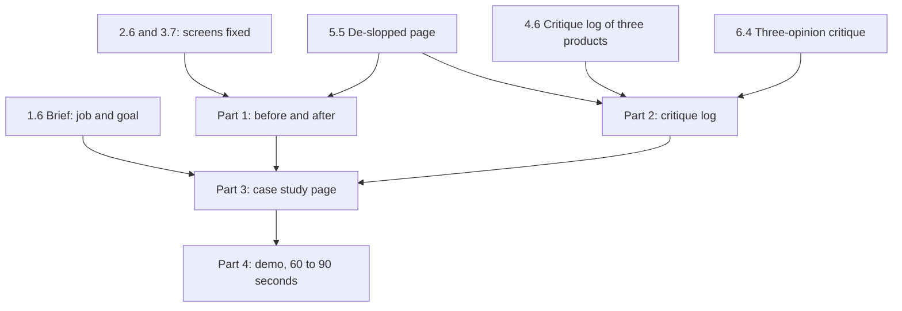

## What you make

This is the capstone of the course. You take one project and move it from the generic look to work that a stranger remembers. The project can be your own, or Wasel, the print shop order app provided below. You hand in four parts: before and after screenshots of at least three screens, a critique log, a case study page, and a short demo. Plan for about 150 minutes, in two or three sittings. Most of the material already exists, because you made it in the practice chapters of modules 1 to 6.

The job of this chapter is to put those pieces together and to test them on a person. A strong project that nobody sees is what happened to Maryam in 7.1. The capstone is the answer: the work, the reasons for every change, and a way in that a busy reviewer can use. Private submission is accepted. If your project belongs to a client or an employer, do not use it without permission, and never paste their screens or data into an AI tool. Course 13 teaches the full privacy habit. Posting in public is your choice.



What to notice: the brief from 1.6 gives the case study its problem and job. The screens you fixed give part 1, and the reasons you wrote give part 2. The case study page leads with the result and links to the others. The demo tells the same story in video. Nothing in a later part should be missing from an earlier one. If the page says a change worked, the log must show how you know.

## The steps

**1. Choose your route and your three screens (10 minutes).**

Pick your own project if it has screens you can capture and you may show them. Pick Wasel if it does not. Choose three screens that teach different things. One is the first screen a person sees. One is a screen where they do something, such as a form. One is a screen where the app waits or fails. Three different screens show range, and the failing screen shows that you design the moments nobody draws.

**2. Capture the before (15 minutes).**

Take a screenshot of each screen before you change anything, and write the date on the file name. For Wasel, write the before from the facts in the Wasel section below. Do this first. You cannot recover a before after you have changed the design, and a before and after with no real before shows nothing about what changed.

**3. Make the changes and number them (30 minutes).**

Use the work you already did: the screen you fixed in 2.6, the unhappy paths from 3.7 and the page you de-slopped in 5.5. Put a number on each change in the after screenshot: 1, 2, 3. Two or three changes per screen is a good size. Each number will become one row in your log, so a change you cannot give a reason for does not belong here.

**4. Write the critique log (25 minutes).**

Make a table with one row for each number. The columns are: what was wrong, the rule or evidence, the change, and what you gave up. The rule can be a standard from module 2 or 3, such as 4.5 to 1 contrast, or a criterion from module 4. The evidence can be a check with a few people. Without the last column, a change is a claim of taste. With it, the change is a choice, and a choice is what the top of the scale in 4.2 asks for.

**5. Check an AI critique (10 minutes).**

Take the output of your three-opinion critique from 6.4. Choose at least one point you checked against a rule or a person and then used, and at least one you rejected. Write the reason for each. An AI critique is a set of questions, not a verdict. A point you rejected, with a reason, shows your judgment better than ten points you accepted.

**6. Write the case study page (25 minutes).**

Put the result in the first screen. Then add the problem and the job from your 1.6 brief, your role, your choices and what you gave up, and the before and after. Then test it. Show the first screen on a phone to someone who has never seen the project, and hide it after ten seconds. Ask what it is, who it is for and whether it worked. If they cannot answer, the page failed, not the person.

**7. Add one-click access and a fallback (10 minutes).**

A reviewer must reach the core without signing up. Use a guest button or a demo mode with sample data, or a plain page that needs no login. Then add the chain: a short captioned video, screenshots on the page and a README. Before you publish, read the host's terms. A free personal plan may not allow paid client work, and a free GitHub Pages site needs a public repository, so check it for keys and private data first.

**8. Plan and record the demo, or write the storyboard (20 minutes).**

Plan five shots with times, from the person and the job to the result, and keep the whole story between 60 and 90 seconds. The core must appear in the first 15 seconds. Put the key words on the screen, add captions, and test it with the sound off on a friend. Check the file size before you upload. If you cannot record, a storyboard with times, the words on screen and the total length is accepted.

**9. Check everything from a phone, signed out (5 minutes).**

Open each link as a stranger would. Read the first screen of the case study. Check that the numbers on the screenshots match the rows of the log. Write the date you checked. This takes five minutes and catches the mistakes that cost the most.

## Worked example: Maryam's Halaqa

Maryam chose her own project. She picked three Halaqa screens. The first was the home screen that a new student sees. The second was the create-group form. The third was the group list on weak data, which is the screen Bashar saw blank in the library. She took all three screenshots first and put the date in the file names.

She made four numbered changes and wrote this log.

| # | What was wrong | Rule or evidence | The change | What I gave up |
|---|---|---|---|---|
| 1 | The home screen was a grid of feature tiles, and nothing came first | One thing first (2.2); value before a tour (3.6) | Tonight's groups, seats left and one 48 high Join button | Chat and polls are now one tap further |
| 2 | The form used placeholders as labels and showed "Invalid input" | Visible labels and errors in words next to the field (3.3) | Labels above fields, a hint, the error "Enter a start time" beside the field, a 48 high button | The form is two lines longer, so the button sits lower |
| 3 | On weak data the list was blank | Nothing under 1 second, activity for 2 to 10, say how long over 10 (3.2) | After 1 second, "Looking for groups near you"; after 10 seconds, a message and a retry button | Two more states to test |
| 4 | Hint text was #777777 on white | 4.5 to 1 for normal text (2.5) | #595959, which is 7.00 to 1 | A slightly heavier look |

The numbers in change 4 come from the contrast formula. #777777 on white is 4.48 to 1, which fails by a hair. #595959 is 7.00 to 1, which passes.

For part 2, she used two points from her three-opinion critique. A tool said that the Join button looked small. She checked it: the button was 36 high, the AA floor is 24 and the aim is 44 to 48, so she raised it to 48 and kept the point. Another tool said to add a progress bar with a percentage to the group list. She rejected it. Her loads took 2 to 5 seconds on weak data, and a percent-done bar is for waits over about 10 seconds. At 2 to 10 seconds, a sign that something is happening is enough. She wrote that reason in the log.

Now the choice she got wrong first. Her first case study page began with "About me", because her portfolio template did. She tested it on Farah, a friend who had never seen Halaqa, for ten seconds. Farah said, "A student built a study app." She could not say whether it worked. Maryam moved the result to the top: "4 of 5 classmates joined a study group in their first visit. Before: 2 of 5." She added one sentence about the job, a tag for her role and a "Try it as a guest" button. Farah tested the new page. This time she said, "Students joined groups faster, four out of five." Under the number, Maryam wrote the limit: a check with five classmates, none from outside her class.

For access, Maryam built a guest mode with sample groups and no real names, and hosted it as a static site on GitHub Pages. She is not paid for it, and she searched the public repository for keys first. Her chain was a 70 second video with captions, three screenshots on the page and a README with the guest link in its first screen. She opened every link signed out on her phone and wrote the date.

Her demo followed the five-shot storyboard from 7.2. The recording was 21 MB, and after she cut seven seconds where nothing happened it was 18 MB. She put the words on screen as text cards. A friend watched it with the sound off and said, "You find a group for tonight, tap Join, and you are in." That was the job she meant.

## Provided case: Wasel

Use Wasel if you do not have a project. Wasel is a print and copy shop near the university gate, owned by Sami (fictional). It is open from 8 am to 6 pm. Black and white pages cost 0.50 shekels a page, colour pages cost 2 shekels a page, and binding costs 5 shekels. Orders sent before noon are ready by 4 pm. In exam weeks the shop gets about 30 to 40 orders a day, which is this case's own number. Most customers are students printing assignments.

The job, in the course's template, is this. "When an assignment is due tomorrow morning and I have no printer, I want to send the file from my phone and collect it printed on my way to class, so that I do not wait in line or miss the deadline." Sami's nephew Karam built the order app in one evening with an AI tool. It has three screens, and all three are in the generic look.

The landing page has a purple glow behind the headline "Revolutionize your printing experience". It has an "AI-powered" pill, the line "Seamless, powerful and effortless." and a glowing "Get started" button. Under them are three identical cards with tinted icon tiles, named "Fast", "Secure" and "Smart". At the bottom, in small grey text, are the prices, the 4 pm promise and the opening hours.

The order form has four fields with placeholders only: "File", "Copies", "Colour?" and "Pickup time". There are no hints. The button is small and says "Submit". When something is wrong, the field gets a red border and nothing else, and one message at the top says "Invalid input".

The order status screen shows a spinner with no words. On a slow connection the spinner never ends. While orders are still loading, it says "No orders". When an upload fails, it says "Something went wrong" and the file is lost.

On this route you do the same four parts. For the before, write each screen from the facts above, or draw it on paper. For the after, draw the new screens on paper or in a notes app, or build a small static page. Number every change. For the case study, you have no real result, because no student used your redesign. That is fine, and you must not invent one. If you can, run a small check. Show your new screens to three to five classmates and ask each to send a file to be printed by 4 pm. Count how many finish, and how long it takes. If you cannot, write "not tested yet" and say which check you would run. For access, a plain page that needs no login is enough, with your screenshots on it and a README as the fallback. For the demo, write a storyboard of 60 to 90 seconds with times and the words on screen. Use the job above as its story.

## The rubric

| Part | Met | Partly | Not yet |
|---|---|---|---|
| 1. Before and after | At least three screens, each with a real before and an after, and every change numbered | Three screens but some changes not numbered, or only two screens | One screen, or no before |
| 2. Critique log | A row for every number, all four columns filled, one AI point checked and one rejected, each with a reason | One column missing in some rows, or only one AI point | Reasons such as "looks better", or no AI point checked |
| 3. Case study and access | A stranger answers what, for whom and did it work after ten seconds; no login; a fallback exists | The skim passes but there is no fallback, or one of the three answers fails | The result is below the first screen, a login blocks the page, or no skim was done |
| 4. Demo | 60 to 90 seconds (or a timed storyboard); the core within 15 seconds; clear muted; captions or words on screen | The right length but the core comes late, or no captions | Over three minutes, depends on a voice, or never tested muted |

**Pass rule:** no part is Not yet, and at most one part is Partly.

## How your mentor will read it

Your mentor opens your case study first. They read the first screen for about ten seconds, then ask themselves the three skim questions. After that, they check one number on a screenshot against a row of your log, and one claim of a result against how you know it. If the number does not match, or the result has no check behind it, they will say so.

The weak answer is common. It is a set of before and after screenshots whose reasons are "looks cleaner" and "more modern", with no rule and no column for what was given up. The next most common is a result that was not measured. A made-up number is worse than an honest "not tested yet", because a mentor can tell. A third is a log where every AI point was accepted. Judgment shows in what you rejected.

The question your mentor usually asks is this: "Which of your changes could have made something worse for someone?" The next part is "How would you find out?" A good reply names one change, the person it might hurt, and a check you could run. For example, "Moving chat one tap further may annoy a student who uses it every day. I would ask three regular users to find chat and see if they struggle." One round of follow-up questions is normal. You answer them in writing, and your mentor reads the weakest part again.

## Submit your capstone

Write the four parts in order, with a number or a short heading for each. Short sentences and lists are fine. You can dictate your answer with your phone's microphone. If you have a private link to your case study page or a folder of screenshots, add it. Your mentor can open a private link you share with them.

```openquestion
prompt: "Hand in the four parts, for your own project or for Wasel. Say which. 1) Before and after: at least three screens, with every change numbered. Describe each screen in a line or two, or link to your screenshots. 2) Critique log: for each number, what was wrong, the rule or evidence, the change and what you gave up. Include one AI critique point you checked and one you rejected, with the reasons. 3) Case study page: write its first screen as it appears, say who you tested it on for ten seconds and what they said, and give the access link and your fallback. 4) Demo: its length, what happens in the first 15 seconds, how it works with the sound off, or your storyboard with times."
required: true
minWords: 250
allowSpeechInput: true
allowUrl: true
urlRequired: false
urlLabel: "Link to your case study page (optional)"
urlHint: "The link to your case study page, or to a folder with your screenshots and storyboard. A private link that your mentor can open is fine."
modelAnswer: "Mentor key for Wasel: Part 1 has three screens, each with a before and an after, and numbered changes. Landing page: the glow, the AI pill and the hype headline go; a plain headline says what happens, such as 'Send your file now. Pick it up printed by 4 pm'; the prices are the main content, not small grey text; the button says 'Upload a file'; the three identical cards are cut or replaced by real facts. Order form: visible labels above the fields, hints (file type, number of copies, black and white or colour, pickup time), errors in words next to the field, input kept after an error, a button of 44 to 48 high that says what happens, such as 'Send my order'. Order status: words next to the spinner ('Uploading your file'), a time or progress once it passes about 10 seconds, no 'No orders' while loading, and a failure message that says what failed, that the file is safe and what to do next. Part 2 has a row for every number with all four columns, using rules from the course (4.5 to 1 contrast, visible labels, errors in text, the four states, the generic look as defaults nobody chose), and a row that names what was given up, such as the three cards. It includes one AI point checked and one rejected with a reason. The common wrong answer says 'looks cleaner' and has no given-up column. Part 3: the first screen puts the result first. Wasel has no measured result unless the learner ran a real check, for example 4 of 5 classmates could send a file to be printed by 4 pm in about a minute. If no check was run, 'not tested yet' with the check planned is a pass, and an invented number is Not yet. The page uses the job sentence, opens with no login and has a fallback (screenshots and a README). Part 4: 60 to 90 seconds, or a storyboard with times; one student with an assignment due tomorrow, the job of sending the file and collecting it by 4 pm, the result within 15 seconds, words on screen. Pass: no part Not yet and at most one Partly. Model answer for a different case: Rahaf redesigned a clinic queue app with a desk screen, a waiting screen and a sign-up form. Her first screen says: '4 of 5 patients found their number in under a minute, in a check with 5. Before: 2 of 5.' Her log has six rows. Row 2 says the form hid errors in a red border; the rule is errors in words (3.3); the change adds 'Enter a phone number' beside the field; given up: a longer form. She checked an AI point about larger text (the body was 14, she raised it to 16) and rejected a point to add a chart to the waiting screen, because patients only need their number. Her demo is 75 seconds with words on screen, and a friend understood it with the sound off. She writes that she did not test it with patients who use screen readers."
```

**Next:** The course checklist, your toolkit of habits, and a look back at your first answer in 1.1.
