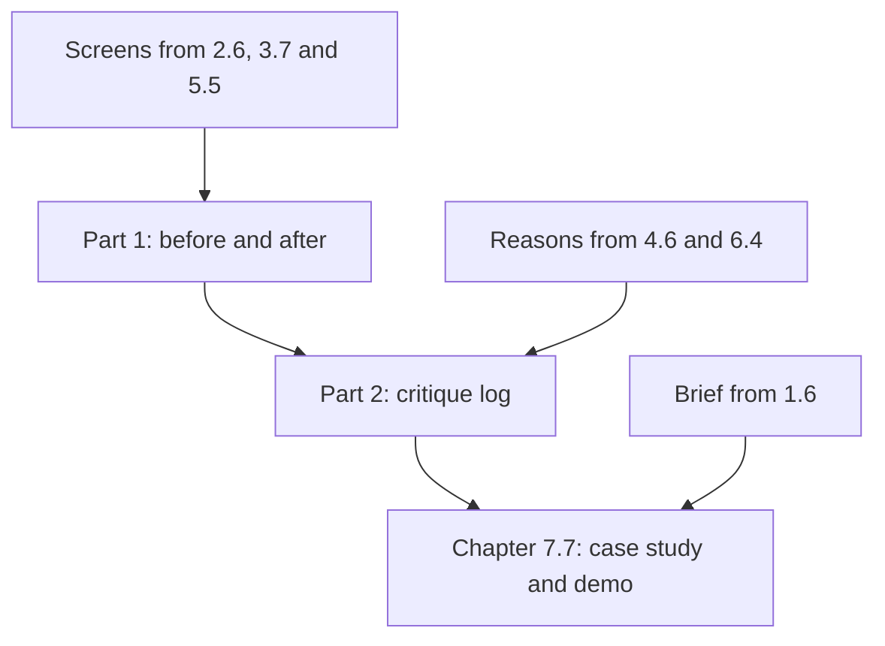

## What you make, and why it matters

This is the first half of the capstone of the course. You take one project and move it from the generic look to work that a stranger remembers. The project can be your own, or Wasel, the print shop order app provided below. In this chapter you hand in parts 1 and 2: before and after screenshots of at least three screens, and a critique log. In chapter 7.7 you hand in parts 3 and 4: a case study page and a short demo. Plan about 90 minutes here, in one or two sittings.

Most of the material already exists, because you made it in the practice chapters of modules 1 to 6. The job of this chapter is to put those pieces together and to check them. The log shows a reviewer that your changes were choices, with reasons, and not only a new look.

Private submission is accepted. If your project belongs to a client or an employer, do not use it without permission, and never paste their screens or data into an AI tool. Course 13 teaches the full privacy habit. Posting in public is your choice.



The screens you fixed give part 1, and the reasons you wrote give part 2. The log then feeds chapter 7.7: if the case study says a change worked, the log must show how you know.

## The steps

**1. Choose your route and your three screens (10 minutes).**

Pick your own project if it has screens you can capture and you may show them. Pick Wasel if it does not. Choose three screens that teach different things. One is the first screen a person sees. One is a screen where they do something, such as a form. One is a screen where the app waits or fails. Three different screens show range, and the failing screen shows that you design the moments nobody draws.

**2. Capture the before (15 minutes).**

Take a screenshot of each screen before you change anything, and write the date in the file name. For Wasel, write the before from the facts in the Wasel section below, or draw it on paper. Do this first. You cannot recover a before after you have changed the design.

**3. Make the changes, number them and measure (30 minutes).**

Use your work from 2.6, 3.7 and 5.5. Put a number on each change in the after screenshot: 1, 2, 3. Two or three changes per screen is a good size. Each number becomes one row in your log, so a change with no reason does not belong here.

While you change, measure the design. Write two numbers before and after, such as the steps from opening the screen to the main action, or the contrast ratio of your smallest text. On a phone, read a contrast ratio from the table of greys in 2.5, or work it out with the formula in that chapter's fold. If your screen has a form, write the order in which a keyboard user would reach the controls, as in the Tab order picture in 3.4. These numbers become your proof in chapter 7.7 when you have no users.

**4. Write the critique log (25 minutes).**

Make a table with one row for each number. The columns are: what was wrong, the rule or evidence, the change, and what you gave up. The rule can be a standard from module 2 or 3, such as 4.5 to 1 contrast, or a criterion from module 4. The evidence can be a check with a few people. Without the last column, a change is a claim of taste. With it, the change is a choice, and a choice is what the top of the scale in 4.2 asks for.

**5. Check an AI critique (10 minutes).**

Take the output of your three-opinion critique from 6.4. Choose at least one point you checked against a rule or a person and then used, and at least one you rejected. Write the reason for each. An AI critique is a set of questions, not a verdict. A point you rejected, with a reason, shows your judgment better than ten points you accepted.

## Worked example: Maryam's Halaqa

Maryam chose her own project. She picked three Halaqa screens: the home screen, the create-group form, and the group list on weak data. Bashar saw that list blank in the library, where it takes about 12 seconds to load. She took all three screenshots first and put the date in the file names.

She made four numbered changes and wrote this log.

| # | What was wrong | Rule or evidence | The change | What I gave up |
|---|---|---|---|---|
| 1 | The home screen was a grid of feature tiles, and nothing came first | One thing first (2.2); value before a tour (3.6) | Tonight's groups, seats left and one Join button | Chat and polls are now one tap further |
| 2 | The Join button was 36 by 36 pixels | Aim for 44 to 48; the AA floor is 24 (3.4) | 44 tall and full width | A group card is taller, so one fewer fits on the screen |
| 3 | The form used placeholders as labels, and an empty Seats field showed only a red border | Visible labels; errors in words next to the field (3.3) | Labels above the fields, a hint in #767676, error words beside Seats, the button "Start the group" | The form is two lines longer |
| 4 | On weak data the list was blank for 12 seconds | Over 10 seconds, say how long (3.2) | A line "Loaded 3 of 8 groups", then a message and a retry button | Two more states to test |

She measured two numbers for the proof she would need later. The hint grey was #777777 on white at 4.48 to 1, which fails by a small amount. She changed it to #767676, which is 4.54 to 1. The steps from opening the app to the first Join went from seven to three.

For part 2, she used two points from her three-opinion critique in 6.4. One tool said to rename the button to "Get started". She rejected it, because a button should say what happens: "Start the group" says it, and "Get started" does not. Two tools said a student may not know what Seats counts. No rule decides that, so she watched three classmates start a pretend group. Two stopped at Seats and asked if it included them. She accepted the point and added the hint "Including you" under Seats, at the cost of one more line of text.

Now the choice she got wrong first. Her first log gave the reason "looks cleaner" for three rows. A reviewer could not check that. She asked herself which rule a reader could look up, found one for each row, and added the cost column. The log took ten minutes longer and could be argued with.

## Provided case: Wasel

Use Wasel if you do not have a project. Wasel is a print and copy shop near the university gate, owned by Sami. It is open from 8 am to 6 pm. Black and white pages cost 0.50 shekels a page, colour pages cost 2 shekels a page, and binding costs 5 shekels. Orders sent before noon are ready by 4 pm. In exam weeks the shop gets about 30 to 40 orders a day, which is this case's own number. Most customers are students printing assignments.

The job is the one from module 1. A student whose assignment is due tomorrow morning has no printer. She wants to send the file from her phone and collect it printed on her way to class. Sami's nephew Karam built the order app in one evening with an AI tool. All three of its screens are in the generic look.

The landing page has a purple glow behind the headline "Revolutionize your printing experience". It has an "AI-powered" pill, the line "Seamless, powerful and effortless." and a glowing "Get started" button. Under them are three identical cards with tinted icon tiles, named "Fast", "Secure" and "Smart". At the bottom, in small grey text, are the prices, the 4 pm promise and the opening hours.

The order form has four fields with placeholders only: "File", "Copies", "Colour?" and "Pickup time". The placeholder grey is #999999 on white, which is 2.85 to 1. There are no hints. The button says "Submit" and is 80 by 28 pixels. When something is wrong, the field gets a red border and nothing else, and one message at the top says "Invalid input".

The order status screen shows a spinner with no words. On a slow connection the spinner never ends. While orders are still loading, it says "No orders". When an upload fails, it says "Something went wrong" and the file is lost.

For the landing page you may start from the fixed version in 5.2 and 5.4. At least two of your numbered changes on it must be your own, each with a reason, and not something those pictures already show. For example, check the contrast of the small grey line. Add the colour and binding prices. Or say what happens to an order sent after noon, and write "ask the shop" if the facts do not tell you. For the order form and the order status screen, design the after yourself. You can draw on paper, use a notes app or build a small static page.

## The rubric

| Part | Met | Partly | Not yet |
|---|---|---|---|
| 1. Before and after | Three screens, each with a real before and an after. Every change numbered. Two numbers measured before and after | Some changes not numbered, or one measured number, or only two screens | One screen, or no real before |
| 1. Own changes (Wasel only) | At least two landing page changes are your own, each with a reason | Two own changes, but one has no reason | The 5.2 version copied with no reasons |
| 2. Critique log | A row for every number, all four columns filled, each rule or evidence checkable | One column missing in some rows, or one reason that only says "looks better" | Reasons such as "looks better" throughout, or no cost column |
| 2. AI points | At least one AI point checked and used and one rejected, each with a reason | Only one point, or a reason that is missing for one | No AI point checked, or every point accepted |

**Pass rule:** no part is Not yet, and at most one part is Partly.

## How your mentor will read it

Your mentor picks one number on a screenshot and looks for its row in your log. They check that the rule or evidence is something they could look up, and that the cost column names a real cost. The weak answer is a log of "looks cleaner" and "more modern" with no cost. The usual follow-up asks which of your changes could have made something worse for someone, and how you would find out. A good reply names one change, the person it might hurt and a check you could run.

## Submit part 1

Write parts 1 and 2 in order, with a number or a short heading for each. Short sentences and lists are fine. You can dictate your answer with your phone's microphone. If you have a private link to a folder of screenshots, add it. Your mentor can open a private link you share with them.

```openquestion
prompt: "Hand in parts 1 and 2, for your own project or for Wasel. Say which. 1) Before and after: at least three screens, with every change numbered. Describe each screen in a line or two, or link to your screenshots, and give two numbers you measured before and after. 2) Critique log: for each number, what was wrong, the rule or evidence, the change and what you gave up. Include one AI critique point you checked and used, and one you rejected, with the reasons."
required: true
minWords: 200
allowSpeechInput: true
allowUrl: true
urlRequired: false
urlLabel: "Link to your screenshots (optional)"
urlHint: "A link to a folder with your before and after screenshots and your log. A private link that your mentor can open is fine."
modelAnswer: "Mentor key for Wasel: Part 1 covers three screens. Each has a real before, an after and numbered changes. On the landing page, check that at least two numbered changes are the learner's own and have reasons. Examples are the contrast of the small grey line, the other prices, or what happens after noon. Do not accept a copy of the 5.2 picture with no reasons. On the order form, look for visible labels above the fields and hints for the file, the copies, the colour choice and the pickup time. Look for errors in words beside the field and the input kept after an error. Look for a button of 44 to 48 pixels high that says what happens. The placeholder grey changes from #999999 (2.85 to 1) to a grey of at least 4.5 to 1, such as #767676 (4.54 to 1). On the order status screen, look for words beside the spinner and a time once the wait passes about 10 seconds. Look for 'No orders' only after loading ends. Look for a failure message that says what failed, that the file is kept and what to do next. Two measured numbers appear, for example steps to send an order and the contrast ratio. Part 2 has a row for every number with all four columns. It uses rules from the course, such as 4.5 to 1 contrast, visible labels, errors in words and the four states. At least one row names a real cost, such as a longer form. It includes one AI point checked and used, and one rejected with a reason. The common wrong answer says 'looks cleaner' and has no given-up column. Pass: no part Not yet and at most one Partly. Model answer for a different case: Rahaf redesigned a clinic queue app with a desk screen, a waiting screen and a sign-up form. Her log has six rows. Row 2 says the form hid errors in a red border. The rule is errors in words (3.3). The change adds 'Enter a phone number' beside the field. The cost is a longer form. She measured the taps to reach her number, 5 before and 2 after. She checked an AI point about larger text, found the body text was 14, and raised it to 16. She rejected a point to add a chart to the waiting screen, because patients only need their number."
```

**Next:** In chapter 7.7 you turn this work into a case study page, one-click access and a short demo.
