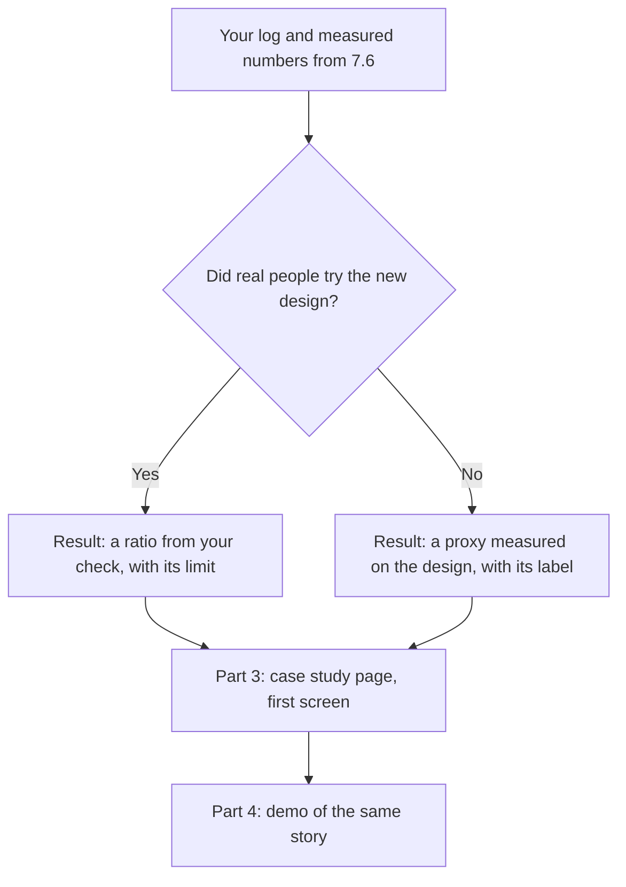

## What you make, and why it matters

This is the second half of the capstone. In chapter 7.6 you made parts 1 and 2: the before and after screens and the critique log. Now you make parts 3 and 4. Part 3 is a case study page with one-click access and a fallback. Part 4 is a demo of 60 to 90 seconds that works with the sound off. A storyboard is accepted when you cannot record. Plan about 90 minutes.

The point of this chapter is the path from a link to your best work, the path that failed for Maryam in 7.1. You already have the work and the reasons. Now you make them easy to reach for a busy reader on a phone. Private submission is accepted. If your project belongs to a client or an employer, do not use it without permission. Posting in public is your choice.



The question in the diagram decides what the top of your page says. Both answers are honest, and both meet the "did it work" question of the skim, as long as the label sits beside the number.

## The steps

**1. Write the case study page and skim-test it (30 minutes).**

Put the result in the first screen. Then add the problem and the job from your 1.6 brief, your role, your choices and what you gave up, and the before and after from 7.6. If real people tried your design, use a ratio, such as 4 of 5, and write the limit of the check in one line. If nobody did, use a proxy result measured on the design. Measure the steps to the main action, the contrast ratio of your smallest text, or the squint test, before and after. Write the label next to it: "Measured on the design, not with users." If you can, ask three to five people to try the main task as well.

Then test the page. Show the first screen on a phone to someone who has never seen the project. Hide it after ten seconds, or twenty if they read in a second language. Ask what it is, who it is for and whether it worked. If they cannot answer, the page failed, not the person.

**2. Add one-click access and a fallback (25 minutes).**

A reviewer must reach the core without signing up. Use a guest button or a demo mode with sample data, or a plain page that needs no login. A guest button that opens an empty app does not count. Then add the chain: a short captioned video, screenshots on the page and a README.

Before you publish, read the host's terms. At the time of writing (checked 2026-10-25), Vercel's free Hobby plan is for personal, non-commercial use and for people 16 or over. A free GitHub Pages site needs a public repository, and GitHub is for people 13 or over. Search a public repository for keys and private data first.

**3. Plan and record the demo, or write the storyboard (30 minutes).**

Plan five shots with times, from the person and the job to the result. Keep the whole story between 60 and 90 seconds. The core must appear in the first 15 seconds. Put the key words on the screen and add captions. Check the file size before you upload, and test the video with the sound off on a friend. If you cannot record, a storyboard with times, the words on screen and the total length is accepted.

**4. Check everything from a phone, signed out (5 minutes).**

Open each link as a stranger would, in a private window. Read the first screen of the case study. Turn on flight mode or move to a weak signal to see how the page behaves when the connection is poor. Check that the numbers on the page match the rows of your log. Write the date you checked. This takes five minutes and catches the mistakes that cost the most.

## Worked example: Maryam's Halaqa

Maryam had a real check, so her result was a ratio. Her first case study page began with "About me", because her portfolio template did. That was the choice she got wrong first. She tested it on Lamis, a friend who had never seen Halaqa, for ten seconds. Lamis said, "A student built a study app." She could not say whether it worked.

Maryam moved the result to the top: "4 of 5 classmates joined a study group in their first visit. Before: 2 of 5." She added one sentence about the job, a tag for her role and a "Try it as a guest" button. Under the number she wrote the limit: a check with five classmates, none from outside her class. Lower down, in the "how I know" section, she listed two numbers measured on the design. The hint grey went from 4.48 to 1 to 4.54 to 1, and the steps from opening the app to the first Join went from seven to three. Lamis tested the new page. This time she said, "Students joined groups faster, four out of five."

For access, Maryam built a guest mode with sample groups and no real names. She hosted it as a static site on GitHub Pages. She is not paid for it, and she searched the public repository for keys first. A guest with no sample data would have opened an empty list, so she checked the first screen of guest mode on her phone. Her chain was a 70 second video with captions, three screenshots on the page and a README with the guest link in its first screen. She opened every link signed out, on her phone, and wrote the date.

Her demo followed the five-shot storyboard from 7.2. The recording was 21 MB, and after she cut seven seconds where nothing happened it was 18 MB. She put the words on screen as text cards. A friend watched it with the sound off and said, "You find a group for tonight, tap Join, and you are in." That was the job she meant.

## Provided case: Wasel

Use Wasel if you do not have a project. You need your own parts 1 and 2 from chapter 7.6. Wasel is the print and copy shop near the university gate, open 8 am to 6 pm. Black and white pages cost 0.50 shekels, colour pages cost 2 shekels, and orders sent before noon are ready by 4 pm.

Wasel has no customers who used your redesign. That is fine, and you must not invent a result. Your result is a proxy measured on the design, with a label. Pick at least two. Count the steps from opening the order page to pressing the send button, before and after. Work out the contrast ratio of the hint text, which was 2.85 to 1 before, and after your change. Do the squint test on the old and new landing page and write what came first. If you can, show your new screens to three to five classmates. Ask each to send a file to be printed by 4 pm, and count how many finish and how long it takes. The label reads: "Measured on the design, not with customers." Then say what you would check next.

For access, a plain page that needs no login is enough. Put your screenshots on it, a short note for each, and a README as the fallback. For the demo, write a storyboard of 60 to 90 seconds with times and the words on screen. Tell the story of one student with a 10-page report, who wants two colour copies by tomorrow morning. Show the file sent before noon, the price of 40 shekels, and the 4 pm pickup. Put the sent order within the first 15 seconds.

## The rubric

| Part | Met | Partly | Not yet |
|---|---|---|---|
| 3. Case study and skim | The first screen shows result, job and role. A stranger answers what, for whom and did it work | The skim passes for two of the three answers, or it was tested only on yourself | The result is below the first screen, or no skim was done |
| 3. Result and honesty | A ratio from a real check with its limit, or a labelled proxy measured on the design. Both meet "did it work" | A result with no label or no limit | An invented number, or no result at all |
| 3. Access and fallback | Opens with no login, with sample data, on a phone. A fallback exists. The host's terms were read | No fallback, or the terms were not read | A login blocks the page, or only a link to code |
| 4. Demo | 60 to 90 seconds or a timed storyboard, the core within 15 seconds, clear muted, with words on screen | The right length but the core comes late, or no captions | Over three minutes, depends on a voice, or never tested muted |

**Pass rule:** no row is Not yet, and at most one row is Partly.

## How your mentor will read it

Your mentor opens your case study first and reads the first screen for about ten seconds. They ask the three skim questions, then check one number on the page against your log. The weak answer is a page that starts with "About me", or a result with no label. A made-up number is worse than a labelled proxy, because a mentor can see the gap. The usual follow-up asks how you know the number and what you would check next.

## Submit part 2

Write parts 3 and 4 in order. Short sentences and lists are fine. You can dictate your answer with your phone's microphone. If you have a private link to your case study page, add it. Your mentor can open a private link you share with them.

```openquestion
prompt: "Hand in parts 3 and 4, for your own project or for Wasel. Say which. 3) Case study page: write its first screen as it appears. Say who you tested it on and what they said after ten or twenty seconds. Say whether the result comes from a check with people or is a proxy measured on the design, and write its label. Give your access link and your fallback. 4) Demo: its length, what happens in the first 15 seconds, how it works with the sound off, or your storyboard with times."
required: true
minWords: 200
allowSpeechInput: true
allowUrl: true
urlRequired: false
urlLabel: "Link to your case study page (optional)"
urlHint: "The link to your case study page, or to a folder with your screenshots and storyboard. A private link that your mentor can open is fine."
modelAnswer: "Mentor key for Wasel: Part 3 puts the result first. Wasel has no customers, so the result is a proxy measured on the design, and it must carry a label. Examples are the steps from the order page to the send button, before and after. Another is the contrast of the hint text, 2.85 to 1 before and at least 4.5 to 1 after. A third is the squint test, before and after. A check with three to five classmates is better when possible, such as how many could send a file for the 4 pm pickup. The label says the number was measured on the design, not with customers. This meets 'did it work' for the skim. A first screen that says only 'not tested yet' with no measurement is Partly. An invented customer number is Not yet. The page also holds the job in one sentence, the learner's role, the choices and what was given up. It opens with no login, for example a plain page with screenshots, and it has a fallback of screenshots and a README. The learner says the host's terms were read. Part 4 is 60 to 90 seconds, or a storyboard with times. It follows one student with an assignment due tomorrow. It shows the file sent and the 4 pm pickup within the first 15 seconds, and it puts the words on screen. Pass: no row Not yet and at most one Partly. Model answer for a different case: Rahaf redesigned a clinic queue app and had no patients to test. Her first screen says: 'Taps to find your number: 5 before, 2 after. Measured on the design, not with patients.' Under it are the job in one sentence and her role. Two friends looked at the screen for ten seconds, and both said it helps patients see their queue number. Her page opens as a guest with sample patients. Her fallback is a 75 second captioned video, screenshots and a README. She read the host's terms and used a static site. Her demo starts on the queue number at 0:00 and shows the tap at 0:10. A friend watched it muted and understood it. She writes that she did not test it with patients who use screen readers."
```

**Next:** The course checklist, your toolkit of habits, and a defence of your changes.
